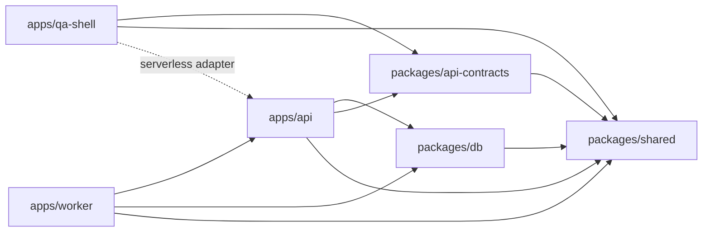

# CLEANUP_REPORT — фазы 0–1

Дата: 01.11.2026, Europe/Chisinau. Начало измеряемого прогона: 01.11.2026, 14:48:48.

## Область и неизменность

База «до»: `origin/main`, commit `d6e5c6116dd79948ebad988d1852b7b65d37b1f1`. Инвентаризация и все измерения выполнены в отдельном detached worktree `D:/OnlineSchool/.codex/worktrees/cleanup-baseline`. Отчёт сохраняется в ветке `chore/repo-cleanup`.

В cleanup-ветке уже был предыдущий проход; его изменённый генератор **не использован** для этой базовой линии. В исходном main нет кабинетов manager/student. Работа `codex/manager-vercel` и production не включены в измерения; их приложения не удалены — они находятся вне выбранного main. Проверенные ранее PR и пути: [предыдущая сверка](docs/repo-cleanup/2026-11-01/open-pr-paths.md).

В рамках этой фазы исходники, manifests, зависимости, contracts, SDK, schema, seed, миграции и Dockerfile не изменялись. Ничего не удалено, включая существующие dist/кэши/образы. После измерений `git diff HEAD` в baseline пустой; OpenAPI checkout SHA-256 совпал до/после. Отчёт и доказательства — единственные новые tracked-файлы этого шага. Не выполнялись deploy, seed, migrations или обращения к рабочей БД.

## Карта apps/* и packages/*

Шесть workspace-пакетов плюс корневой orchestrator (pnpm/Turbo). Потребители в таблице — **прямые** workspace dependencies из manifests; это не утверждение, что каждая зависимость входит в браузерный bundle.

| Каталог                  | Пакет                          | Назначение                                                                                           | Прямые потребители workspace                                                                                                  |
| ------------------------ | ------------------------------ | ---------------------------------------------------------------------------------------------------- | ----------------------------------------------------------------------------------------------------------------------------- |
| `apps/api`               | `@online-school/api`           | NestJS HTTP API, сессии и guards; standalone и serverless.                                           | `@online-school/qa-shell`, `@online-school/worker`                                                                            |
| `apps/qa-shell`          | `@online-school/qa-shell`      | React/Vite QA-интерфейс действующей среды; не отдельная тестовая БД.                                 |                                                                                                                               |
| `apps/worker`            | `@online-school/worker`        | Nest application context без HTTP: Outbox, recovery, heartbeat, Finance expiry и Schedule deadlines. |                                                                                                                               |
| `packages/api-contracts` | `@online-school/api-contracts` | OpenAPI JSON, generated TypeScript/Orval SDK и HTTP transport.                                       | `@online-school/api`, `@online-school/qa-shell`                                                                               |
| `packages/db`            | `@online-school/db`            | Prisma Client/адаптер pg, schema, миграции, reference/QA seed и database tools.                      | `@online-school/api`, `@online-school/worker`                                                                                 |
| `packages/shared`        | `@online-school/shared`        | Result<T,E>, ok/err и общие имена сервисов.                                                          | `@online-school/api`, `@online-school/qa-shell`, `@online-school/worker`, `@online-school/api-contracts`, `@online-school/db` |

Дополнительные потребители и границы:

- `@online-school/api`: корневой `api/handler.ts` импортирует compiled serverless напрямую; `apps/qa-shell/api/handler.ts` использует package export. Worker использует только `finance-expiry` и `schedule-deadlines` subpaths. QA SPA обращается к HTTP API, а не включает сервер Nest в JS bundle.
- `@online-school/db`: кроме API/worker, фабрики клиента используются Prisma/seed/database tools и эксплуатационными/integration скриптами. Эти команды не являются автоматически мёртвым кодом. Сами DB-команды не запускались.
- `@online-school/api-contracts`: API использует контракт типов; qa-shell импортирует generated SDK и transport. Root `generate` и `generate:client` управляют генерацией. Worker получает его транзитивно через API.
- `@online-school/shared`: Result используется пятью остальными workspace-пакетами; runtime `ok/err` и типы различаются по характеру импорта.
- `apps/api/tsconfig.json` references → shared, db, api-contracts; worker → api, shared, db; qa-shell → shared, api-contracts, api. Turbo `build` имеет `dependsOn: ["^build"]`.

Все ссылки на имена пакетов в tracked-файлах перечислены в [машинной карте](docs/repo-cleanup/2026-11-01/phase0/evidence.json) → inventory.workspaces[].referenceFiles; список включает документацию и тесты, а не только runtime.

## Модули внутри apps/api/src

`AppModule` в `apps/api/src/app.module.ts` подключает CoreModule и все восемь областей ниже, плюс собственный HealthController.

| Каталог                             | Nest-модули                            | Содержимое / состояние                                                                       | Связи                                                                        |
| ----------------------------------- | -------------------------------------- | -------------------------------------------------------------------------------------------- | ---------------------------------------------------------------------------- |
| `apps/api/src/modules/crm`          | CrmModule                              | RegistryController / RegistryService: ученики, семьи, представители.                         | Подключён AppModule; прямых Nest imports нет.                                |
| `apps/api/src/modules/education`    | EducationModule                        | Пустой каркас `@Module({})`.                                                                 | AppModule.                                                                   |
| `apps/api/src/modules/finance`      | FinanceModule, FinanceExpiryModule     | Payments, entitlements, ledger, periods, payroll, teacher rates; отдельный expiry processor. | AppModule; ScheduleModule; worker через экспорт пакета `api/finance-expiry`. |
| `apps/api/src/modules/identity`     | IdentityModule                         | Пароли, opaque session, WebAuthn, recovery и rate limit; экспорт Passwords.                  | AppModule.                                                                   |
| `apps/api/src/modules/integrations` | IntegrationsModule                     | Пустой каркас `@Module({})`.                                                                 | AppModule.                                                                   |
| `apps/api/src/modules/qa`           | QaModule                               | Диагностика компонентов, проверка файлового доступа, API/worker health.                      | AppModule; QA SPA вызывает API.                                              |
| `apps/api/src/modules/schedule`     | ScheduleModule, ScheduleDeadlineModule | Registry, booking, recurrence, outcomes; отдельный deadline processor.                       | AppModule; импортирует FinanceModule; worker через `api/schedule-deadlines`. |
| `apps/api/src/modules/storage`      | StorageModule                          | Пустой каркас `@Module({})`.                                                                 | AppModule.                                                                   |

CoreModule — общий слой в `apps/api/src/core/`: `audit`, `csrf`, `database`, `errors`, `idempotency`, `policy`, `rbac`, `request-id`, `session`, `transaction`. Глобально устанавливает DTO validation pipe, AppExceptionFilter, Session/RBAC/CSRF/WebAuthn/Idempotency guards и CriticalCommandInterceptor; request-id middleware охватывает маршруты.

`apps/api/src/openapi/` — DTO-классы и Swagger/export-инфраструктура; это не самостоятельный предметный Nest-модуль. Пустые Education/Storage/Integrations отмечены как каркасы, а не как разрешение на удаление.

## Точки входа

| Сценарий             | Исходник                                    | Выход / запуск                                                          | Особенности                                                                      |
| -------------------- | ------------------------------------------- | ----------------------------------------------------------------------- | -------------------------------------------------------------------------------- |
| Standalone API       | `apps/api/src/main.ts`                      | `apps/api/dist/main.js`; `pnpm --filter @online-school/api start`       | NestFactory.create(AppModule), Swagger; HOST/PORT; shutdown hooks.               |
| Общий serverless API | `apps/api/src/serverless.ts`                | `apps/api/dist/serverless.js`, export handler                           | Кэширует приложение на Function instance; polling worker не запускает.           |
| Root Vercel adapter  | `api/handler.ts`                            | default re-export handler                                               | Выбран root vercel.json; rewrites /api/* и /health.                              |
| QA-project adapter   | `apps/qa-shell/api/handler.ts`              | default export из `@online-school/api/serverless`                       | Альтернативная Vercel entrypoint; не импортируется из браузерного main.          |
| Worker               | `apps/worker/src/main.ts`                   | `apps/worker/dist/main.js`; `pnpm --filter @online-school/worker start` | createApplicationContext(WorkerModule), без HTTP listener; SIGINT/SIGTERM drain. |
| QA frontend          | `apps/qa-shell/index.html` → `src/main.tsx` | `apps/qa-shell/dist/index.html`                                         | React StrictMode → App; SDK через api.ts, passkey через auth.ts; Vite.           |
| OpenAPI export       | `apps/api/scripts/export-openapi.mjs`       | `pnpm generate:client`                                                  | Создаёт Nest app и документ; в этой фазе контракт не переэкспортировался.        |

Инфраструктурные связи сохранены: root `vercel.json` → `infra/vercel/build.mjs` + `Dockerfile.worker`; Compose → `apps/api/Dockerfile` и `apps/worker/Dockerfile`. Два worker Dockerfile в исходной базе побайтово одинаковы, но имеют разные внешние потребители.

## Среда и методика

Host: Windows x64, AMD Ryzen 5 5600G with Radeon Graphics, 12 логических CPU, 15.37 GiB RAM; Node v24.21.0, pnpm 10.34.9. Локальные версии из lockfile: Turbo 2.11.10, TypeScript 6.0.3, NestJS 12.2.0, Prisma 7.10.1, React 18.3.1, Vite 7.3.7.

Зависимости установлены через `pnpm install --frozen-lockfile`; postinstall выполнил штатную offline-генерацию. Установка не включена в build time. Подготовительный запуск до завершения установки не нашёл turbo и не начал сборку; он исключён из замера. Перед измеряемой холодной сборкой подтверждено отсутствие dist всех пакетов, *.tsbuildinfo и выделенного Turbo cache.

Два build-прогона шли последовательно, без изменения source/environment между ними. Локальный кэш новый: `.codex/phase0/turbo-cache`; remote cache выключен через `--cache=local:rw`. pnpm store и OS file cache уже тёплые; холодную сеть, очистку OS cache и повторные статистические серии не измеряли. URL-переменные БД удалены из окружения команд; `BUILD_COMMIT_SHA` установлен в baseline commit. Данные — одиночные локальные замеры, не p95/CI SLA.

## Результаты «до»: typecheck / build / lint / test

| Команда                                                                                        | Результат | Wall time с запуском pnpm | Лог                                                              |
| ---------------------------------------------------------------------------------------------- | --------- | ------------------------- | ---------------------------------------------------------------- |
| `pnpm exec turbo run build --cache-dir=.codex/phase0/turbo-cache --cache=local:rw --summarize` | PASS      | 31.566 с                  | [turbo-cold](docs/repo-cleanup/2026-11-01/phase0/turbo-cold.txt) |
| `pnpm exec turbo run build --cache-dir=.codex/phase0/turbo-cache --cache=local:rw --summarize` | PASS      | 0.495 с                   | [turbo-warm](docs/repo-cleanup/2026-11-01/phase0/turbo-warm.txt) |
| `pnpm typecheck`                                                                               | PASS      | 4.969 с                   | [typecheck](docs/repo-cleanup/2026-11-01/phase0/typecheck.txt)   |
| `pnpm lint`                                                                                    | PASS      | 3.271 с                   | [lint](docs/repo-cleanup/2026-11-01/phase0/lint.txt)             |
| `pnpm test`                                                                                    | PASS      | 5.628 с                   | [test](docs/repo-cleanup/2026-11-01/phase0/test.txt)             |

Первая команда эквивалентна корневому `pnpm build` (тот же `turbo run build`) с явным изолированным cache и summary. Typecheck использует Turbo, lint — корневой ESLint, test — Turbo unit + monorepo smoke.

`pnpm test`: API 10, worker 2, DB clients 3, shared 1, monorepo smoke 2 — **18 passed, 0 failed**. У api-contracts и qa-shell в исходном main нет package test-script. DB/integration/QA seed suites не запускались; эти 18 тестов не означают полной DB приёмки. В test-прогоне 10 успешных Turbo задач, из них 6 cached build и 4 исполненных test.

## Холодная и тёплая сборка Turbo

| Режим                       | Полный wall time | Внутреннее время Turbo | Build tasks     | Cache   |
| --------------------------- | ---------------- | ---------------------- | --------------- | ------- |
| Холодная компиляция         | 31.566 с         | 31.128 с               | 6 успешных      | 0/6 HIT |
| Повторный идентичный запуск | 0.495 с          | 0.100 с                | 6 восстановлены | 6/6 HIT |

Это базовая линия cache reuse, не сравнение «до/после оптимизации». Никакие существующие outputs не удалялись. Хеши задач и cache status сохранены в evidence.json → turbo.

## Размеры dist

Логические байты файлов, без node_modules, с .d.ts и source maps; не allocated disk size и не размер npm tarball. QA-shell имеет TypeScript noEmit, его dist создаёт Vite.

| Каталог                       | Файлов | Всего, bytes | MiB   | JS, bytes | .d.ts, bytes | Maps, bytes |
| ----------------------------- | ------ | ------------ | ----- | --------- | ------------ | ----------- |
| `apps/api/dist`               | 252    | 1084366      | 1.03  | 528243    | 96247        | 459876      |
| `apps/worker/dist`            | 28     | 74129        | 0.07  | 34564     | 4788         | 34777       |
| `apps/qa-shell/dist`          | 3      | 193088       | 0.18  | 183042    | 0            | 0           |
| `packages/api-contracts/dist` | 16     | 502419       | 0.48  | 52745     | 248565       | 201109      |
| `packages/db/dist`            | 328    | 15253344     | 14.55 | 898506    | 8715824      | 5639014     |
| `packages/db/dist-tools`      | 13     | 117885       | 0.11  | 32094     | 1699         | 29343       |
| `packages/shared/dist`        | 8      | 2143         | 0.00  | 275       | 518          | 1350        |

`packages/db/dist-tools` показан отдельно от runtime dist; его общий размер также включает прочие файлы. В packages/db/dist включён generated Prisma Client, поэтому объём types/maps значителен.

## Frontend bundle: Vite production build

`apps/qa-shell`: Vite build, 1 JS + 1 CSS + HTML. Имена файлов относятся к этому конкретному build; builtAt/commit metadata могут менять хеш имени при следующем запуске.

| Файл                                           | Raw bytes  | gzip bytes |
| ---------------------------------------------- | ---------- | ---------- |
| `apps/qa-shell/dist/assets/index-C7dOYG32.css` | 9592       | 2680       |
| `apps/qa-shell/dist/assets/index-DKPUe2PE.js`  | 183042     | 57493      |
| `apps/qa-shell/dist/index.html`                | 454        | 300        |
| **Всего**                                      | **193088** | **60473**  |

JS: 178.75 KiB raw / 56.15 KiB gzip. Gzip подсчитан Node gzipSync отдельно для каждого emitted файла и суммирован; HTTP headers/Brotli и сетевой overhead не включены.

## Размер Docker-образов

Оба образа собраны из **исходных** Dockerfile выбранного main с root build context; пакеты и версии не менялись. Команды и результаты — evidence.json → images; [API build log](docs/repo-cleanup/2026-11-01/phase0/docker-api.txt), [worker build log](docs/repo-cleanup/2026-11-01/phase0/docker-worker.txt).

| Локальный образ                      | Dockerfile            | Size, bytes | MiB     | Платформа   |
| ------------------------------------ | --------------------- | ----------- | ------- | ----------- |
| `onlineschool-phase0-api:d6e5c61`    | `apps/api/Dockerfile` | 1181208848  | 1126.49 | linux/amd64 |
| `onlineschool-phase0-worker:d6e5c61` | `Dockerfile.worker`   | 1181598995  | 1126.86 | linux/amd64 |

Size — значение docker image inspect: логический несжатый размер слоёв; не registry transfer size и не уникальный расход диска. Образы разделяют слои, складывать размеры для оценки места нельзя. Сборки могли использовать существующий Docker layer cache; Docker cold build здесь не заявляется. Container Node: 24.22.2; исходный base tag `node:24-bookworm-slim` не закреплён digest, его не меняли. Параметры runtime и точные image IDs сохранены в evidence.json. Контейнеры приложения/БД в этой фазе не запускались.

## Контрольный хеш OpenAPI

Файл: `packages/api-contracts/openapi/openapi.json`.

- SHA-256 канонического Git blob (LF): `f32a2cf03eca4db077ddc88e1f844aa5c0cfcd724353357f062573b635ccec9f`.
- SHA-256 измеренного Windows checkout (CRLF): `5c7deefd2479228addfdb34d19e9ec74911664ab3e346011f94b94011a1444d5`.
- Checkout SHA-256 до/после совпал. Разные окончания строк объясняют различие двух хешей; source diff пустой. Ручного редактирования generated файлов не было.

## Доказательства и границы

[Полная машинная карта, размеры, cache hashes, команды и metadata](docs/repo-cleanup/2026-11-01/phase0/evidence.json); [канонические SHA-256 всех 214 tracked-файлов baseline](docs/repo-cleanup/2026-11-01/phase0/source-hashes.json). Чистый baseline worktree сохранён; существующие рабочие деревья/outputs и production не трогались.

Результат фазы — инвентаризация и измеряемая база, без удаления или рефакторинга. Ни архитектурное закрытие, ни production GO, ни полная DB-regression из этих измерений не следуют.

# Фаза 1 — мёртвый код

Дата: 01.11.2026, Europe/Chisinau. База этой фазы: `cad89fa08f289f1f867d067abb9a338a1a57f8df` (после отчёта фазы 0), ветка `chore/repo-cleanup`.

## Метод и охват

Повторно выполнен `pnpm dlx knip@6.44.1 --reporter json --no-progress`; в package.json/lockfile инструмент не добавлялся. Код выхода Knip 1 означает оставшиеся findings, а не провал тестов. [До](docs/repo-cleanup/2026-11-01/phase1/knip-before.json), [после](docs/repo-cleanup/2026-11-01/phase1/knip-after.json).

Вручную проверены входы Vercel/Compose/CI, Nest providers/controllers/@Inject tokens, динамические import/require, Swagger DTO_CLASSES/SCHEMA_OVERRIDES/extraModels, class-validator, SQL/seed и операторские CLI. По всем tracked-файлам выполнено 60 точных git grep-поисков (6 символов × HEAD, восемь активных PR heads и ветка менеджера); строки, документация и сохранённые отчёты не исключались из доказательного поиска. [Результаты поиска](docs/repo-cleanup/2026-11-01/phase1/search-before.json) содержат команды и совпадения; длинные строки старых JSON evidence сокращены только в отображаемом excerpt.

Дополнительно разобраны AST/comments 128 исходников; проверены 70 npm-скриптов, 26 env-названий из всех .env.example и 61 статическое обращение process.env. Динамические read(key), environment.* и Compose interpolation проверены отдельно. TODO/FIXME/HACK/XXX и закомментированные исполняемые фрагменты без владельца не обнаружены. Библиотечные/генерируемые файлы не редактировались.

Открытые PR #2–#9 сверены повторно; список и пути остаются в [приложении фазы 0](docs/repo-cleanup/2026-11-01/open-pr-paths.md). Дополнительно просмотрена codex/manager-vercel. Удаление SESSION_IDLE_MS и DirectorLedgerPublicationPolicy отклонено после обнаружения реальных потребителей в этой ветке. Файлы менеджера и его frontend не менялись и не перемещались. Пересечения текущего code-коммита с открытыми PR: #3 — `apps/api/src/modules/identity/identity.service.ts`, #6 — `apps/api/src/modules/finance/finance-ledger.service.ts`. В обоих случаях изменён только один export-модификатор; переносов нет.

## Таблица удалений

Удалены **четыре неиспользуемых модификатора export**. Функции, константа, type alias и все их локальные вызовы сохранены. Это внутренние файлы, не entrypoints из package exports; HTTP и публичный SDK не меняются. AST-проверка подтверждает, что иных изменений в этих четырёх файлах нет.

| Путь                                                     | Что удалено                                          | Доказательство отсутствия внешнего использования                                                                                                                                                                                                   | Коммит    |
| -------------------------------------------------------- | ---------------------------------------------------- | -------------------------------------------------------------------------------------------------------------------------------------------------------------------------------------------------------------------------------------------------- | --------- |
| `apps/api/src/core/session/session.store.ts`             | Лишний export у локальной константы `SESSION_TTL_MS` | Knip exports; git grep в HEAD и 9 проверенных ветках даёт только определение/локальный расчёт expiresAt. SESSION_IDLE_MS не тронут. Нет DI/Swagger metadata у этой константы.                                                                      | `ebf7779` |
| `apps/api/src/modules/finance/finance-ledger.service.ts` | Лишний export у локальной функции `pair`             | Knip exports; все вызовы находятся в том же finance-ledger.service.ts. Межмодульные импорты из файла используют FinanceLedger; другие pair в тестах — локальные переменные. Строковые/динамические/рефлексивные ссылки на этот helper не найдены.  | `ebf7779` |
| `apps/api/src/modules/identity/identity.service.ts`      | Лишний export у локальной функции `userHandle`       | Knip exports; используется внутри IdentityService для WebAuthn, поэтому функция сохранена. Внешние одноимённые поля response.userHandle — протокольные данные, не импорт функции; string/module/DI searches не выявили потребителя export.         | `ebf7779` |
| `apps/qa-shell/src/scenarios.ts`                         | Лишний export у локального type alias `Role`         | Knip types; alias используется локально в Action.roles; App.tsx импортирует Action/Field/Values/canRun/scenarios. Все refs к scenarios-модулю проверены в текущей и активных ветках; external type Role import нет. Emitted JS до/после идентичен. | `ebf7779` |

Полностью удалённых файлов/алгоритмов/зависимостей/env/npm-скриптов/TODO нет. Отсутствие импортов не принималось за доказательство неиспользования внешней команды или DI-регистрации.

## Подозрительные и ложноположительные кандидаты — сохранены

| Кандидат                                                                                              | Решение                 | Найденное использование / причина                                                                                                                                           |
| ----------------------------------------------------------------------------------------------------- | ----------------------- | --------------------------------------------------------------------------------------------------------------------------------------------------------------------------- |
| api/handler.ts; apps/qa-shell/api/handler.ts                                                          | Оставлены               | Root vercel.json functions/rewrites и Vercel file convention; qa-shell adapter импортирует @online-school/api/serverless.                                                   |
| infra/compose-smoke.mjs                                                                               | Оставлен                | Инструкция запуска внутри самого файла; operational probe с внешним вызовом. Нет доказательства отказа от него.                                                             |
| infra/prepare-source-export.mjs                                                                       | Оставлен                | Документирован в infra/README.md:128.                                                                                                                                       |
| infra/worker-health.mjs                                                                               | Оставлен                | docker-compose.yml:84 запускает его из healthcheck; включён .dockerignore.                                                                                                  |
| infra/vercel/build.mjs                                                                                | Оставлен                | vercel.json buildCommand.                                                                                                                                                   |
| scripts/authorize-recovery.mjs; scripts/set-account-password.mjs                                      | Оставлены               | Документированные операторские CLI в apps/api/IDENTITY.md:99,133.                                                                                                           |
| scripts/provision-initial-project.mjs                                                                 | Оставлен                | Maintenance entrypoint из apps/qa-shell/QA_SHELL.md:55.                                                                                                                     |
| packages/db/seed.ts; packages/db/scripts/database-tools.ts; database-targets.ts                       | Оставлены               | Package scripts db:seed/db:migrate:*; tsconfig.tools.json; seed/database-tools imports и seed-guards test. Не выполнялись на БД.                                            |
| apps/qa-shell/package.json → @online-school/api                                                       | Оставлена зависимость   | apps/qa-shell/api/handler.ts импортирует @online-school/api/serverless; требуется также TS reference.                                                                       |
| packages/db/package.json → @prisma/client                                                             | Оставлена зависимость   | Generated Prisma client.ts/internal/*.ts импортируют @prisma/client/runtime/client и index-browser.                                                                         |
| SESSION_IDLE_MS                                                                                       | Оставлен export         | origin/codex/manager-vercel: apps/api/src/student/security/sessions.service.ts:5,25–26 импортирует и использует.                                                            |
| DirectorLedgerPublicationPolicy                                                                       | Оставлен export и класс | Вызывается ContextualLedgerPublicationPolicy; в manager-ветке scripts/student-cabinet-provision.mjs:5,56 импортирует класс.                                                 |
| RECOVERY_PROVIDERS; Worker handlers; WorkerFailure                                                    | Оставлены               | Nest Inject/provider token; createHandlers map; WorkerFailure импортируется apps/worker/test/config.test.mjs.                                                               |
| CsrfController; QaController; FileAccessController                                                    | Оставлены               | Декораторы маршрутов и controllers массивы Nest; удаление ломает регистрацию.                                                                                               |
| LoginRequestAlternative*; HouseholdMemberRequestAlternative*; LedgerEntryResponseBalanceSnapshotValue | Оставлены               | DTO_CLASSES, SCHEMA_OVERRIDES $ref и Swagger extraModels; class-validator metadata. Контракты не менялись.                                                                  |
| webhooks; $defs (generated OpenAPI types)                                                             | Оставлены               | Generated API surface защищён; ручное удаление запрещено.                                                                                                                   |
| IdentityService.private db                                                                            | Оставлен                | TS6138 из дополнительного диагностического noUnused прохода. Это constructor DI slot; его удаление меняет metadata/signature. Подозрительный кандидат, не удалять.          |
| VITE_API_BASE_URL в turbo.json                                                                        | Оставлен                | Единственная найденная ссылка — явный Turbo env/cache input. Удаление меняет кэш-контракт; отсутствие frontend read недостаточно для этого шага.                            |
| npm scripts и env templates                                                                           | Оставлены               | CLI lifecycle/CI/операторские команды; env читаются напрямую либо через read(key)/environment/Compose interpolation. Нет доказательства отказа от внешних способов запуска. |
| TODO без владельца / закомментированный код                                                           | Удалений нет            | Поиск TODO/FIXME/HACK/XXX в коде/конфигах и TS scanner comments: 0 кандидатов.                                                                                              |
| README: локальные ссылки на корпус требований и прежнюю graph tooling                                 | Оставлены в этой фазе   | Корпус намеренно исключён из source-only main; битая локальная ссылка не доказывает мёртвый runtime-код. Ранее удалённый инструмент не запускался.                          |

Дополнительный диагностический запуск noUnusedLocals/noUnusedParameters не менял tsconfig. Он нашёл IdentityService.db; это не ошибка действующей сборки, а сигнал анализа. Constructor DI signature сохранён. ESLint/tsconfig не ослаблялись.

## Проверки после шага

| Команда                                           | Результат                        | Доказательство                                                   |
| ------------------------------------------------- | -------------------------------- | ---------------------------------------------------------------- |
| `pnpm --filter @online-school/api typecheck`      | PASS                             | [check-1.txt](docs/repo-cleanup/2026-11-01/phase1/check-1.txt)   |
| `pnpm --filter @online-school/api lint`           | PASS                             | [check-2.txt](docs/repo-cleanup/2026-11-01/phase1/check-2.txt)   |
| `pnpm --filter @online-school/api test`           | PASS                             | [check-3.txt](docs/repo-cleanup/2026-11-01/phase1/check-3.txt)   |
| `pnpm --filter @online-school/qa-shell typecheck` | PASS                             | [check-4.txt](docs/repo-cleanup/2026-11-01/phase1/check-4.txt)   |
| `pnpm --filter @online-school/qa-shell lint`      | PASS                             | [check-5.txt](docs/repo-cleanup/2026-11-01/phase1/check-5.txt)   |
| `pnpm --filter @online-school/qa-shell build`     | PASS                             | [check-6.txt](docs/repo-cleanup/2026-11-01/phase1/check-6.txt)   |
| `node --test scripts/monorepo-smoke.test.mjs`     | PASS                             | [check-7.txt](docs/repo-cleanup/2026-11-01/phase1/check-7.txt)   |
| `pnpm generate`                                   | PASS; git diff контрактов пустой | [generate.txt](docs/repo-cleanup/2026-11-01/phase1/generate.txt) |

API: 10 unit-тестов; monorepo smoke: 2/2. У qa-shell нет package test-script; для него выполнены typecheck, lint и production Vite build. Проверки адресные; полный recursive прогон не повторялся. Ни одна проверка шага не упала, откат не потребовался. Известный общий format gate фазы 0 остаётся открытым; эта фаза его не объявляет пройденным.

OpenAPI, построенный Nest/Swagger из изменённого API, сравнен в памяти с checked-in JSON: полное совпадение, без перезаписи контрактов и подключения БД. Удаление export у type Role даёт идентичный emitted JS. SHA-256 всех 28 защищённых файлов (schema, migrations/history, seed, OpenAPI и generated SDK/types) совпал до/после; package manifests, lockfile и версии зависимостей не изменены. После generate по этим путям git diff пустой.

Knip: exports 18 → 15, types 3 → 2; оставшиеся 12 file-кандидатов и 2 dependency-кандидата сохранены по причинам выше. Новых findings не добавлено. [Машинный отчёт](docs/repo-cleanup/2026-11-01/phase1/evidence.json), [инварианты](docs/repo-cleanup/2026-11-01/phase1/invariants.json), [проверка контрактов](docs/repo-cleanup/2026-11-01/phase1/contract-check.json). Логи в Git нормализованы только по trailing whitespace/пустым строкам в конце; команды, результаты и смысл строк сохранены.
