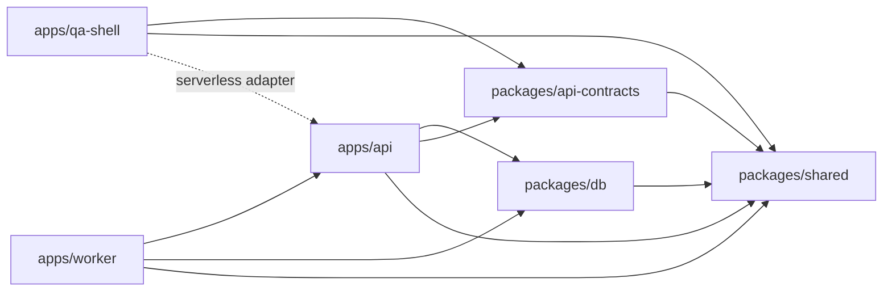

# CLEANUP_REPORT — фазы 0–5

Дата: 01.11.2026, Europe/Chisinau. Начало измеряемого прогона: 01.11.2026, 14:48:48.

Итог для ревью: [Фаза 5 — восемь разделов, финальный прогон и ограничения](#фаза-5--итоговая-сводка-для-pr). Предыдущие разделы сохраняют историю отдельных фаз.

## Область и неизменность

База «до»: `origin/main`, commit `d6e5c6116dd79948ebad988d1852b7b65d37b1f1`. Инвентаризация и все измерения выполнены в отдельном detached worktree `D:/OnlineSchool/.codex/worktrees/cleanup-baseline`. Отчёт сохраняется в ветке `chore/repo-cleanup`.

В cleanup-ветке уже был предыдущий проход; его изменённый генератор **не использован** для этой базовой линии. В исходном main нет кабинетов manager/student. Работа `codex/manager-vercel` и production не включены в измерения; их приложения не удалены — они находятся вне выбранного main. Проверенные ранее PR и пути: [предыдущая сверка](docs/repo-cleanup/2026-11-01/open-pr-paths.md).

В рамках этой фазы исходники, manifests, зависимости, contracts, SDK, schema, seed, миграции и Dockerfile не изменялись. Ничего не удалено, включая существующие dist/кэши/образы. После измерений `git diff HEAD` в baseline пустой; OpenAPI checkout SHA-256 совпал до/после. Отчёт и доказательства — единственные новые tracked-файлы этого шага. Не выполнялись deploy, seed, migrations или обращения к рабочей БД.

## Карта apps/* и packages/*

Шесть workspace-пакетов плюс корневой orchestrator (pnpm/Turbo). Потребители в таблице — **прямые** workspace dependencies из manifests; это не утверждение, что каждая зависимость входит в браузерный bundle.

| Каталог                  | Пакет                          | Назначение                                                                                           | Прямые потребители workspace                                                                                                  |
| ------------------------ | ------------------------------ | ---------------------------------------------------------------------------------------------------- | ----------------------------------------------------------------------------------------------------------------------------- |
| `apps/api`               | `@online-school/api`           | NestJS HTTP API, сессии и guards; standalone и serverless.                                           | `@online-school/qa-shell`, `@online-school/worker`                                                                            |
| `apps/qa-shell`          | `@online-school/qa-shell`      | React/Vite QA-интерфейс действующей среды; не отдельная тестовая БД.                                 |                                                                                                                               |
| `apps/worker`            | `@online-school/worker`        | Nest application context без HTTP: Outbox, recovery, heartbeat, Finance expiry и Schedule deadlines. |                                                                                                                               |
| `packages/api-contracts` | `@online-school/api-contracts` | OpenAPI JSON, generated TypeScript/Orval SDK и HTTP transport.                                       | `@online-school/api`, `@online-school/qa-shell`                                                                               |
| `packages/db`            | `@online-school/db`            | Prisma Client/адаптер pg, schema, миграции, reference/QA seed и database tools.                      | `@online-school/api`, `@online-school/worker`                                                                                 |
| `packages/shared`        | `@online-school/shared`        | Result<T,E>, ok/err и общие имена сервисов.                                                          | `@online-school/api`, `@online-school/qa-shell`, `@online-school/worker`, `@online-school/api-contracts`, `@online-school/db` |

Дополнительные потребители и границы:

- `@online-school/api`: корневой `api/handler.ts` импортирует compiled serverless напрямую; `apps/qa-shell/api/handler.ts` использует package export. Worker использует только `finance-expiry` и `schedule-deadlines` subpaths. QA SPA обращается к HTTP API, а не включает сервер Nest в JS bundle.
- `@online-school/db`: кроме API/worker, фабрики клиента используются Prisma/seed/database tools и эксплуатационными/integration скриптами. Эти команды не являются автоматически мёртвым кодом. Сами DB-команды не запускались.
- `@online-school/api-contracts`: API использует контракт типов; qa-shell импортирует generated SDK и transport. Root `generate` и `generate:client` управляют генерацией. Worker получает его транзитивно через API.
- `@online-school/shared`: Result используется пятью остальными workspace-пакетами; runtime `ok/err` и типы различаются по характеру импорта.
- `apps/api/tsconfig.json` references → shared, db, api-contracts; worker → api, shared, db; qa-shell → shared, api-contracts, api. Turbo `build` имеет `dependsOn: ["^build"]`.

Все ссылки на имена пакетов в tracked-файлах перечислены в [машинной карте](docs/repo-cleanup/2026-11-01/phase0/evidence.json) → inventory.workspaces[].referenceFiles; список включает документацию и тесты, а не только runtime.

## Модули внутри apps/api/src

`AppModule` в `apps/api/src/app.module.ts` подключает CoreModule и все восемь областей ниже, плюс собственный HealthController.

| Каталог                             | Nest-модули                            | Содержимое / состояние                                                                       | Связи                                                                        |
| ----------------------------------- | -------------------------------------- | -------------------------------------------------------------------------------------------- | ---------------------------------------------------------------------------- |
| `apps/api/src/modules/crm`          | CrmModule                              | RegistryController / RegistryService: ученики, семьи, представители.                         | Подключён AppModule; прямых Nest imports нет.                                |
| `apps/api/src/modules/education`    | EducationModule                        | Пустой каркас `@Module({})`.                                                                 | AppModule.                                                                   |
| `apps/api/src/modules/finance`      | FinanceModule, FinanceExpiryModule     | Payments, entitlements, ledger, periods, payroll, teacher rates; отдельный expiry processor. | AppModule; ScheduleModule; worker через экспорт пакета `api/finance-expiry`. |
| `apps/api/src/modules/identity`     | IdentityModule                         | Пароли, opaque session, WebAuthn, recovery и rate limit; экспорт Passwords.                  | AppModule.                                                                   |
| `apps/api/src/modules/integrations` | IntegrationsModule                     | Пустой каркас `@Module({})`.                                                                 | AppModule.                                                                   |
| `apps/api/src/modules/qa`           | QaModule                               | Диагностика компонентов, проверка файлового доступа, API/worker health.                      | AppModule; QA SPA вызывает API.                                              |
| `apps/api/src/modules/schedule`     | ScheduleModule, ScheduleDeadlineModule | Registry, booking, recurrence, outcomes; отдельный deadline processor.                       | AppModule; импортирует FinanceModule; worker через `api/schedule-deadlines`. |
| `apps/api/src/modules/storage`      | StorageModule                          | Пустой каркас `@Module({})`.                                                                 | AppModule.                                                                   |

CoreModule — общий слой в `apps/api/src/core/`: `audit`, `csrf`, `database`, `errors`, `idempotency`, `policy`, `rbac`, `request-id`, `session`, `transaction`. Глобально устанавливает DTO validation pipe, AppExceptionFilter, Session/RBAC/CSRF/WebAuthn/Idempotency guards и CriticalCommandInterceptor; request-id middleware охватывает маршруты.

`apps/api/src/openapi/` — DTO-классы и Swagger/export-инфраструктура; это не самостоятельный предметный Nest-модуль. Пустые Education/Storage/Integrations отмечены как каркасы, а не как разрешение на удаление.

## Точки входа

| Сценарий             | Исходник                                    | Выход / запуск                                                          | Особенности                                                                      |
| -------------------- | ------------------------------------------- | ----------------------------------------------------------------------- | -------------------------------------------------------------------------------- |
| Standalone API       | `apps/api/src/main.ts`                      | `apps/api/dist/main.js`; `pnpm --filter @online-school/api start`       | NestFactory.create(AppModule), Swagger; HOST/PORT; shutdown hooks.               |
| Общий serverless API | `apps/api/src/serverless.ts`                | `apps/api/dist/serverless.js`, export handler                           | Кэширует приложение на Function instance; polling worker не запускает.           |
| Root Vercel adapter  | `api/handler.ts`                            | default re-export handler                                               | Выбран root vercel.json; rewrites /api/* и /health.                              |
| QA-project adapter   | `apps/qa-shell/api/handler.ts`              | default export из `@online-school/api/serverless`                       | Альтернативная Vercel entrypoint; не импортируется из браузерного main.          |
| Worker               | `apps/worker/src/main.ts`                   | `apps/worker/dist/main.js`; `pnpm --filter @online-school/worker start` | createApplicationContext(WorkerModule), без HTTP listener; SIGINT/SIGTERM drain. |
| QA frontend          | `apps/qa-shell/index.html` → `src/main.tsx` | `apps/qa-shell/dist/index.html`                                         | React StrictMode → App; SDK через api.ts, passkey через auth.ts; Vite.           |
| OpenAPI export       | `apps/api/scripts/export-openapi.mjs`       | `pnpm generate:client`                                                  | Создаёт Nest app и документ; в этой фазе контракт не переэкспортировался.        |

Инфраструктурные связи сохранены: root `vercel.json` → `infra/vercel/build.mjs` + `Dockerfile.worker`; Compose → `apps/api/Dockerfile` и `apps/worker/Dockerfile`. Два worker Dockerfile в исходной базе побайтово одинаковы, но имеют разные внешние потребители.

## Среда и методика

Host: Windows x64, AMD Ryzen 5 5600G with Radeon Graphics, 12 логических CPU, 15.37 GiB RAM; Node v24.21.0, pnpm 10.34.9. Локальные версии из lockfile: Turbo 2.11.10, TypeScript 6.0.3, NestJS 12.2.0, Prisma 7.10.1, React 18.3.1, Vite 7.3.7.

Зависимости установлены через `pnpm install --frozen-lockfile`; postinstall выполнил штатную offline-генерацию. Установка не включена в build time. Подготовительный запуск до завершения установки не нашёл turbo и не начал сборку; он исключён из замера. Перед измеряемой холодной сборкой подтверждено отсутствие dist всех пакетов, *.tsbuildinfo и выделенного Turbo cache.

Два build-прогона шли последовательно, без изменения source/environment между ними. Локальный кэш новый: `.codex/phase0/turbo-cache`; remote cache выключен через `--cache=local:rw`. pnpm store и OS file cache уже тёплые; холодную сеть, очистку OS cache и повторные статистические серии не измеряли. URL-переменные БД удалены из окружения команд; `BUILD_COMMIT_SHA` установлен в baseline commit. Данные — одиночные локальные замеры, не p95/CI SLA.

## Результаты «до»: typecheck / build / lint / test

| Команда                                                                                        | Результат | Wall time с запуском pnpm | Лог                                                              |
| ---------------------------------------------------------------------------------------------- | --------- | ------------------------- | ---------------------------------------------------------------- |
| `pnpm exec turbo run build --cache-dir=.codex/phase0/turbo-cache --cache=local:rw --summarize` | PASS      | 31.566 с                  | [turbo-cold](docs/repo-cleanup/2026-11-01/phase0/turbo-cold.txt) |
| `pnpm exec turbo run build --cache-dir=.codex/phase0/turbo-cache --cache=local:rw --summarize` | PASS      | 0.495 с                   | [turbo-warm](docs/repo-cleanup/2026-11-01/phase0/turbo-warm.txt) |
| `pnpm typecheck`                                                                               | PASS      | 4.969 с                   | [typecheck](docs/repo-cleanup/2026-11-01/phase0/typecheck.txt)   |
| `pnpm lint`                                                                                    | PASS      | 3.271 с                   | [lint](docs/repo-cleanup/2026-11-01/phase0/lint.txt)             |
| `pnpm test`                                                                                    | PASS      | 5.628 с                   | [test](docs/repo-cleanup/2026-11-01/phase0/test.txt)             |

Первая команда эквивалентна корневому `pnpm build` (тот же `turbo run build`) с явным изолированным cache и summary. Typecheck использует Turbo, lint — корневой ESLint, test — Turbo unit + monorepo smoke.

`pnpm test`: API 10, worker 2, DB clients 3, shared 1, monorepo smoke 2 — **18 passed, 0 failed**. У api-contracts и qa-shell в исходном main нет package test-script. DB/integration/QA seed suites не запускались; эти 18 тестов не означают полной DB приёмки. В test-прогоне 10 успешных Turbo задач, из них 6 cached build и 4 исполненных test.

## Холодная и тёплая сборка Turbo

| Режим                       | Полный wall time | Внутреннее время Turbo | Build tasks     | Cache   |
| --------------------------- | ---------------- | ---------------------- | --------------- | ------- |
| Холодная компиляция         | 31.566 с         | 31.128 с               | 6 успешных      | 0/6 HIT |
| Повторный идентичный запуск | 0.495 с          | 0.100 с                | 6 восстановлены | 6/6 HIT |

Это базовая линия cache reuse, не сравнение «до/после оптимизации». Никакие существующие outputs не удалялись. Хеши задач и cache status сохранены в evidence.json → turbo.

## Размеры dist

Логические байты файлов, без node_modules, с .d.ts и source maps; не allocated disk size и не размер npm tarball. QA-shell имеет TypeScript noEmit, его dist создаёт Vite.

| Каталог                       | Файлов | Всего, bytes | MiB   | JS, bytes | .d.ts, bytes | Maps, bytes |
| ----------------------------- | ------ | ------------ | ----- | --------- | ------------ | ----------- |
| `apps/api/dist`               | 252    | 1084366      | 1.03  | 528243    | 96247        | 459876      |
| `apps/worker/dist`            | 28     | 74129        | 0.07  | 34564     | 4788         | 34777       |
| `apps/qa-shell/dist`          | 3      | 193088       | 0.18  | 183042    | 0            | 0           |
| `packages/api-contracts/dist` | 16     | 502419       | 0.48  | 52745     | 248565       | 201109      |
| `packages/db/dist`            | 328    | 15253344     | 14.55 | 898506    | 8715824      | 5639014     |
| `packages/db/dist-tools`      | 13     | 117885       | 0.11  | 32094     | 1699         | 29343       |
| `packages/shared/dist`        | 8      | 2143         | 0.00  | 275       | 518          | 1350        |

`packages/db/dist-tools` показан отдельно от runtime dist; его общий размер также включает прочие файлы. В packages/db/dist включён generated Prisma Client, поэтому объём types/maps значителен.

## Frontend bundle: Vite production build

`apps/qa-shell`: Vite build, 1 JS + 1 CSS + HTML. Имена файлов относятся к этому конкретному build; builtAt/commit metadata могут менять хеш имени при следующем запуске.

| Файл                                           | Raw bytes  | gzip bytes |
| ---------------------------------------------- | ---------- | ---------- |
| `apps/qa-shell/dist/assets/index-C7dOYG32.css` | 9592       | 2680       |
| `apps/qa-shell/dist/assets/index-DKPUe2PE.js`  | 183042     | 57493      |
| `apps/qa-shell/dist/index.html`                | 454        | 300        |
| **Всего**                                      | **193088** | **60473**  |

JS: 178.75 KiB raw / 56.15 KiB gzip. Gzip подсчитан Node gzipSync отдельно для каждого emitted файла и суммирован; HTTP headers/Brotli и сетевой overhead не включены.

## Размер Docker-образов

Оба образа собраны из **исходных** Dockerfile выбранного main с root build context; пакеты и версии не менялись. Команды и результаты — evidence.json → images; [API build log](docs/repo-cleanup/2026-11-01/phase0/docker-api.txt), [worker build log](docs/repo-cleanup/2026-11-01/phase0/docker-worker.txt).

| Локальный образ                      | Dockerfile            | Size, bytes | MiB     | Платформа   |
| ------------------------------------ | --------------------- | ----------- | ------- | ----------- |
| `onlineschool-phase0-api:d6e5c61`    | `apps/api/Dockerfile` | 1181208848  | 1126.49 | linux/amd64 |
| `onlineschool-phase0-worker:d6e5c61` | `Dockerfile.worker`   | 1181598995  | 1126.86 | linux/amd64 |

Size — значение docker image inspect: логический несжатый размер слоёв; не registry transfer size и не уникальный расход диска. Образы разделяют слои, складывать размеры для оценки места нельзя. Сборки могли использовать существующий Docker layer cache; Docker cold build здесь не заявляется. Container Node: 24.22.2; исходный base tag `node:24-bookworm-slim` не закреплён digest, его не меняли. Параметры runtime и точные image IDs сохранены в evidence.json. Контейнеры приложения/БД в этой фазе не запускались.

## Контрольный хеш OpenAPI

Файл: `packages/api-contracts/openapi/openapi.json`.

- SHA-256 канонического Git blob (LF): `f32a2cf03eca4db077ddc88e1f844aa5c0cfcd724353357f062573b635ccec9f`.
- SHA-256 измеренного Windows checkout (CRLF): `5c7deefd2479228addfdb34d19e9ec74911664ab3e346011f94b94011a1444d5`.
- Checkout SHA-256 до/после совпал. Разные окончания строк объясняют различие двух хешей; source diff пустой. Ручного редактирования generated файлов не было.

## Доказательства и границы

[Полная машинная карта, размеры, cache hashes, команды и metadata](docs/repo-cleanup/2026-11-01/phase0/evidence.json); [канонические SHA-256 всех 214 tracked-файлов baseline](docs/repo-cleanup/2026-11-01/phase0/source-hashes.json). Чистый baseline worktree сохранён; существующие рабочие деревья/outputs и production не трогались.

Результат фазы — инвентаризация и измеряемая база, без удаления или рефакторинга. Ни архитектурное закрытие, ни production GO, ни полная DB-regression из этих измерений не следуют.

# Фаза 1 — мёртвый код

Дата: 01.11.2026, Europe/Chisinau. База этой фазы: `cad89fa08f289f1f867d067abb9a338a1a57f8df` (после отчёта фазы 0), ветка `chore/repo-cleanup`.

## Метод и охват

Повторно выполнен `pnpm dlx knip@6.44.1 --reporter json --no-progress`; в package.json/lockfile инструмент не добавлялся. Код выхода Knip 1 означает оставшиеся findings, а не провал тестов. [До](docs/repo-cleanup/2026-11-01/phase1/knip-before.json), [после](docs/repo-cleanup/2026-11-01/phase1/knip-after.json).

Вручную проверены входы Vercel/Compose/CI, Nest providers/controllers/@Inject tokens, динамические import/require, Swagger DTO_CLASSES/SCHEMA_OVERRIDES/extraModels, class-validator, SQL/seed и операторские CLI. По всем tracked-файлам выполнено 60 точных git grep-поисков (6 символов × HEAD, восемь активных PR heads и ветка менеджера); строки, документация и сохранённые отчёты не исключались из доказательного поиска. [Результаты поиска](docs/repo-cleanup/2026-11-01/phase1/search-before.json) содержат команды и совпадения; длинные строки старых JSON evidence сокращены только в отображаемом excerpt.

Дополнительно разобраны AST/comments 128 исходников; проверены 70 npm-скриптов, 26 env-названий из всех .env.example и 61 статическое обращение process.env. Динамические read(key), environment.* и Compose interpolation проверены отдельно. TODO/FIXME/HACK/XXX и закомментированные исполняемые фрагменты без владельца не обнаружены. Библиотечные/генерируемые файлы не редактировались.

Открытые PR #2–#9 сверены повторно; список и пути остаются в [приложении фазы 0](docs/repo-cleanup/2026-11-01/open-pr-paths.md). Дополнительно просмотрена codex/manager-vercel. Удаление SESSION_IDLE_MS и DirectorLedgerPublicationPolicy отклонено после обнаружения реальных потребителей в этой ветке. Файлы менеджера и его frontend не менялись и не перемещались. Пересечения текущего code-коммита с открытыми PR: #3 — `apps/api/src/modules/identity/identity.service.ts`, #6 — `apps/api/src/modules/finance/finance-ledger.service.ts`. В обоих случаях изменён только один export-модификатор; переносов нет.

## Таблица удалений

Удалены **четыре неиспользуемых модификатора export**. Функции, константа, type alias и все их локальные вызовы сохранены. Это внутренние файлы, не entrypoints из package exports; HTTP и публичный SDK не меняются. AST-проверка подтверждает, что иных изменений в этих четырёх файлах нет.

| Путь                                                     | Что удалено                                          | Доказательство отсутствия внешнего использования                                                                                                                                                                                                   | Коммит    |
| -------------------------------------------------------- | ---------------------------------------------------- | -------------------------------------------------------------------------------------------------------------------------------------------------------------------------------------------------------------------------------------------------- | --------- |
| `apps/api/src/core/session/session.store.ts`             | Лишний export у локальной константы `SESSION_TTL_MS` | Knip exports; git grep в HEAD и 9 проверенных ветках даёт только определение/локальный расчёт expiresAt. SESSION_IDLE_MS не тронут. Нет DI/Swagger metadata у этой константы.                                                                      | `ebf7779` |
| `apps/api/src/modules/finance/finance-ledger.service.ts` | Лишний export у локальной функции `pair`             | Knip exports; все вызовы находятся в том же finance-ledger.service.ts. Межмодульные импорты из файла используют FinanceLedger; другие pair в тестах — локальные переменные. Строковые/динамические/рефлексивные ссылки на этот helper не найдены.  | `ebf7779` |
| `apps/api/src/modules/identity/identity.service.ts`      | Лишний export у локальной функции `userHandle`       | Knip exports; используется внутри IdentityService для WebAuthn, поэтому функция сохранена. Внешние одноимённые поля response.userHandle — протокольные данные, не импорт функции; string/module/DI searches не выявили потребителя export.         | `ebf7779` |
| `apps/qa-shell/src/scenarios.ts`                         | Лишний export у локального type alias `Role`         | Knip types; alias используется локально в Action.roles; App.tsx импортирует Action/Field/Values/canRun/scenarios. Все refs к scenarios-модулю проверены в текущей и активных ветках; external type Role import нет. Emitted JS до/после идентичен. | `ebf7779` |

Полностью удалённых файлов/алгоритмов/зависимостей/env/npm-скриптов/TODO нет. Отсутствие импортов не принималось за доказательство неиспользования внешней команды или DI-регистрации.

## Подозрительные и ложноположительные кандидаты — сохранены

| Кандидат                                                                                              | Решение                 | Найденное использование / причина                                                                                                                                           |
| ----------------------------------------------------------------------------------------------------- | ----------------------- | --------------------------------------------------------------------------------------------------------------------------------------------------------------------------- |
| api/handler.ts; apps/qa-shell/api/handler.ts                                                          | Оставлены               | Root vercel.json functions/rewrites и Vercel file convention; qa-shell adapter импортирует @online-school/api/serverless.                                                   |
| infra/compose-smoke.mjs                                                                               | Оставлен                | Инструкция запуска внутри самого файла; operational probe с внешним вызовом. Нет доказательства отказа от него.                                                             |
| infra/prepare-source-export.mjs                                                                       | Оставлен                | Документирован в infra/README.md:128.                                                                                                                                       |
| infra/worker-health.mjs                                                                               | Оставлен                | docker-compose.yml:84 запускает его из healthcheck; включён .dockerignore.                                                                                                  |
| infra/vercel/build.mjs                                                                                | Оставлен                | vercel.json buildCommand.                                                                                                                                                   |
| scripts/authorize-recovery.mjs; scripts/set-account-password.mjs                                      | Оставлены               | Документированные операторские CLI в apps/api/IDENTITY.md:99,133.                                                                                                           |
| scripts/provision-initial-project.mjs                                                                 | Оставлен                | Maintenance entrypoint из apps/qa-shell/QA_SHELL.md:55.                                                                                                                     |
| packages/db/seed.ts; packages/db/scripts/database-tools.ts; database-targets.ts                       | Оставлены               | Package scripts db:seed/db:migrate:*; tsconfig.tools.json; seed/database-tools imports и seed-guards test. Не выполнялись на БД.                                            |
| apps/qa-shell/package.json → @online-school/api                                                       | Оставлена зависимость   | apps/qa-shell/api/handler.ts импортирует @online-school/api/serverless; требуется также TS reference.                                                                       |
| packages/db/package.json → @prisma/client                                                             | Оставлена зависимость   | Generated Prisma client.ts/internal/*.ts импортируют @prisma/client/runtime/client и index-browser.                                                                         |
| SESSION_IDLE_MS                                                                                       | Оставлен export         | origin/codex/manager-vercel: apps/api/src/student/security/sessions.service.ts:5,25–26 импортирует и использует.                                                            |
| DirectorLedgerPublicationPolicy                                                                       | Оставлен export и класс | Вызывается ContextualLedgerPublicationPolicy; в manager-ветке scripts/student-cabinet-provision.mjs:5,56 импортирует класс.                                                 |
| RECOVERY_PROVIDERS; Worker handlers; WorkerFailure                                                    | Оставлены               | Nest Inject/provider token; createHandlers map; WorkerFailure импортируется apps/worker/test/config.test.mjs.                                                               |
| CsrfController; QaController; FileAccessController                                                    | Оставлены               | Декораторы маршрутов и controllers массивы Nest; удаление ломает регистрацию.                                                                                               |
| LoginRequestAlternative*; HouseholdMemberRequestAlternative*; LedgerEntryResponseBalanceSnapshotValue | Оставлены               | DTO_CLASSES, SCHEMA_OVERRIDES $ref и Swagger extraModels; class-validator metadata. Контракты не менялись.                                                                  |
| webhooks; $defs (generated OpenAPI types)                                                             | Оставлены               | Generated API surface защищён; ручное удаление запрещено.                                                                                                                   |
| IdentityService.private db                                                                            | Оставлен                | TS6138 из дополнительного диагностического noUnused прохода. Это constructor DI slot; его удаление меняет metadata/signature. Подозрительный кандидат, не удалять.          |
| VITE_API_BASE_URL в turbo.json                                                                        | Оставлен                | Единственная найденная ссылка — явный Turbo env/cache input. Удаление меняет кэш-контракт; отсутствие frontend read недостаточно для этого шага.                            |
| npm scripts и env templates                                                                           | Оставлены               | CLI lifecycle/CI/операторские команды; env читаются напрямую либо через read(key)/environment/Compose interpolation. Нет доказательства отказа от внешних способов запуска. |
| TODO без владельца / закомментированный код                                                           | Удалений нет            | Поиск TODO/FIXME/HACK/XXX в коде/конфигах и TS scanner comments: 0 кандидатов.                                                                                              |
| README: локальные ссылки на корпус требований и прежнюю graph tooling                                 | Оставлены в этой фазе   | Корпус намеренно исключён из source-only main; битая локальная ссылка не доказывает мёртвый runtime-код. Ранее удалённый инструмент не запускался.                          |

Дополнительный диагностический запуск noUnusedLocals/noUnusedParameters не менял tsconfig. Он нашёл IdentityService.db; это не ошибка действующей сборки, а сигнал анализа. Constructor DI signature сохранён. ESLint/tsconfig не ослаблялись.

## Проверки после шага

| Команда                                           | Результат                        | Доказательство                                                   |
| ------------------------------------------------- | -------------------------------- | ---------------------------------------------------------------- |
| `pnpm --filter @online-school/api typecheck`      | PASS                             | [check-1.txt](docs/repo-cleanup/2026-11-01/phase1/check-1.txt)   |
| `pnpm --filter @online-school/api lint`           | PASS                             | [check-2.txt](docs/repo-cleanup/2026-11-01/phase1/check-2.txt)   |
| `pnpm --filter @online-school/api test`           | PASS                             | [check-3.txt](docs/repo-cleanup/2026-11-01/phase1/check-3.txt)   |
| `pnpm --filter @online-school/qa-shell typecheck` | PASS                             | [check-4.txt](docs/repo-cleanup/2026-11-01/phase1/check-4.txt)   |
| `pnpm --filter @online-school/qa-shell lint`      | PASS                             | [check-5.txt](docs/repo-cleanup/2026-11-01/phase1/check-5.txt)   |
| `pnpm --filter @online-school/qa-shell build`     | PASS                             | [check-6.txt](docs/repo-cleanup/2026-11-01/phase1/check-6.txt)   |
| `node --test scripts/monorepo-smoke.test.mjs`     | PASS                             | [check-7.txt](docs/repo-cleanup/2026-11-01/phase1/check-7.txt)   |
| `pnpm generate`                                   | PASS; git diff контрактов пустой | [generate.txt](docs/repo-cleanup/2026-11-01/phase1/generate.txt) |

API: 10 unit-тестов; monorepo smoke: 2/2. У qa-shell нет package test-script; для него выполнены typecheck, lint и production Vite build. Проверки адресные; полный recursive прогон не повторялся. Ни одна проверка шага не упала, откат не потребовался. Известный общий format gate фазы 0 остаётся открытым; эта фаза его не объявляет пройденным.

OpenAPI, построенный Nest/Swagger из изменённого API, сравнен в памяти с checked-in JSON: полное совпадение, без перезаписи контрактов и подключения БД. Удаление export у type Role даёт идентичный emitted JS. SHA-256 всех 28 защищённых файлов (schema, migrations/history, seed, OpenAPI и generated SDK/types) совпал до/после; package manifests, lockfile и версии зависимостей не изменены. После generate по этим путям git diff пустой.

Knip: exports 18 → 15, types 3 → 2; оставшиеся 12 file-кандидатов и 2 dependency-кандидата сохранены по причинам выше. Новых findings не добавлено. [Машинный отчёт](docs/repo-cleanup/2026-11-01/phase1/evidence.json), [инварианты](docs/repo-cleanup/2026-11-01/phase1/invariants.json), [проверка контрактов](docs/repo-cleanup/2026-11-01/phase1/contract-check.json). Логи в Git нормализованы только по trailing whitespace/пустым строкам в конце; команды, результаты и смысл строк сохранены.

# Фаза 2 — зависимости

Дата: 01.11.2026, Europe/Chisinau. База: `5567b50fdbc3922f3ced30f6481ebdcd3fe7850d`. Эта фаза не изменила ни одной зависимости или версии: безопасных удалений не подтверждено.

## Прямые зависимости и peer-правила

Проверены все 7 workspace importers: 38 различных прямых имён, 49 деклараций dependencies/devDependencies. Одно прямое имя не закреплено в разных версиях. Повторная декларация NestJS/rxjs/reflect-metadata в API и worker — необходимая зависимость каждого приложения, а не две устанавливаемые версии; strict pnpm resolution не заменялся доступом через соседний пакет.

Кандидаты Knip из фазы 1 перепроверены:

| Кандидат                             | Фактический потребитель                                                                                            | Решение   |
| ------------------------------------ | ------------------------------------------------------------------------------------------------------------------ | --------- |
| `apps/qa-shell → @online-school/api` | `apps/qa-shell/api/handler.ts` импортирует `@online-school/api/serverless`; qa-shell tsconfig имеет api reference  | Сохранить |
| `packages/db → @prisma/client`       | Generated Prisma client/internal namespace импортируют `@prisma/client/runtime/client` и browser runtime           | Сохранить |
| `reflect-metadata`, `rxjs`           | side-effect import в bootstrap и обязательные peers NestJS; приложение/worker имеют отдельные entrypoints          | Сохранить |
| `@nestjs/platform-express`           | NestFactory HTTP bootstrap выбирает адаптер платформы; import через framework не виден простому grep по приложению | Сохранить |
| `@types/pg`                          | декларации `@prisma/adapter-pg/dist/index.d.ts` импортируют pg; строгая проверка библиотечных типов включена       | Сохранить |
| `dotenv`                             | `packages/db/prisma.config.ts` и `prisma.legacy.config.ts`: `import 'dotenv/config'`                               | Сохранить |

В `peerDependencyRules` ровно одно правило: `allowedVersions['openapi-typescript>typescript'] = '6.0.3'`. Оно оставлено без изменения согласно исключению владельца. Лишних peer-исключений нет. `strict-peer-dependencies=true`, `engine-strict=true` и `save-exact=true` сохранены.

## Дубли транзитивных версий

В lockfile 579 package keys и 579 snapshots. По обходу от importers через dependencies/optionalDependencies/peer snapshots все snapshots достижимы; orphaned entries и неразрешённые edges отсутствуют. Это проверка графа lockfile, а не самостоятельное доказательство использования каждого runtime-пути.

У 29 библиотек несколько версий. Для каждой найдена пара несовместимых consumer ranges. В частности, даже d3-array 3.2.1/3.2.4 нельзя слить: @visx/vendor и @prisma/studio-core требуют разные **точные** версии. @prisma/get-platform/debug 7.2.0 нужны @prisma/dev, а runtime/engines требуют 7.10.1. Удалить одну ветвь нельзя без изменения закреплённой версии или manifest внешнего потребителя.

| Библиотека             | Версии в lockfile           | Доказательство несовместимости: два потребителя                                                                                                                                                                                                                                                     | Решение   |
| ---------------------- | --------------------------- | --------------------------------------------------------------------------------------------------------------------------------------------------------------------------------------------------------------------------------------------------------------------------------------------------- | --------- |
| `@prisma/debug`        | `7.10.1`, `7.2.0`           | `@prisma/driver-adapter-utils@7.10.1` → `7.10.1`; `@prisma/get-platform@7.2.0` → `7.2.0`                                                                                                                                                                                                            | Сохранены |
| `@prisma/get-platform` | `7.10.1`, `7.2.0`           | `@prisma/dev@0.24.17(typescript@6.0.3)` → `7.2.0`; `@prisma/engines@7.10.1` → `7.10.1`                                                                                                                                                                                                              | Сохранены |
| `@scalar/json-magic`   | `0.16.1`, `0.17.0`          | `@scalar/openapi-parser@0.29.16` → `0.17.0`; `orval@8.45.0(effect@3.20.0)(prettier@3.9.10)(typescript@6.0.3)(zod@4.6.7)` → `^0.16.1`                                                                                                                                                                | Сохранены |
| `ajv`                  | `6.15.0`, `8.20.0`          | `@eslint/eslintrc@3.3.7` → `^6.14.0`; `@prisma/streams-local@0.1.11` → `^8.12.0`                                                                                                                                                                                                                    | Сохранены |
| `argparse`             | `2.0.1`, `3.0.4`            | `js-yaml@4.3.2` → `^2.0.1`; `js-yaml@5.5.0` → `^3.0.3`                                                                                                                                                                                                                                              | Сохранены |
| `balanced-match`       | `1.0.2`, `4.0.4`            | `brace-expansion@1.1.21` → `^1.0.0`; `brace-expansion@5.0.12` → `^4.0.2`                                                                                                                                                                                                                            | Сохранены |
| `brace-expansion`      | `1.1.21`, `2.1.7`, `5.0.12` | `minimatch@10.2.6` → `^5.0.8`; `minimatch@3.1.5` → `^1.1.7`                                                                                                                                                                                                                                         | Сохранены |
| `confbox`              | `0.2.4`, `0.3.1`            | `c12@3.3.4` → `^0.2.4`; `pkg-types@2.4.0` → `^0.3.1`                                                                                                                                                                                                                                                | Сохранены |
| `d3-array`             | `3.2.1`, `3.2.4`            | `@prisma/studio-core@0.33.0(@types/react-dom@18.3.7(@types/react@18.3.31))(@types/react@18.3.31)(react-dom@18.3.1(react@18.3.1))(react@18.3.1)` → `3.2.4`; `@visx/vendor@4.0.0-alpha.0` → `3.2.1`                                                                                                   | Сохранены |
| `dotenv`               | `17.4.2`, `18.0.9`          | `c12@3.3.4` → `^17.3.1`; `workspace:packages/db` → `18.0.9`                                                                                                                                                                                                                                         | Сохранены |
| `eslint-visitor-keys`  | `3.4.3`, `4.2.1`, `5.0.1`   | `@eslint-community/eslint-utils@4.10.1(eslint@9.39.5(jiti@2.7.0))` → `^3.4.3`; `@typescript-eslint/visitor-keys@8.72.0` → `^5.0.0`                                                                                                                                                                  | Сохранены |
| `globals`              | `14.0.0`, `17.13.0`         | `@eslint/eslintrc@3.3.7` → `^14.0.0`; `@orval/zod@8.45.0(zod@4.6.7)` → `^17.0.0`                                                                                                                                                                                                                    | Сохранены |
| `ignore`               | `5.3.2`, `7.0.14`           | `@eslint/eslintrc@3.3.7` → `^5.2.0`; `@typescript-eslint/eslint-plugin@8.72.0(@typescript-eslint/parser@8.72.0(eslint@9.39.5(jiti@2.7.0))(typescript@6.0.3))(eslint@9.39.5(jiti@2.7.0))(typescript@6.0.3)` → `^7.0.5`                                                                               | Сохранены |
| `js-yaml`              | `4.3.2`, `5.5.0`            | `@eslint/eslintrc@3.3.7` → `^4.3.2`; `@nestjs/swagger@12.0.4(@nestjs/common@12.2.0(class-transformer@0.5.1)(class-validator@0.15.1)(reflect-metadata@0.2.2)(rxjs@7.8.2))(@nestjs/core@12.2.0)(class-transformer@0.5.1)(class-validator@0.15.1)(reflect-metadata@0.2.2)(typescript@6.0.3)` → `5.5.0` | Сохранены |
| `json-schema-traverse` | `0.4.1`, `1.0.0`            | `@redocly/ajv@8.11.2` → `^1.0.0`; `ajv@6.15.0` → `^0.4.1`                                                                                                                                                                                                                                           | Сохранены |
| `media-typer`          | `0.3.0`, `1.1.1`            | `type-is@1.6.18` → `0.3.0`; `type-is@2.1.0` → `^1.1.0`                                                                                                                                                                                                                                              | Сохранены |
| `mime-db`              | `1.52.0`, `1.54.0`          | `mime-types@2.1.35` → `1.52.0`; `mime-types@3.0.2` → `^1.54.0`                                                                                                                                                                                                                                      | Сохранены |
| `mime-types`           | `2.1.35`, `3.0.2`           | `accepts@2.0.0` → `^3.0.0`; `type-is@1.6.18` → `~2.1.24`                                                                                                                                                                                                                                            | Сохранены |
| `minimatch`            | `10.2.6`, `3.1.5`, `5.1.9`  | `@eslint/config-array@0.21.2` → `^3.1.5`; `@redocly/openapi-core@1.34.22(supports-color@10.2.2)` → `5.1.9`                                                                                                                                                                                          | Сохранены |
| `nanoid`               | `3.3.20`, `5.1.16`          | `@scalar/types@0.25.0` → `^5.1.16`; `postcss@8.5.31` → `^3.3.20`                                                                                                                                                                                                                                    | Сохранены |
| `path-key`             | `3.1.1`, `4.0.0`            | `cross-spawn@7.0.6` → `^3.1.0`; `npm-run-path@6.0.0` → `^4.0.0`                                                                                                                                                                                                                                     | Сохранены |
| `postgres-array`       | `2.0.0`, `3.0.4`            | `@prisma/adapter-pg@7.10.1` → `3.0.4`; `pg-types@2.2.0` → `~2.0.0`                                                                                                                                                                                                                                  | Сохранены |
| `semver`               | `6.3.1`, `7.8.5`            | `@babel/core@7.29.7` → `^6.3.1`; `@typescript-eslint/typescript-estree@8.72.0(typescript@6.0.3)` → `^7.7.3`                                                                                                                                                                                         | Сохранены |
| `signal-exit`          | `3.0.7`, `4.1.0`            | `execa@9.6.1` → `^4.1.0`; `proper-lockfile@4.1.2` → `^3.0.2`                                                                                                                                                                                                                                        | Сохранены |
| `supports-color`       | `10.2.2`, `7.2.0`           | `chalk@4.1.2` → `^7.1.0`; `openapi-typescript@7.13.0(typescript@6.0.3)` → `^10.2.2`                                                                                                                                                                                                                 | Сохранены |
| `tslib`                | `1.14.1`, `2.8.1`           | `@nestjs/common@12.2.0(class-transformer@0.5.1)(class-validator@0.15.1)(reflect-metadata@0.2.2)(rxjs@7.8.2)` → `2.8.1`; `tsyringe@4.10.0` → `^1.9.3`                                                                                                                                                | Сохранены |
| `type-fest`            | `4.41.0`, `5.10.0`          | `@scalar/types@0.25.0` → `^5.10.0`; `parse-json@8.3.0` → `^4.39.1`                                                                                                                                                                                                                                  | Сохранены |
| `type-is`              | `1.6.18`, `2.1.0`           | `body-parser@2.4.0` → `^2.1.0`; `multer@2.4.0` → `^1.6.18`                                                                                                                                                                                                                                          | Сохранены |
| `undici`               | `7.30.1`, `8.12.3`          | `@scalar/json-magic@0.16.1` → `7.30.1`; `@scalar/json-magic@0.17.0` → `8.12.3`                                                                                                                                                                                                                      | Сохранены |

Диапазоны взяты из установленных manifests и peer metadata lockfile; пересечения проверены существующим semver из node_modules. Полные parent edges и диапазоны — [evidence.json](docs/repo-cleanup/2026-11-01/phase2/evidence.json). Глобальный `pnpm dedupe`, overrides, resolutions и обновление внешних пакетов не применялись: это могло бы переразрешить закреплённый граф. Инструменты анализа/библиотеки не добавлялись в package.json.

## Проверка установки и lockfile

`pnpm install --frozen-lockfile` — **PASS**, exit 0. Установка: «Lockfile is up to date, resolution step is skipped; Already up to date». Штатный postinstall успешно выполнил Prisma generate и OpenAPI TypeScript generation (unchanged). [Полный лог](docs/repo-cleanup/2026-11-01/phase2/frozen-install.txt). Полный build/test sweep повторно не запускался: executable code и dependency graph не менялись.

SHA-256 `pnpm-lock.yaml` до/после: `a6d152cb65b09559c078eb136b23e5692140850298ba9822340ca87f1186c6f3`. Он побайтово не изменён, поэтому неожиданных добавлений, обновлений и churn от повторного разрешения нет. Также совпали хеши всех 7 package.json, pnpm-workspace.yaml и .npmrc. Ручного редактирования lockfile не было.

Удалено зависимостей: **0**; слито несовместимых версий: **0**; удалено peer-правил: **0**. Это консервативный результат проверки, а не обещание удаления ради уменьшения числа строк. Для объединения перечисленных библиотек потребовалось бы отдельное разрешение на смену версий; в этой фазе оно запрещено.

[Прямые декларации](docs/repo-cleanup/2026-11-01/phase2/direct-dependencies.json), [хеши и доказательства графа](docs/repo-cleanup/2026-11-01/phase2/evidence.json).

# Фаза 3 — структура

Дата: 01.11.2026, Europe/Chisinau. База фазы: `56a2597`. Работа продолжена в
`chore/repo-cleanup`, в изолированном cleanup worktree. Изменения относятся к
структуре; схема, миграции, seed, бизнес-алгоритмы и HTTP-контракты не менялись.

**Статус: основные границы закреплены; полная раскладка DTO/controller не завершена
после обязательного отката неуспешного шага.** Три существующих зависимости core от
OpenAPI composition сохранены явно, а не объявлены устранёнными.

## Коммиты и карта изменений

| Коммит | Категория | Результат |
| --- | --- | --- |
| `4b10320` | Структура: общие серверные пакеты | Database/Transaction/Audit/AccountContext/DomainError вынесены в `packages/server-kernel`, FinanceExpiry/ScheduleDeadline — в `packages/jobs`; API и worker используют пакеты |
| `acfb46d` | Структура: публичные границы доменов | Добавлены 8 публичных index, Schedule → Finance переведён на index, общая input-валидация перемещена из Identity в core, CRM больше не импортирует IdentityService ради clock |
| `a143bae` | Структура: совпадающие утилиты | Общая JSON-проекция в shared и DB clock в kernel; прежние `serialize`, `at`, `now`, `dbNow` сохранены alias |
| `0e8febe` | Структура: автоматический контроль | ESLint boundaries/ESM/money, 13 архитектурных fixtures и проверка циклов Madge; CI вызывает проверки |

Старые пути ядра и обработчиков API сохранены реэкспортами тех же классов; старые
package export subpaths не удалены. Это снижает конфликтность с manager-веткой и
открытыми PR. В новых jobs module/service находятся в отдельных файлах. Общие
Result и константы не дублировались заново; generic money-парсер и универсальная
пагинационная DTO-обёртка не создавались: одинаковых по смыслу реализаций для такого
объединения не установлено. Разные правила денежных входов сохранены.

Worker больше не зависит от `@online-school/api` ни в package.json, ни в project
references. API → kernel/jobs; worker → kernel/jobs; jobs → kernel/db/shared;
kernel → db/shared. Все tsconfig по-прежнему наследуют `tsconfig.base.json`; strict,
NodeNext и проверки библиотечных типов не ослаблялись. У qa-shell reference на API
сохранён: он нужен serverless-адаптеру. Новый состав ссылок не требует менять
общий tsconfig.base. В CI unit-test теперь явно собирает API и worker: прежде API
собирался транзитивно через worker. Отключённый integration job не включался.

Для Docker расширен только allow-list контекста двумя новыми пакетами. Dockerfile,
Compose, корневой api/, infra, seed и эксплуатационные SQL сохранены. Текущие слои
и полная карта прежних/новых путей — [REPOSITORY_STRUCTURE.md](docs/REPOSITORY_STRUCTURE.md).
В README добавлен отдельный актуальный раздел; его исторический префикс побайтово
совпадает после нормализации EOL. TASK-01…13 и старые описания путей не переписаны.

## Правила и циклы

Локальный ESLint plugin без новой зависимости проверяет:

- запрет imports из packages в приложения и API ↔ worker;
- отсутствие domain-module imports в core;
- междоменные imports только через публичный index.js или ports/;
- `.js` в относительных server imports;
- запрет денежных `number` и очевидных Number/parseFloat/toNumber для известных
  денежных полей. Это синтаксический guard, не полный анализ потоков данных.

Проверяются import, re-export, literal dynamic import и require. Существующий
запрет явного throw сохранён; единственное исключение перенесено вместе с
DomainError → AppException в kernel. В исходниках приложений явных throw больше
нет. Счётчики могут оставаться number; деньги не конвертировались в float.

`pnpm check:boundaries`: **13/13 PASS**, включая намеренно запрещённые fixtures и
разрешённые imports. Новые исключения для доменов/worker не добавлены.

`pnpm check:cycles`: **105 файлов, 392 ребра, 0 циклов**, неразрешённых локальных
импортов нет. Выполняется `pnpm dlx madge@8.0.0 --stdin --circular --json --no-spinner`.
Граф построен из Git inventory с TypeScript resolution и workspace exports; он
охватывает first-party apps/packages/serverless исходники и type imports, исключая
generated-код и внешние библиотеки. Пустой graph считается ошибкой. Первый пробный
directory scan Madge обработал 0 файлов под скрытой `.codex` и **не считался PASS**;
поэтому рабочая проверка передаёт явный граф через stdin. Analysis tool не добавлен
в manifests. [Лог Madge](docs/repo-cleanup/2026-11-01/phase3/enforcement-1.txt).

## Неуспешный шаг и оставшийся долг

Незакоммиченная совместная попытка разложить OpenAPI DTO registry и QA controller
по папкам модулей остановлена на первой API typecheck ошибке TS2339: новый CSRF
namespace facade не экспортировал `ApiError`, используемый Swagger error-response
annotations. Весь шаг откачен к `4b10320`: 33 tracked пути восстановлены, 18
собственных новых файлов удалены. Исправления вперёд и ослабления проверок не было.
[Лог ошибки](docs/repo-cleanup/2026-11-01/phase3/layout-failed-typecheck.txt),
[доказательство отката](docs/repo-cleanup/2026-11-01/phase3/rollback.json).

Последующие небольшие шаги касались импортов и независимых общих функций; DTO move
не восстанавливался. Остаются `openapi/dtos.ts`, `qa/qa.dto.ts`, контроллеры в
`qa.module.ts` и три точных старых core → composition зависимости:

| Core source | Сохранённая цель |
| --- | --- |
| `core/core.module.ts` | `openapi/dto-validation.pipe.js` |
| `core/csrf/csrf.module.ts` | `openapi/dtos.js` |
| `core/errors/domain-error.ts` | `openapi/dtos.js`, старый DTO alias |

ESLint фиксирует только эти три пары; новый core → composition import запрещён.
Core → доменные модули запрещён без исключений. Полное отделение core от DTO registry
и единая физическая раскладка всех старых module/controller/service/dto/errors
остаются незавершёнными. Пустые папки для формального соответствия не добавлялись.

## Адресные проверки и неизменность

| Проверка | Результат / доказательство |
| --- | --- |
| API/worker typecheck после каждого сохранённого runtime шага | PASS; [промежуточные результаты](docs/repo-cleanup/2026-11-01/phase3/public-checks.json), [итоговые результаты](docs/repo-cleanup/2026-11-01/phase3/shared-checks.json) |
| kernel/jobs/API/worker lint | PASS; [адресные проверки](docs/repo-cleanup/2026-11-01/phase3/shared-checks.json) |
| API unit / worker unit / monorepo smoke | 10/10 + 2/2 + 2/2 PASS; итоговые runtime-6/7/8.txt в evidence |
| Shared typecheck и unit | PASS, 3/3; [результаты](docs/repo-cleanup/2026-11-01/phase3/consumer-checks.json) |
| ESLint всех server src, включая db/contracts, и новых scripts | PASS; [лог](docs/repo-cleanup/2026-11-01/phase3/enforcement-2.txt) |
| qa-shell typecheck и Vite build | PASS; 56 modules, JS 183.04 kB / gzip 57.49 kB; [лог](docs/repo-cleanup/2026-11-01/phase3/consumer-3.txt) |
| Новые scripts и документ структуры, адресный prettier check | PASS; [лог](docs/repo-cleanup/2026-11-01/phase3/consumer-4.txt) |
| Frozen install + штатный postinstall `pnpm generate` | PASS; generated TypeScript unchanged; [лог](docs/repo-cleanup/2026-11-01/phase3/final-0.txt) |
| Nest Swagger in-memory против checked-in OpenAPI | Полное совпадение; без DB и перезаписи контракта; [проверка](docs/repo-cleanup/2026-11-01/phase3/contract-check.json) |
| Docker API и worker, исходные Dockerfile | Обе сборки PASS; [команды](docs/repo-cleanup/2026-11-01/phase3/final-checks.json) |
| Контейнерные smoke | API /health 200; worker Nest lifecycle PASS; NODE_ENV=test, network none, БД не использовалась; [результат](docs/repo-cleanup/2026-11-01/phase3/docker-smoke.json) |

Shared tests проверяют сохранение денежной строки `9007199254740993.1234`, Date
snapshot и независимость вложенного audit JSON, а также прежний нативный отказ для
BigInt. Class AST DatabaseService/TransactionService/AuditService и двух job services
совпадает с исходным. Проверены идентичность старых и новых конструкторов,
совместимость `instanceof HttpException` и сохранение Nest peer context.
[Runtime equivalence](docs/repo-cleanup/2026-11-01/phase3/runtime-equivalence.json).

Хеши всех **28 защищённых файлов** до/после совпали, protected git diff пустой:
schema, migrations/history, seed, OpenAPI, generated SDK/types. Существующие package
exports сохранены. В lockfile изменены только workspace importers/links для
kernel/jobs и удаления worker → API; внешние 579 packages и 579 snapshots идентичны
базе фазы. Новых внешних версий/dev-зависимостей нет. Peer-исключение
openapi-typescript/TypeScript 6.0.3 не трогалось.
[Инварианты](docs/repo-cleanup/2026-11-01/phase3/invariants.json).

Ни один запрос к рабочей БД, миграция или создание тестовой БД не выполнялись.
Предварительно зафиксированное расхождение схемы main с расширенной рабочей БД
сохраняется: пустой migrate diff к этой БД **не заявляется**. Принятое владельцем
доказательство — неизменность schema/migrations относительно main — сохранено.

Полный recursive gate в этой фазе не повторялся согласно правилу адресных проверок.
Его известный format failure из фазы 0 остаётся в отчёте; новый полный gate и реальная
DB-регрессия не объявляются пройденными. Сохранены итоговые текстовые логи и JSON
результаты промежуточных шагов; в копиях логов удалены только trailing whitespace.

## Открытые PR и пересечения

GitHub повторно сверён: открыты PR #2–#9, их heads совпадают с инвентаризацией фазы 0.
[Снимок](docs/repo-cleanup/2026-11-01/phase3/open-prs.json). Полные перечни PR paths
сохранены в фазе 0; пересечения с этим шагом перечислены в phase3 invariants.json.

| PR | Пересекающиеся пути этой фазы |
| --- | --- |
| #2 | CI, README, root package.json, lockfile |
| #3 | CI, API package.json, AppModule, core/http.ts, IdentityService, root package.json, lockfile |
| #4 | .dockerignore, CI, API package.json, Schedule registry.service.ts, root package.json, lockfile |
| #5 | CI, Schedule outcomes.service.ts, root package.json |
| #6 | CI, Finance entitlements.service.ts / finance-ledger.service.ts, root package.json |
| #7 | CI, API package.json, core/http.ts, WorkerModule, root package.json, lockfile |
| #8 / #9 | CI, root package.json |

Для `codex/manager-vercel` сохранён отдельный полный список пересечений в invariants.
Есть общие изменения ядра и импортов, поэтому автоматическое отсутствие merge
конфликтов не обещается. Общие переносы разделены на четыре небольших коммита,
старые import paths сохранены. `modules/manager`, frontend менеджера, локальный
корневой dirty tree и release worktree не перемещались и не менялись. Merge в main,
force push и деплой не выполнялись.

# Фаза 4 — сборка и оптимизация

Дата: 01.11.2026, Europe/Chisinau. База: `e137468`. Ветка `chore/repo-cleanup`.
Сохранены два измеримых изменения: корректность/область кэша Turbo и уменьшение
Docker runtime-образов. Бизнес-код, runtime SQL, зависимости и generated-контракты
не менялись. Прежний незавершённый перенос DTO из фазы 3 остаётся незавершённым.

Уточнение владельца в этой фазе: **откатывать только новые регрессии, исходные ошибки
зафиксировать в отчёте**. Оно применяется к ранее падавшему format:check; защищённый
OpenAPI для форматирования не переписывался.

## Измерения до/после

| Метрика                                               | До                                 | После                       | Вывод                                                                                        |
| ----------------------------------------------------- | ---------------------------------- | --------------------------- | -------------------------------------------------------------------------------------------- |
| Turbo build, пустой отдельный Turbo cache + tsc clean | 64 687 мс                          | 45 482 мс                   | Одиночные локальные пробы; причинное ускорение не доказано, OS cache не очищался             |
| Turbo build, повтор без изменений                     | 481 мс, 8/8 cached                 | 712 мс, 8/8 cached          | Все 8 задач восстанавливаются из кэша; ускорение самого тёплого запуска не заявляется        |
| Изменение только Markdown в API                       | Меняются хеши API и qa-shell build | 0 изменённых build-хешей    | Устранены две ненужные пересборки                                                            |
| Изменение общего tsconfig / generation helper         | 0 изменённых build-хешей           | Все 8 меняются              | Исправлены пропущенные входы кэша                                                            |
| Изменение server source                               | API + qa-shell                     | API + qa-shell              | Транзитивная зависимость сохранена                                                           |
| Изменение BUILD_COMMIT_SHA                            | 0 изменённых build-хешей           | Все 8 меняются              | SHA входит в strict environment/hash; выбран консервативный общий env без пакетных overrides |
| Frontend JS / CSS / HTML                              | 183 042 / 9 592 / 454 байта        | 183 042 / 9 592 / 454 байта | Ни один артефакт не вырос при одинаковом окружении без SHA                                   |
| API image, docker inspect Size                        | 1 182 291 697 байт                 | 1 003 093 950 байт          | −179 197 747 байт, около 15,2%                                                               |
| Worker image, docker inspect Size                     | 1 182 700 250 байт                 | 1 003 498 234 байта         | −179 202 016 байт, около 15,2%                                                               |

Замеры выполнены на одной машине с Node 24.21.0/pnpm 10.34.9; в контейнерах Node
24.22.2, одинаковый base image до/после. Cold здесь означает отсутствие Turbo cache
и compiler outputs после tsc clean, не холодный диск/OS. Один замер до и один после
не является статистической оценкой производительности. Размер Docker — логический
Size образа, не сжатый registry transfer и не размер занятого BuildKit cache.
[Сводка](docs/repo-cleanup/2026-11-01/phase4/measurements.json),
[до](docs/repo-cleanup/2026-11-01/phase4/before.json),
[после](docs/repo-cleanup/2026-11-01/phase4/after.json).

## Turbo, TypeScript и генерация

В `6e73d5c` сохранены исходные `dependsOn: ["^build"]` и outputs dist/dist-tools/
tsbuildinfo/generated. Добавлены globalDependencies для общего tsconfig и helper
генерации, build inputs исключают Markdown, внешний test/, Dockerfile и env example.
Эти файлы не входят в compiler/Vite build. Test/lint inputs не исключены из своих
задач; lint дополнительно учитывает root ESLint plugin/config и workspace manifests,
из которых вычисляются границы. Секретные env-файлы в build/cache не добавлялись.

Проверены dry-run хеши при временных изменениях документа, tsconfig, helper, source
и SHA. Все временные файлы/байты восстановлены. После tsc clean проверен реальный
cache restore **8/8** и два monorepo smoke. [Входы кэша](docs/repo-cleanup/2026-11-01/phase4/cache-probes-after.json),
[восстановление](docs/repo-cleanup/2026-11-01/phase4/cache-restore.json).

Пакетные overrides первой попытки не прошли проверку: source change перестал
инвалидировать зависимый qa-shell. Весь незакоммиченный шаг откачен; потерянные
dependsOn не исправлялись вперёд. Этот подход оставлен. Независимый меньший шаг
изменяет только общие inputs/env и сохраняет исходный граф зависимостей.
[Неуспешная попытка](docs/repo-cleanup/2026-11-01/phase4/cache-probes-overrides-failed.json).

Composite уже включён в общем tsconfig.base; incremental включается им неявно,
включая DB tools и frontend typecheck. Новые флаги не добавлялись без выигрыша.
Root postinstall уже выполняет ровно одну Prisma generation и одну OpenAPI generation
на install: пакетных postinstall-дублей нет. Изменять это поведение не потребовалось.
Повторные явные build/typecheck продолжают штатно вызывать свои генераторы, а warm
Turbo build не запускает их. Fresh Docker install прошёл без .env/DB, со frozen
lockfile, затем оба генератора завершились успешно. Prisma CLI 7.10.1 и TypeScript
6.0.3 сохранены; Orval/Prisma/generated файлы вручную не редактировались.

## Frontend

Проведён Rollup generateBundle-анализ через установленный Vite, без новой зависимости
и изменения production config. Основные rendered modules: React DOM 133 838 байт,
App 28 331, generated client 19 012, scenarios 8 579. Это значения модулей до финальной
совместной минификации, их нельзя складывать как размер итогового JS.
[Полный анализ](docs/repo-cleanup/2026-11-01/phase4/bundle-analysis.json).

В source-only main присутствует один экран qa-shell, отдельных маршрутов для lazy
splitting нет. Ненужных прямых зависимостей не подтверждено (см. фазу 2). Ленивые
импорты, новые loading states и разделение auth ради размера не вводились. CSS/HTML/
JS не выросли. Непустой build SHA штатно занимает место в метаданных артефакта;
размеры сравнивались при одинаковом окружении без SHA. Менеджерский frontend из
отдельной ветки не изменялся.

## Docker

`fed32bb`: общий base, отдельный dependencies stage с `pnpm fetch` и BuildKit cache
mount; исходники копируются после lock/config. Install использует offline/frozen.
Проверка с временным изменением main.ts подтвердила fetch layer CACHED; исходник
побайтово восстановлен. Измерение касалось только dependency stage, поэтому не
доказывает ускорение полного Docker build.
[Проба](docs/repo-cleanup/2026-11-01/phase4/docker-cache-probe.json).

Runtime упаковщик обходит **уже установленные** pnpm entries/peer links и копирует
292 из 524 Linux store entries. Он не переразрешает зависимости и не запускает
scripts. Сохранены production-зависимости серверных workspace-пакетов, DB devDeps
(Prisma CLI/dotenv/types), TypeScript/Node types для DB build/seed. ESLint, Vite,
Orval и прочие инструменты остаются в build stage; их декларации/версии не удалялись.
SQL/schema/migrations/seed и весь рабочий layout серверного кода копируются как были.
`.dockerignore` дополнен только путём этого упаковщика; Dockerfile.worker не удалён
и побайтово совпадает с apps/worker/Dockerfile.

Первый отдельный, незакоммиченный pnpm deploy --legacy prototype был оставлен:
offline deploy пытался повторно разрешить workspace-зависимости и требовал registry
metadata. Версии/lockfile ради него не менялись. В принятом подходе deploy не
используется, установленный граф копируется без resolver.
[Лог отклонённого прототипа](docs/repo-cleanup/2026-11-01/phase4/docker-prototype.txt).

Подтверждения поведения принятого образа:

- API: **716** файлов compiled packages + schema/migrations/seed совпали по хешам;
  worker: **28** файлов compiled worker совпали. tsbuildinfo исключён из сравнения
  runtime-файлов. User/WorkingDir/Cmd/Entrypoint/ENV/ExposedPorts идентичны до/после.
- API /health 200, Swagger точно совпал с checked-in JSON; worker Nest context
  создался и закрылся. Network none, NODE_ENV=test; реальные фоновые DB jobs этим
  smoke не проверялись.
- Prisma --version и validate PASS; DB `pnpm run build` PASS без сети/БД/.env.
  Reference seed вызван только с mock transaction: 5 ожидаемых вызовов, рабочих
  SQL-записей нет. Команда migrate deploy сохранена по прежнему пути, но реальная
  миграция не запускалась.

[API equivalence](docs/repo-cleanup/2026-11-01/phase4/docker-api-equivalence.json),
[worker equivalence](docs/repo-cleanup/2026-11-01/phase4/docker-worker-equivalence.json),
[DB build](docs/repo-cleanup/2026-11-01/phase4/docker-db-build.txt).

## Итоговый общий прогон — выполнен один раз

| Команда             | Результат                                                 | Время     |
| ------------------- | --------------------------------------------------------- | --------- |
| `pnpm -r typecheck` | PASS                                                      | 60 658 мс |
| `pnpm -r build`     | PASS                                                      | 9 705 мс  |
| `pnpm -r lint`      | PASS                                                      | 9 876 мс  |
| `pnpm test`         | PASS, 20 package + 2 monorepo tests                       | 28 128 мс |
| `pnpm format:check` | FAIL, исходный долг, 154 файла в текущем Windows checkout | 4 489 мс  |
| `pnpm generate`     | PASS; protected diff пустой                               | 3 673 мс  |

[Команды и exit codes](docs/repo-cleanup/2026-11-01/phase4/final/results.json),
[format log](docs/repo-cleanup/2026-11-01/phase4/final/5.txt).
Отдельно адресный ESLint упаковщика прошёл. Повторных полных прогонов не делалось.
Format baseline проверен заранее по Git LF blobs: уже неформатированы CLEANUP_REPORT.md,
PHASE0_CHECKS.md, apps/qa-shell/TASK12_EVIDENCE.json и защищённый openapi.json. Большая
часть Windows warnings дополнительно вызвана CRLF при настройке endOfLine=lf.
Новых format failure в изменённом коде нет. ESLint/tsconfig/Prettier правила не
ослаблялись; исходный долг оставлен по явному ответу владельца.
[Диагностика до](docs/repo-cleanup/2026-11-01/phase4/format-baseline.json).

Все **28 защищённых файлов** совпали побайтово с исходной линией; schema/migrations
не изменились относительно main. Lockfile (579 packages/snapshots), все manifests,
публичные export maps и общий tsconfig не менялись. OpenAPI и SDK diff пустой после
generate; application source phase4 diff пустой. DB mismatch из фазы 0 сохраняется,
пустой diff к расширенной рабочей БД не заявляется. Ни новых БД, ни live DB-запросов,
ни новых внешних зависимостей/версий не вводилось.
[Инварианты](docs/repo-cleanup/2026-11-01/phase4/invariants.json).

Границы приёмки: full format gate остаётся красным по исходному долгу; реальная
финансовая/конкурентная DB-регрессия/FND-GATE не объявляются пройденными. Исторические
TASK-01…13 не переписаны. С manager веткой пересекаются .dockerignore и актуальные
README-добавления; с PR #4 — .dockerignore, с PR #2 — README. Полные пути остальных
открытых PR сохранены в фазе 0. Manager paths, Compose, Vercel и GitHub Actions этой
фазой не менялись. Merge в main, force push и деплой не выполнялись.

## Только находки рантайма, без изменений

В Schedule BookingService.patchSlot (`booking.service.ts`) у каждого future lesson
отдельно запрашивается outcome report; затем assignment/resources и обновления/jobs
обрабатываются по каждому уроку. Это кандидат для измерения числа запросов на большой
серии, не доказанная проблема latency. Профилирования/нагрузочного теста нет; код
оставлен, поскольку пакетная замена должна сохранять блокировки, проверки доступа и
атомарность Audit/Outbox. Оптимизаций runtime SQL/N+1 в фазе 4 нет.

Справочные первичные источники, сверенные при подготовке: [Turbo configuration](https://turborepo.dev/docs/reference/configuration),
[pnpm 10 Docker](https://pnpm.io/10.x/docker), [pnpm 10 deploy](https://pnpm.io/10.x/cli/deploy).
Результаты выше основаны на локальных измерениях закреплённых версий, не на обещаниях
из документации. В сохранённых копиях логов удалён только trailing whitespace.

# Фаза 5 — итоговая сводка для PR

Дата: 01.11.2026, Europe/Chisinau. Ветка: `chore/repo-cleanup`, база — актуальный `origin/main` `d6e5c6116dd79948ebad988d1852b7b65d37b1f1`. Код финального прогона: `310040e` (после него в фазе 5 меняются только отчёт и evidence). Main повторно проверен на remote и не изменился. Итоговая сводка дополняет исторические записи фаз 0–4; они не заменяют этот финальный статус.

**Статус для ревью:** структура/сборка улучшены, бизнес-контракты и DB-артефакты сохранены. Полная унификация DTO/controller не завершена; format gate остаётся красным по исходному долгу. Это не production GO и не закрытие FND-GATE.

## Финальный прогон по правилу 7

В фазе 5 выполнена **ровно одна** последовательность всех шести требуемых команд. Более ранние прогоны фаз 0 и 4 — отдельные датированные свидетельства, не подмена этого запуска.

| Команда             | Результат                   | Wall time, мс | Лог                                                      |
| ------------------- | --------------------------- | ------------- | -------------------------------------------------------- |
| `pnpm -r typecheck` | PASS                        | 32476         | [1.txt](docs/repo-cleanup/2026-11-01/phase5/final/1.txt) |
| `pnpm -r build`     | PASS                        | 9266          | [2.txt](docs/repo-cleanup/2026-11-01/phase5/final/2.txt) |
| `pnpm -r lint`      | PASS                        | 23068         | [3.txt](docs/repo-cleanup/2026-11-01/phase5/final/3.txt) |
| `pnpm test`         | PASS                        | 37315         | [4.txt](docs/repo-cleanup/2026-11-01/phase5/final/4.txt) |
| `pnpm format:check` | FAIL — исходный format-долг | 5880          | [5.txt](docs/repo-cleanup/2026-11-01/phase5/final/5.txt) |
| `pnpm generate`     | PASS                        | 4713          | [6.txt](docs/repo-cleanup/2026-11-01/phase5/final/6.txt) |

`pnpm test`: API 10 + worker 2 + DB clients 3 + shared 3 + contracts generator 2 + monorepo smoke 2 = **22/22**. Исходные 18 тестов по прежним именам/сценариям сохранены и прошли; добавлены четыре проверки JSON/generator. Проверки DB client не являются реальной DB-регрессией. Все 154 предупреждения format:check совпадают с фазой 4, новых/исчезнувших путей — 0. По явному решению владельца исходные ошибки сохранены, откату подлежат новые регрессии. Защищённый OpenAPI и старые документы ради format не переписывались.

Адресные финальные проверки: 13/13 fixtures правил границ; Madge 8.0.0 через pnpm dlx — **105 файлов, 392 ребра, 0 циклов**, unresolved local imports 0; ESLint новых infra/scripts PASS; Nest/Swagger in-memory полностью совпал с checked-in OpenAPI. Повторный полный прогон после этого не запускался.

[Машинные результаты](docs/repo-cleanup/2026-11-01/phase5/final/results.json), [дополнительные проверки](docs/repo-cleanup/2026-11-01/phase5/extra-checks.json), [финальные инварианты и размеры](docs/repo-cleanup/2026-11-01/phase5/final-evidence.json).

## 1. База «до» и «после» по метрикам

| Метрика                               | Исходный main, фаза 0                                            | Финальная линия cleanup          | Границы сравнения                                                        |
| ------------------------------------- | ---------------------------------------------------------------- | -------------------------------- | ------------------------------------------------------------------------ |
| Workspace-пакеты без root             | 6                                                                | 8                                | Добавлены kernel/jobs; исходные приложения сохранены                     |
| Холодный Turbo build                  | 31 566 мс, 0/6 cached                                            | 45 482 мс, 0/8 cached (фаза 4)   | Разный граф и одиночные пробы; ускорение относительно main не заявляется |
| Тёплый Turbo build                    | 495 мс, 6/6 cached                                               | 712 мс, 8/8 cached (фаза 4)      | Все задачи из кэша; ускорение wall time не заявляется                    |
| API Markdown-only edit                | 2 изменённых build-хеша перед оптимизацией фазы 4                | 0 после                          | Контрольный dry-run до/после, см. фазу 4                                 |
| Пропущенные cache inputs              | общий tsconfig/helper/SHA не учитывались                         | Учитываются                      | Проверены временными probes, байты восстановлены                         |
| Unit + monorepo smoke                 | 18/18 PASS                                                       | 22/22 PASS                       | +4 осмысленных теста; real DB не проверялась                             |
| typecheck/build/lint                  | PASS                                                             | PASS                             | Разные команды/кэш/граф; времена финального прогона выше                 |
| Общий format                          | Исходный долг в раннем общем прогоне                             | FAIL, 154 файла Windows checkout | CRLF и 4 исходно неформатированных LF blobs; новые предупреждения 0      |
| Frontend JS, байт                     | 183 042                                                          | 183 042                          | Только актуальный entry chunk; без увеличения                            |
| Frontend CSS / HTML, байт             | 9 592 / 454                                                      | 9 592 / 454                      | Состав и размеры прежние                                                 |
| API Docker image Size, байт           | 1 181 208 848                                                    | 1 003 093 950                    | −178 114 898 байт (около 15,1%) к исходному main                         |
| Worker Docker image Size, байт        | 1 181 598 995                                                    | 1 003 498 234                    | −178 100 761 байт (около 15,1%) к исходному main                         |
| OpenAPI Git blob SHA-256              | f32a2cf03eca4db077ddc88e1f844aa5c0cfcd724353357f062573b635ccec9f | Тот же                           | Checked-in JSON и generated SDK/types git diff пустой                    |
| Внешние lockfile packages / snapshots | 579 / 579                                                        | 579 / 579                        | Оба раздела идентичны, версии не обновлялись                             |

Выигрыш Docker собственно фазы 4 относительно расширенной структуры фазы 3 — около 179 МБ на образ; таблица здесь сравнивает со **старым main**, поэтому дельта немного другая. Docker Size не равен registry download/уникальному расходу диска. Host OS/pnpm cache и Docker builder cache не очищались. Скорость холодного старта/пользовательский latency и N+1 не оптимизировались.

Размеры dist (логические байты с declarations/maps; не node_modules):

| Каталог                       | Main, фаза 0 | Фактически в локальном dist после итогового прогона | Актуальные compiler outputs / HTML-referenced frontend |
| ----------------------------- | ------------ | --------------------------------------------------- | ------------------------------------------------------ |
| `apps/api/dist`               | 1084366      | 1064184                                             | 1034555                                                |
| `apps/worker/dist`            | 74129        | 73900                                               | 73900                                                  |
| `apps/qa-shell/dist`          | 193088       | 376130                                              | 193088                                                 |
| `packages/api-contracts/dist` | 502419       | 502419                                              | 502419                                                 |
| `packages/db/dist`            | 15253344     | 15253344                                            | 15253344                                               |
| `packages/db/dist-tools`      | 117885       | 118025                                              | 118025                                                 |
| `packages/shared/dist`        | 2143         | 3082                                                | 3082                                                   |
| `packages/server-kernel/dist` | —            | 22939                                               | 22939                                                  |
| `packages/jobs/dist`          | —            | 42873                                               | 42873                                                  |

У API локально остались **32 файла / 29 629 байт** от откатанной DTO-попытки; tsc не удаляет outputs исчезнувших source files. В qa-shell лежат два timestamp-разных JS-файла по 183 042 байта; HTML ссылается на один. Фактический frontend dist — 376 130 байт, актуальный HTML+CSS+JS — **193 088**, как в main. Остатки появились при прежних пробах/аддитивном cache restore, не входят в tracked source и не включались в Docker context. В фазе 5 они не удалялись и не выдаются за рост используемого bundle. Для следующей сборочной задачи остаётся проверка очистки stale outputs/cache после отката/перемещений; это ограничение локальных измерений, не скрытая экономия.

## 2. Удалённое и доказательства

Полностью удалённых tracked файлов приложения/инфраструктуры — **0**. Убраны только четыре лишних export modifier, сами определения и локальные вызовы сохранены:

| Путь / декларация                                | Удалено     | Доказательство отсутствия внешнего использования                                    | Коммит  |
| ------------------------------------------------ | ----------- | ----------------------------------------------------------------------------------- | ------- |
| core/session/session.store.ts: SESSION_TTL_MS    | export      | Knip и поиск HEAD + активных веток: только локальный expiresAt; без DI/Swagger      | ebf7779 |
| modules/finance/finance-ledger.service.ts: pair  | export      | Все вызовы в том же файле; string/dynamic/DI/metadata refs не обнаружены            | ebf7779 |
| modules/identity/identity.service.ts: userHandle | export      | Локальный WebAuthn helper; response.userHandle — данные протокола, не import        | ebf7779 |
| apps/qa-shell/src/scenarios.ts: Role             | export type | App импортирует Action/Field/Values, внешних Role imports нет; emitted JS идентичен | ebf7779 |

Первые три пути относительны `apps/api/src/`. Во всех четырёх случаях class/function AST идентичен, кроме export. Полные пути, результаты поиска по всему репозиторию, конфигам/SQL/seed/активным веткам и retained candidates — [фаза 1](docs/repo-cleanup/2026-11-01/phase1/evidence.json), [декларации](docs/repo-cleanup/2026-11-01/phase1/removed.json). Цель не подменялась количеством удалённых строк. Неиспользуемые на вид entrypoints, публичные extension tokens, эксплуатационные scripts и generated declarations оставлены.

## 3. Перенесённое и переименованное

| Раньше                                              | Теперь                                                  | Сохранение поведения                                                                  |
| --------------------------------------------------- | ------------------------------------------------------- | ------------------------------------------------------------------------------------- |
| API core database/transaction/audit implementations | packages/server-kernel/src/{database,transaction,audit} | Старые пути реэкспортируют те же классы/модули; AST + DI identities проверены         |
| API core errors/domain-error.ts implementation      | packages/server-kernel/src/errors/domain-error.ts       | Единственная throw-граница перенесена; старые exports и DTO alias сохранены           |
| AccountContext в core/http.ts                       | kernel/contracts/account-context.ts                     | Type re-export в старом HTTP пути                                                     |
| Finance expiry.module.ts implementation             | packages/jobs/src/finance-expiry module/service         | Существующие API exports/subpath и class identity сохранены                           |
| Schedule deadline.module.ts implementation          | packages/jobs/src/schedule-deadline module/service      | Те же классы и алгоритмы                                                              |
| Identity input.ts implementation                    | core/validation/input.ts                                | Старый путь реэкспортирует функции; остальные домены не зависят от Identity internals |
| Finance/Schedule JSON snapshots                     | shared/src/json.ts                                      | Нативные JSON/Date/Decimal.toJSON и BigInt failure сохранены                          |
| Identity now / Finance at / worker dbNow            | kernel/database/clock.ts                                | Старые имена — aliases, тот же clock_timestamp()                                      |
| Междоменные Schedule → Finance imports              | finance/index.ts                                        | Публичный barrel, Nest exports прежние                                                |

Старые файлы-адаптеры и package export subpaths **не удалены**, поэтому это перенос реализации, а не массовый git rename. Добавлены 8 публичных index. Worker dependency/reference на API заменены kernel/jobs. Каталоги modules/manager и frontend менеджера не перемещались. Новый универсальный money/parser/pagination helper не создавался без двух равнозначных реализаций. [Полная карта](docs/REPOSITORY_STRUCTURE.md), [equivalence](docs/repo-cleanup/2026-11-01/phase3/runtime-equivalence.json).

## 4. Удалённые зависимости

| Вид                                  | Результат                                                                                                  |
| ------------------------------------ | ---------------------------------------------------------------------------------------------------------- |
| Внешние dependencies/devDependencies | **0 удалено**, 0 новых версий, 0 новых dev-зависимостей                                                    |
| Peer exceptions                      | 0 удалено; единственное openapi-typescript → TypeScript 6.0.3 сохранено                                    |
| Workspace edge worker → API          | Удалён как часть переноса; вместо него kernel/jobs                                                         |
| Транзитивные дубли                   | 29 групп оставлены: несовместимые consumer ranges/точные pins; orphan snapshots 0                          |
| Docker runtime                       | 292 из 524 установленных Linux store entries сохранены; это packaging, не удаление деклараций/lock entries |

Lockfile меняет только workspace importers/links для двух новых пакетов и worker edge. Frozen install прошёл; offline install без .env/DB по-прежнему генерирует Prisma Client и OpenAPI types по одному разу. DB CLI/types/TypeScript сохранены в runtime для maintenance. [Аудит зависимостей](docs/repo-cleanup/2026-11-01/phase2/evidence.json), [финальные инварианты](docs/repo-cleanup/2026-11-01/phase5/final-evidence.json).

## 5. Добавленные правила ESLint и архитектуры

| Правило                                            | Охват / ограничение                                                                                                              |
| -------------------------------------------------- | -------------------------------------------------------------------------------------------------------------------------------- |
| repository/boundaries                              | packages не импортируют apps; API ↔ worker запрещён; core → домены запрещён; cross-domain только public index.js/ports           |
| repository/esm-relative-imports                    | Server relative import/re-export/dynamic literal/require требует .js                                                             |
| repository/decimal-money                           | Известные денежные fields не number; очевидные Number/parseFloat/toNumber conversions запрещены; не полноценный data-flow анализ |
| Существующий no-restricted-syntax / ThrowStatement | Не ослаблен; исключение перемещено из старого core пути в единственную kernel DomainError → AppException boundary                |
| check:boundaries + check:cycles в CI               | 13 fixtures + Madge через pnpm dlx; 0 source cycles; не новые dev-зависимости                                                    |

Три точные legacy core → OpenAPI пары перечислены ниже и не разрешают domain imports. Добавленный plugin не требует новых npm-пакетов. Strict/skipLibCheck/ESLint/Prettier не ослаблялись. [Код правил](scripts/repo-boundary-rules.mjs), [конфигурация](eslint.config.mjs), [финальные результаты](docs/repo-cleanup/2026-11-01/phase5/extra-checks.json).

## 6. Отложенное и спорное — нужно решение владельца

| Пункт                                                                | Состояние / что потребуется решить                                                                                                                                                           |
| -------------------------------------------------------------------- | -------------------------------------------------------------------------------------------------------------------------------------------------------------------------------------------- |
| Полная DTO/controller раскладка, отделение core от OpenAPI           | Шаг не прошёл typecheck и полностью откачен. Отдельная следующая задача с сохранением Swagger metadata; сейчас не завершено                                                                  |
| Format долг                                                          | Владелец уже разрешил сохранить исходные ошибки; полного зелёного gate нет. Отдельно определить форматирование защищённого OpenAPI/исторических актов, не менять в cleanup                   |
| DB schema mismatch и настоящая DB/race/migration приёмка             | Принято: зафиксировать исходный drift и доказать неизменность schema/migrations main. Реальная приёмка требует стратегии владельца; новые БД/синтетические записи запрещены и не выполнялись |
| Stale dist/cache после rollback/source moves                         | 32 compiler-файла API и один старый frontend asset видимы только локально; отдельная задача на безопасный clean/cache restore. Fresh Docker их не содержит                                   |
| Knip file/dependency candidates, extension points, env/scripts/infra | Без доказательства внешней неиспользуемости оставлены, подробная таблица фазы 1. Не удалять только по одному статическому сигналу                                                            |
| 29 транзитивных duplicate groups                                     | Слить без смены закреплённых версий нельзя; требуется отдельное разрешение на upgrade, которого в cleanup нет                                                                                |
| Runtime N+1                                                          | BookingService.patchSlot делает report/assignment/resources calls на элементы серии; без профиля/нагрузочного теста ничего не менялось                                                       |
| Интеграция с параллельными ветками                                   | PR paths ниже пересекаются; compatibility re-exports сохранены, отсутствия merge conflicts не обещаем                                                                                        |

Это перечень для ревью, не новый запрос разрешений на завершённую работу. Исторические TASK-01…13, неподтверждённые design/production gates и исходный регламент не переписывались.

## 7. Найденные нарушения соглашений, не исправленные

- `core/core.module.ts → openapi/dto-validation.pipe.js`, `core/csrf/csrf.module.ts → openapi/dtos.js`, `core/errors/domain-error.ts → openapi/dtos.js`: три legacy composition зависимости. Core не импортирует доменные модули; абсолютная независимость от composition пока не достигнута.
- Центральный `apps/api/src/openapi/dtos.ts`, `qa/qa.dto.ts`, контроллеры внутри `qa.module.ts`: единая физическая Nest раскладка всех старых модулей не завершена после обязательного отката TS2339 ApiError.
- Prettier endOfLine=lf против Windows CRLF и четыре исходно неформатированных Git LF blobs (CLEANUP_REPORT, PHASE0_CHECKS, TASK12_EVIDENCE, защищённый openapi.json): сохраняется по решению владельца. Точный список 154 путей в финальном логе.

Обнаруженных application нарушений .js/explicit throw/очевидных денежных number, которые lint пропускает через исключение, кроме разрешённой throw-границы, не заявлено. Это ограниченный статический анализ, не доказательство всех возможных денежных вычислений. Эксплуатационные/build scripts используют throw для аварии CLI и не являются бизнес-слоем Result.

## 8. Затронутые открытые PR

Список GitHub повторно прочитан в фазе 5. PR #2–#9 остаются открытыми, их heads совпали с предыдущим inventory; поэтому сохранённые полные списки files принадлежат тем же точным commits. В таблице — пересечение **всей cleanup ветки с main**, не только финального документа.

| PR                                                     | Head                                | Пересекающиеся пути                                                                                                                                                                                   |
| ------------------------------------------------------ | ----------------------------------- | ----------------------------------------------------------------------------------------------------------------------------------------------------------------------------------------------------- |
| [#9](https://github.com/EsinencuP/OnlineSchool/pull/9) | `codex/stu07-subscription-showcase` | `.github/workflows/ci.yml`, `package.json`                                                                                                                                                            |
| [#8](https://github.com/EsinencuP/OnlineSchool/pull/8) | `codex/stu06-student-materials`     | `.github/workflows/ci.yml`, `package.json`                                                                                                                                                            |
| [#7](https://github.com/EsinencuP/OnlineSchool/pull/7) | `codex/stu05-homework`              | `.github/workflows/ci.yml`, `apps/api/package.json`, `apps/api/src/core/http.ts`, `apps/worker/src/worker.module.ts`, `package.json`, `pnpm-lock.yaml`                                                |
| [#6](https://github.com/EsinencuP/OnlineSchool/pull/6) | `codex/stu04-history-disputes`      | `.github/workflows/ci.yml`, `apps/api/src/modules/finance/entitlements.service.ts`, `apps/api/src/modules/finance/finance-ledger.service.ts`, `package.json`                                          |
| [#5](https://github.com/EsinencuP/OnlineSchool/pull/5) | `codex/stu03-student-lessons`       | `.github/workflows/ci.yml`, `apps/api/src/modules/schedule/outcomes.service.ts`, `package.json`                                                                                                       |
| [#4](https://github.com/EsinencuP/OnlineSchool/pull/4) | `codex/stu02-dashboard`             | `.dockerignore`, `.github/workflows/ci.yml`, `apps/api/package.json`, `apps/api/src/modules/schedule/registry.service.ts`, `package.json`, `pnpm-lock.yaml`                                           |
| [#3](https://github.com/EsinencuP/OnlineSchool/pull/3) | `stu01/student-module`              | `.github/workflows/ci.yml`, `apps/api/package.json`, `apps/api/src/app.module.ts`, `apps/api/src/core/http.ts`, `apps/api/src/modules/identity/identity.service.ts`, `package.json`, `pnpm-lock.yaml` |
| [#2](https://github.com/EsinencuP/OnlineSchool/pull/2) | `task15/foundation-tests`           | `.github/workflows/ci.yml`, `README.md`, `package.json`, `pnpm-lock.yaml`                                                                                                                             |

[Полные PR paths](docs/repo-cleanup/2026-11-01/open-pr-paths.md), [свежий snapshot](docs/repo-cleanup/2026-11-01/phase5/open-prs.json), [полные пересечения и codex/manager-vercel](docs/repo-cleanup/2026-11-01/phase5/final-evidence.json). Manager branch не является открытым PR в полученном списке; его отдельное пересечение учтено (ядро, импортные адаптеры, manifests, CI, .dockerignore/README). Worker/code sharing сделаны отдельными коммитами, старые import paths оставлены. Основной dirty workspace D:/OnlineSchool и release worktree не менялись.

Защищённые **28 файлов** после generate совпали и с исходными checkout-хешами, и с Git blobs main. OpenAPI/SDK/схема/миграции/seed diff пустой; HTTP-контракт совпал при сравнении Nest/Swagger. Рабочую DB в фазе 5 не читали и не меняли; пустой migrate diff к расширенной рабочей схеме не заявляется. Force push, merge в main, деплой и отправка сообщений третьим лицам не выполнялись. Следующий внешний результат этой фазы — PR для ревью со ссылкой на этот отчёт; слияние остаётся за владельцем.
