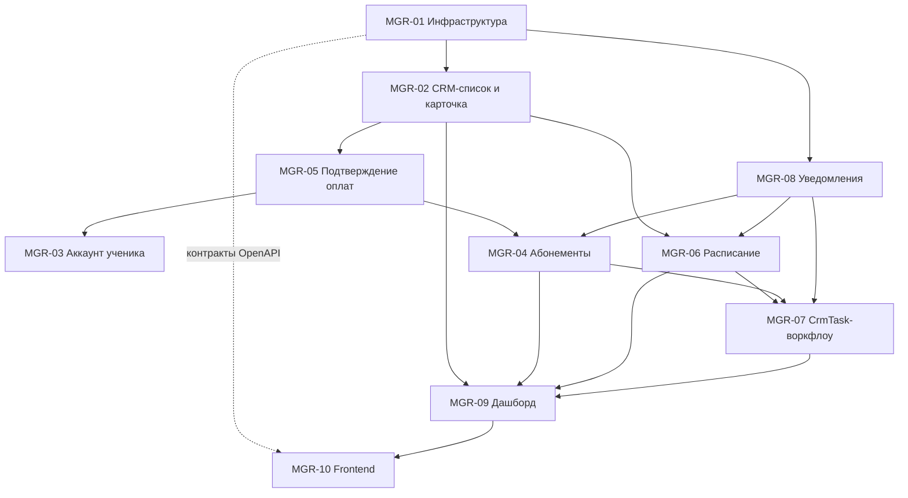

# Пакет инженерных задач (AI Coder Tasks) — Модуль 2: Кабинет менеджера

> Утверждённое уточнение от 31.10.2026: [деньги ученика, распределения и видимость семьи](online_academy_manager_finance_distribution_clarification_2026_10_31.md).
> Оно переопределяет несовместимые paymentId/balance/видимость/MGR-09 формулировки MGR-02/03/04/05/09 ниже:
> деньги ученика принадлежат его опубликованным распределениям; уникальность операции абонемента — по distributionId, не по целому paymentId.

> Для MGR-04 действуют также [решения владельца от 31.10.2026](online_academy_manager_subscription_decisions_2026_10_31.md): 30/60 дней, один активный абонемент на направление и готовое опубликованное распределение на входе.

> Для MGR-05 действует [уточнение валюты и финансовых ограничений от 31.10.2026](online_academy_manager_payment_decisions_2026_10_31.md): новые поступления только MDL; действующий Finance требует директора для подтверждения и утверждения распределения. Manager-confirm отправляет на одобрение. Исходные несовместимые формулировки про самостоятельную публикацию менеджером и consumed целого поступления ниже сохранены как история.

> Для MGR-06 действуют [решения владельца от 31.10.2026](online_academy_manager_schedule_decisions_2026_10_31.md): подготовка 60 минут по умолчанию; поздний перенос без потери права и третий перенос ученика требуют отдельного решения директора. Флаг менеджера с причиной создаёт запрос, а не разрешение. Исходное предположение ниже применяется с этим уточнением.

Платформа «Онлайн-Академия» · редакция 1.0 от 31.10.2026 · TypeScript strict, NestJS 12, Prisma 7.10.1, PostgreSQL 18, React/Vite, pnpm-монорепозиторий

> Для MGR-07 действует [решение владельца от 01.11.2026](online_academy_manager_task_decisions_2026_11_01.md): полная отмена исходного списания через директора восстанавливает занятия и аванс абонемента; частичный эффект — отдельное финансовое решение. До исполнения задача IN_PROGRESS, публикации нет. Несовместимое ожидание самостоятельного ACCEPT менеджером ниже сохранено как история. Директорские исключения переноса MGR-06 также сохраняются.

## 0. Исходные данные и сверка с репозиторием

> Для MGR-09 владелец [повторно подтвердил правило ожидающих оплат 01.11.2026](online_academy_manager_dashboard_decisions_2026_11_01.md): ожидание одобрения и подтверждённый остаток, ещё не покрытый опубликованными распределениями; только положительная сумма остатка, один receipt — один count, валюты отдельно. Семейные поступления со смешанным портфолио исключаются из агрегата. Ограничение только PENDING/AWAITING_APPROVAL ниже применяется с этим уточнением.

> Для MGR-08 действует [решение владельца от 01.11.2026](online_academy_manager_notification_decisions_2026_11_01.md): если нет аккаунта и email, системная операция завершается с уведомлением FAILED / NO_DELIVERY_CHANNEL; ручная отправка возвращает422. Общее требование422 ниже применяется с этим исключением.

Пакет составлен по ТЗ и публичному README репозитория EsinencuP/OnlineSchool. Локальный каталог D:\\OnlineSchool мне недоступен, исходники `apps/api/src/core/` и `schema.prisma` я не читал. Поэтому в каждой задаче есть шаг 0: сверить имена с реальным кодом до начала работы.

Что важно учесть по README:

- **Имена моделей.** README описывает Household, Student, AuthAccount, 69 моделей. В ТЗ — StudentProfile, CrmTask, PaymentRecord и т. д. В документе используются имена из ТЗ. Исполнитель обязан составить таблицу соответствия «имя в ТЗ → имя в schema.prisma» (результат шага 0 в MGR-01) и дальше работать с реальными именами.
- **Статус Модуля 1.** README описывает завершённую Фазу 0 (TASK-01…13), а ученический кабинет как отдельный этап не отражает. Если Модуль 1 не влит в main, зависимости задач MGR-06/07/08 от его контрактов уточняются на шаге 0.
- **Финансы.** В README финансовая модель — поступления и распределение платежей с подтверждением директора, неполная оплата и рассрочка требуют допуска руководителя (CON-01—11), менеджер ограничен назначенными учениками. Эти правила обязательны и для MGR-04/05.
- **Конвенции ядра** (приняты как обязательные): ESM с расширением `.js` в импортах; `Result<T, E>` из `@online-school/shared`; явный `throw` запрещён ESLint, кроме границы DomainError → AppException; DTO — классы с class-validator и Swagger; OpenAPI → `api-contracts` → Orval-клиент; бизнес-запись, Audit и Outbox — атомарно; SERIALIZABLE retry ≤ 3; идемпотентность критических команд.
- Ученик в CRM создаётся **без аккаунта**; аккаунт создаётся в MGR-03 после подтверждённой первой оплаты.
- Аутентификация в репозитории сессионная (PostgreSQL SessionStore). Под `JwtAuthGuard` из ТЗ понимается существующий guard аутентификации ядра; второй механизм не вводить.

## 1. Диаграмма зависимостей



Порядок поставки: **волна 0** — MGR-01; **волна 1** — MGR-02, MGR-08; **волна 2** — MGR-05; **волна 3** — MGR-03, MGR-04, MGR-06 (параллельно); **волна 4** — MGR-07; **волна 5** — MGR-09. MGR-10 стартует после волны 1 на сгенерированном OpenAPI-клиенте и растёт срезами вслед за бэкендом.

## 2. Таблица приоритетов

| ID | Задача | Приоритет | Сложность | Зависит от | Сценарии |
| --- | --- | --- | --- | --- | --- |
| MGR-01 | Инфраструктура ManagerModule | P0 | M | ядро | все |
| MGR-02 | CRM-список и карточка ученика | P0 | L | 01 | все |
| MGR-08 | Уведомления ученику | P0 | M | 01 | М-02, М-03, М-05 |
| MGR-05 | Подтверждение оплат | P0 | XL | 01, 02 | М-01, М-02, М-04 |
| MGR-03 | Аккаунт ученика после первой оплаты | P0 | L | 05 | М-01 |
| MGR-04 | Управление абонементами | P0 | XL | 05, 08 | М-02, М-05 |
| MGR-06 | Расписание и Google Meet | P0 | XL | 02, 08 | М-03 |
| MGR-07 | CrmTask-воркфлоу | P0 | L | 04, 06, 08 | М-03, М-04 |
| MGR-09 | Дашборд менеджера | P1 | M | 02, 04, 06, 07 | — |
| MGR-10 | Frontend кабинета | P0 | XL | 01…09 (срезами) | все |

## 3. Сквозные инварианты (обязательны для каждой задачи)

| № | Инвариант | Как проверяется |
| --- | --- | --- |
| INV-01 | **Изоляция портфолио.** Любой ученик-центричный запрос фильтруется по `managerId` через `ManagerScopeService`. Чужой и несуществующий ученик дают одинаковый ответ 404 `STUDENT_NOT_FOUND` (не 403, чтобы не раскрывать существование). | Тест на каждый эндпоинт: менеджер А → ученик менеджера Б |
| INV-02 | **Учебные данные только для чтения.** Менеджер не меняет статусы навыков, оценки ДЗ, образовательные отчёты. В `modules/manager` нет write-методов для SkillMap, Homework, EducationalReport. | Архитектурный тест: запрет записи через Prisma-делегаты этих моделей из `modules/manager` |
| INV-03 | **Финансы только через LedgerPublicationService.** Запрет прямой записи в LedgerEntry. Подтверждение директора и допуск руководителя при неполной оплате соблюдаются. | ESLint/архитектурный тест: в `modules/manager` нет `ledgerEntry.create/update/delete` |
| INV-04 | **Audit.** Каждая мутация пишет AuditLog в той же транзакции; при отказе audit бизнес-запись откатывается. Чтение карточки с контактами ученика пишется как `STUDENT_PII_VIEWED`. | Интеграционный тест отката |
| INV-05 | **Деньги.** В Prisma `Decimal(20,4)`, в DTO — строка десятичного вида с не более чем 4 знаками после точки, расчёты через decimal.js. `number`, `parseFloat`, `Number()` в денежных путях запрещены. | ESLint `no-restricted-syntax` + unit-тесты |
| INV-06 | **Deny-by-default.** Все роуты менеджера: аутентификация + `ManagerContextGuard`. STUDENT, TEACHER, ADMIN → 403; без сессии → 401. | Матрица ролей в e2e |
| INV-07 | **CSRF** на POST/PUT/PATCH/DELETE; GET без побочных эффектов. | e2e: мутация без токена → 403 |
| INV-08 | **Result.** Сервисные методы возвращают `Result<T, DomainError>`, без `throw`. Конвертация в HTTP — только на границе ядра. | ESLint |
| INV-09 | **Идемпотентность.** Мутации с денежным или доступовым эффектом требуют заголовок `Idempotency-Key` (UUID). Повтор с тем же телом → тот же ответ; другое тело → 409 `IDEMPOTENCY_KEY_REUSED`. | Тест конкурентного повтора |
| INV-10 | **Атомарность.** Бизнес-запись + Audit + Outbox — одна транзакция `core/transaction`. Деньги и абонементы: SERIALIZABLE, retry ≤ 3. | Тест отката при отказе outbox |
| INV-11 | **Уведомления только через Outbox → NotificationService**, не напрямую из транзакции. | Code review + тест |
| INV-12 | **PII и секреты.** Временный пароль показывается один раз, не попадает в логи, Audit, Outbox, кэш и OpenAPI-примеры. Телефоны и email в логах маскируются. | Тест на отсутствие секрета в audit/outbox |
| INV-13 | **Контракты.** DTO — классы с class-validator и Swagger; клиент генерируется Orval, руками не пишется. | `pnpm generate` без diff |
| INV-14 | **Пагинация.** Cursor-пагинация, `limit` ≤ 100, безлимитных списков нет. | Валидация DTO |
| INV-15 | **Время и валюта.** В БД UTC, в API ISO-8601. Таймзона школы и валюта берутся из конфигурации/ledger (по умолчанию Europe/Chisinau, MDL), не хардкодятся. | Unit-тесты на границах суток |
| INV-16 | **Матрица тестов на эндпоинт:** аноним, STUDENT, TEACHER, ADMIN, MANAGER-свой, MANAGER-чужой, плюс валидация и конфликт. | Чек-лист каждой задачи |

---

### MGR-01: Инфраструктура ManagerModule

**Приоритет:** P0 · **Сложность:** M · **Архитектурные ссылки:** INV-01, INV-06, INV-07, INV-08, INV-13, INV-16; `core/rbac`, `core/session`, `core/csrf`, `core/policy`, `core/errors`, `core/request-id`.

#### Контекст и бизнес-правила

0. **Шаг 0 (сверка).** Прочитать `core/*` и `schema.prisma`. Составить таблицу «ТЗ → код» (StudentProfile, CrmTask, Subscription, LedgerEntry, Manager-сущность и т. д.) и положить в `apps/api/src/modules/manager/MANAGER.md`. Проверить, есть ли `StudentProfile.managerId` и профиль менеджера; если нет — миграция ниже.
1. Структура: `apps/api/src/modules/manager/{manager.module.ts, context/, guards/, scope/, me/, errors/, dto/}`. Модуль импортирует ядро и не экспортирует внутренности.
2. `ManagerContextGuard` выполняется после guard аутентификации ядра: проверяет роль MANAGER, находит активный профиль менеджера по `accountId`, кладёт `ManagerContext` в request. Роль ADMIN на manager-роутах → 403 (имперсонация вне объёма).
3. `ManagerScopeService` — единственная точка проверки принадлежности ученика портфолио (INV-01). Все последующие модули используют только её.
4. Составной декоратор `@ManagerRoute()` навешивает guard'ы, `@Roles('MANAGER')`, `@ApiTags('manager')`, `@ApiCookieAuth()` и стандартные ответы 401/403.
5. `GET /api/v1/manager/me` — профиль, размер портфолио, таймзона, список возможностей (capabilities).

#### Контракты

```prisma
// только если в схеме нет аналога (см. шаг 0)
model ManagerProfile {
  id          String   @id @default(uuid()) @db.Uuid
  accountId   String   @unique @db.Uuid
  displayName String
  isActive    Boolean  @default(true)
  createdAt   DateTime @default(now())
  updatedAt   DateTime @updatedAt
  students    StudentProfile[]
}
// StudentProfile: managerId String? @db.Uuid + @@index([managerId])
```

```ts
// context/manager-context.ts
export interface ManagerContext {
  readonly accountId: string;
  readonly managerId: string;
  readonly sessionId: string;
  readonly requestId: string;
}

export type ManagerCapability =
  | 'STUDENTS_VIEW' | 'ACCOUNTS_CREATE' | 'PAYMENTS_CONFIRM'
  | 'SUBSCRIPTIONS_MANAGE' | 'SCHEDULE_MANAGE' | 'TASKS_PROCESS' | 'NOTIFICATIONS_SEND';

// errors/manager-errors.ts
export const MANAGER_ERROR_CODES = [
  'MANAGER_PROFILE_NOT_FOUND', 'MANAGER_INACTIVE', 'FORBIDDEN_ROLE',
  'STUDENT_NOT_FOUND', 'IDEMPOTENCY_KEY_REQUIRED', 'IDEMPOTENCY_KEY_REUSED',
] as const;
export type ManagerErrorCode = (typeof MANAGER_ERROR_CODES)[number];

// scope/manager-scope.service.ts
export interface ManagerScopeService {
  resolveContext(principal: SessionPrincipal): Promise<Result<ManagerContext, DomainError>>;
  assertStudentInPortfolio(ctx: ManagerContext, studentId: string): Promise<Result<void, DomainError>>;
  portfolioWhere(ctx: ManagerContext): Prisma.StudentProfileWhereInput; // { managerId: ctx.managerId }
}

// dto/manager-me.response.dto.ts
export class ManagerMeResponseDto {
  @ApiProperty({ format: 'uuid' }) managerId!: string;
  @ApiProperty() displayName!: string;
  @ApiProperty({ enum: ['MANAGER'] }) role!: 'MANAGER';
  @ApiProperty() portfolioSize!: number;
  @ApiProperty({ example: 'Europe/Chisinau' }) timezone!: string;
  @ApiProperty({ type: [String] }) capabilities!: ManagerCapability[];
}
```

Эндпоинт: `GET /api/v1/manager/me` → `200 ManagerMeResponseDto`; ошибки 401, 403 (`FORBIDDEN_ROLE`, `MANAGER_INACTIVE`).

#### Безопасность и обработка исключений

- Нет сессии → 401; роли STUDENT, TEACHER, ADMIN → 403 `FORBIDDEN_ROLE`; профиль деактивирован → 403 `MANAGER_INACTIVE`; профиля нет → 403 `MANAGER_PROFILE_NOT_FOUND`. Тела ошибок не раскрывают детали.
- `assertStudentInPortfolio` для чужого и несуществующего ученика возвращает один и тот же `STUDENT_NOT_FOUND` и работает за сопоставимое время.
- `managerId` берётся только из контекста, никогда из тела, query или path.
- Ошибки БД преобразуются в Result на границе data access, без `throw`.

#### Критерии готовности

- [ ] Шаг 0 выполнен, `MANAGER.md` с таблицей соответствия имён закоммичен
- [ ] Миграция добавлена только при отсутствии аналога, `prisma validate` и `migrate dev` проходят на PostgreSQL 18
- [ ] `ManagerContextGuard`, `ManagerScopeService`, `@ManagerRoute()` реализованы, импорты с `.js`, `tsc -b` без ошибок
- [ ] `GET /manager/me` работает, документирован в OpenAPI, `pnpm generate` обновил `api-contracts` и Orval-клиент
- [ ] Матрица INV-16 для `/me`: аноним 401, STUDENT/TEACHER/ADMIN 403, неактивный менеджер 403, активный 200
- [ ] Архитектурный тест: каждый контроллер в `modules/manager` помечен `@ManagerRoute()`
- [ ] Архитектурные тесты INV-02 и INV-03 добавлены (падают при записи в запрещённые модели)
- [ ] ESLint-правила INV-05 и INV-08 включены для `modules/manager`
- [ ] Тест `assertStudentInPortfolio`: свой → ok, чужой и несуществующий → идентичная ошибка
- [ ] В логах и ответах нет данных чужого портфолио

---

### MGR-02: CRM-список учеников и карточка ученика

**Приоритет:** P0 · **Сложность:** L · **Архитектурные ссылки:** INV-01, INV-02, INV-04, INV-05, INV-09, INV-12, INV-14; зависит от MGR-01.

#### Контекст и бизнес-правила

1. Менеджер видит список только своего портфолио (`portfolioWhere(ctx)`), любые фильтры накладываются поверх него, а не вместо.
2. Карточка ученика объединяет: профиль и контакты, активный абонемент и баланс, ближайшие 5 уроков, открытые CrmTask, последние 10 платежей и **учебный срез только для чтения**. Учебный срез содержит агрегаты: число освоенных навыков из общего числа, счётчики ДЗ «сдано / не сдано / просрочено», дату и статус последнего образовательного отчёта. Тексты оценок, комментарии преподавателя и содержимое отчётов менеджеру не отдаются (INV-02).
3. Менеджер может создать запись ученика **без аккаунта** (лид) — `managerId` ставится из контекста — и редактировать контакты и внутреннюю заметку. Учебные поля не редактируются.
4. Открытие карточки с контактами пишет Audit `STUDENT_PII_VIEWED`; список контактов не раскрывает (только маскированный телефон).
5. Поиск — по ФИО, телефону и email, минимум 2 символа, спецсимволы `%` и `_` экранируются. Сортировка стабильная: пользовательский ключ + `id`. Пагинация cursor-based, cursor — непрозрачная строка.
6. Список строится не более чем 4 запросами к БД независимо от размера страницы (без N+1).
7. Обновление контактов — оптимистичная блокировка по полю `version`.

#### Контракты

```ts
// dto/student-crm.dto.ts
export enum StudentCrmStatus {
  LEAD = 'LEAD', ACTIVE = 'ACTIVE', FROZEN = 'FROZEN', EXPIRED = 'EXPIRED', ARCHIVED = 'ARCHIVED',
}

export class ListStudentsQueryDto {
  @IsOptional() @IsString() @MinLength(2) @MaxLength(100) search?: string;
  @IsOptional() @IsEnum(StudentCrmStatus) status?: StudentCrmStatus;
  @IsOptional() @Transform(({ value }) => value === 'true') @IsBoolean() hasOverdueTask?: boolean;
  @IsOptional() @Transform(({ value }) => value === 'true') @IsBoolean() subscriptionExpiringSoon?: boolean;
  @IsOptional() @IsIn(['name', 'nextLesson', 'subscriptionEnd']) sort?: 'name' | 'nextLesson' | 'subscriptionEnd';
  @IsOptional() @IsString() @MaxLength(200) cursor?: string;
  @IsOptional() @Type(() => Number) @IsInt() @Min(1) @Max(100) limit: number = 25;
}

export class Page<T> { items!: T[]; nextCursor!: string | null; }

export class StudentListItemDto {
  studentId!: string;
  fullName!: string;
  status!: StudentCrmStatus;
  hasAccount!: boolean;
  maskedPhone!: string | null;
  activeSubscription!: { id: string; endsAt: string; remainingLessons: number } | null;
  balance!: string;                 // Decimal как строка
  nextLessonAt!: string | null;     // ISO-8601 UTC
  openTasksCount!: number;
  overdueTasksCount!: number;
}

export class StudentCardDto {
  studentId!: string; version!: number;
  fullName!: string; status!: StudentCrmStatus; hasAccount!: boolean;
  contacts!: { phone: string | null; email: string | null; guardianName: string | null; guardianPhone: string | null };
  managerNote!: string | null;
  subscription!: SubscriptionSummaryDto | null;
  balance!: string;
  upcomingLessons!: LessonBriefDto[];          // до 5
  openTasks!: CrmTaskBriefDto[];
  recentPayments!: PaymentBriefDto[];          // до 10
  learning!: { skillsMastered: number; skillsTotal: number; homeworkSubmitted: number; homeworkPending: number;
               homeworkOverdue: number; lastReportAt: string | null; lastReportStatus: string | null };
}

export class CreateStudentDto {
  @IsString() @MinLength(2) @MaxLength(120) fullName!: string;
  @IsOptional() @IsString() @Matches(/^\+?[0-9 ()-]{6,20}$/) phone?: string;
  @IsOptional() @IsEmail() @MaxLength(254) email?: string;
  @IsOptional() @IsString() @MaxLength(120) guardianName?: string;
  @IsOptional() @IsString() @MaxLength(2000) managerNote?: string;
}

export class UpdateStudentContactsDto extends PartialType(OmitType(CreateStudentDto, ['fullName'] as const)) {
  @IsInt() @Min(1) version!: number;
}

export interface ManagerStudentsService {
  list(ctx: ManagerContext, q: ListStudentsQueryDto): Promise<Result<Page<StudentListItemDto>, DomainError>>;
  getCard(ctx: ManagerContext, studentId: string): Promise<Result<StudentCardDto, DomainError>>;
  create(ctx: ManagerContext, dto: CreateStudentDto, idempotencyKey: string): Promise<Result<StudentCardDto, DomainError>>;
  updateContacts(ctx: ManagerContext, studentId: string, dto: UpdateStudentContactsDto): Promise<Result<StudentCardDto, DomainError>>;
}
```

Эндпоинты:

| Метод | Путь | Успех | Ошибки |
| --- | --- | --- | --- |
| GET | `/api/v1/manager/students` | 200 `Page<StudentListItemDto>` | 401, 403, 422 |
| GET | `/api/v1/manager/students/:studentId` | 200 `StudentCardDto` | 401, 403, 404 |
| POST | `/api/v1/manager/students` (+`Idempotency-Key`) | 201 `StudentCardDto` | 401, 403, 409, 422 |
| PATCH | `/api/v1/manager/students/:studentId/contacts` | 200 `StudentCardDto` | 401, 403, 404, 409 `VERSION_CONFLICT`, 422 |

Prisma: `Student/StudentProfile` — добавить `version Int @default(1)`, `managerNote String?`; индексы `@@index([managerId, status])` и `@@index([managerId, createdAt, id])`; для поиска — индекс `pg_trgm` по `lower(fullName)` (если расширение разрешено в окружении).

#### Безопасность и обработка исключений

- Любой `studentId` проходит `assertStudentInPortfolio`; чужой и несуществующий → 404 `STUDENT_NOT_FOUND`.
- Поля `managerId`, `status`, `hasAccount` из тела запроса игнорируются/отклоняются (`forbidNonWhitelisted`).
- Audit: `STUDENT_CREATED`, `STUDENT_CONTACTS_UPDATED` (в payload — список изменённых полей и маскированные значения), `STUDENT_PII_VIEWED`. Все записи — в транзакции мутации (INV-04).
- Заметка и контакты хранятся как PII; в логи не попадают.
- Конкурентное обновление → 409 `VERSION_CONFLICT` без частичной записи.

#### Критерии готовности

- [ ] Шаг 0: сверены имена моделей и полей (`version`, `managerNote`), миграция добавлена, `prisma validate` проходит
- [ ] Список возвращает только портфолио, фильтры `status`, `hasOverdueTask`, `subscriptionExpiringSoon`, `search` работают совместно
- [ ] Cursor-пагинация стабильна при одинаковых значениях сортировки (тест с дубликатами)
- [ ] Список строится ≤ 4 запросами (тест на счётчик запросов)
- [ ] Карточка не содержит оценок ДЗ, комментариев преподавателя и текстов отчётов (контрактный тест на отсутствие полей)
- [ ] Деньги в ответах — строки, тест на отсутствие `number`
- [ ] `STUDENT_PII_VIEWED` пишется при каждом открытии карточки
- [ ] Создание ученика идемпотентно (повтор с тем же ключом → тот же ответ, другой body → 409)
- [ ] Обновление контактов: конфликт версий → 409, успешное → версия +1, audit записан
- [ ] Чужой ученик → 404 на всех четырёх эндпоинтах; роли STUDENT/TEACHER/ADMIN → 403; мутации без CSRF → 403
- [ ] Поиск со спецсимволами `%`, `_` не ломает запрос и не возвращает лишнего
- [ ] OpenAPI и Orval-клиент перегенерированы без ручных правок

---

### MGR-03: Создание аккаунта ученика после первой оплаты (СЦ-М-01)

**Приоритет:** P0 · **Сложность:** L · **Архитектурные ссылки:** INV-01, INV-03, INV-04, INV-09, INV-10, INV-11, INV-12; зависит от MGR-02, MGR-05; использует Identity-модуль (AuthAccount).

#### Контекст и бизнес-правила

1. Аккаунт создаётся только для ученика из портфолио, у которого ещё нет аккаунта и есть **подтверждённая и опубликованная в Ledger первая оплата** (MGR-05). Если оплата неполная или в рассрочку, дополнительно требуется допуск руководителя (CON-01–11); иначе 409 `FIRST_PAYMENT_NOT_CONFIRMED`.
2. Аккаунт создаётся существующим сервисом Identity (метод создания аккаунта ученика, возвращающий Result). Свой механизм хеширования в Manager-модуль не добавляется.
3. Временный пароль: генерируется на сервере из CSPRNG, 16 символов без неоднозначных (`0O1lI`), хешируется тем же алгоритмом, что и обычные пароли. Срок действия — 72 часа, флаг `mustChangePassword = true`. До смены пароля любой запрос ученика, кроме смены пароля и выхода, → 403 `PASSWORD_CHANGE_REQUIRED` (если в Identity этого ещё нет, расширение входит в задачу).
4. Пароль возвращается **один раз** в теле ответа с `Cache-Control: no-store`. Он не пишется в Audit, Outbox, логи, кэш идемпотентности и OpenAPI-примеры (INV-12).
5. Повтор запроса с тем же `Idempotency-Key` возвращает 200 с `temporaryPassword: null` и `passwordAlreadyIssued: true`; новый пароль выдаётся через `reset-password`.
6. Уведомление ученику (через Outbox → MGR-08) содержит логин и инструкцию, **без пароля**. Пароль менеджер передаёт по согласованному каналу.
7. Не более одного активного аккаунта на ученика: гарантия — частичный UNIQUE в БД; гонка двух запросов → один успех, второй 409 `ACCOUNT_ALREADY_EXISTS`.
8. Сброс пароля: новый временный пароль, отзыв всех сессий ученика, не более 3 раз в сутки на ученика.

#### Контракты

```ts
// dto/student-account.dto.ts
export class CreateStudentAccountDto {
  @IsEmail() @MaxLength(254) loginEmail!: string;
}

export class StudentAccountIssuedDto {
  accountId!: string;
  loginEmail!: string;
  temporaryPassword!: string | null;      // только в первом ответе
  temporaryPasswordExpiresAt!: string;    // ISO-8601
  passwordAlreadyIssued!: boolean;
}

export interface ManagerAccountsService {
  createAccount(ctx: ManagerContext, studentId: string, dto: CreateStudentAccountDto,
    idempotencyKey: string): Promise<Result<StudentAccountIssuedDto, DomainError>>;
  resetPassword(ctx: ManagerContext, studentId: string,
    idempotencyKey: string): Promise<Result<StudentAccountIssuedDto, DomainError>>;
}

export type AccountErrorCode =
  | 'FIRST_PAYMENT_NOT_CONFIRMED' | 'ACCOUNT_ALREADY_EXISTS' | 'EMAIL_ALREADY_USED'
  | 'ACCOUNT_NOT_FOUND' | 'RESET_LIMIT_EXCEEDED' | 'PASSWORD_CHANGE_REQUIRED';
```

Эндпоинты: `POST /api/v1/manager/students/:studentId/account` → 201 `StudentAccountIssuedDto`; `POST /api/v1/manager/students/:studentId/account/reset-password` → 200 `StudentAccountIssuedDto`. Оба требуют CSRF и `Idempotency-Key`.

Prisma: `AuthAccount` — `mustChangePassword Boolean @default(false)`, `passwordExpiresAt DateTime?` (если полей нет); частичный UNIQUE на активный аккаунт ученика уже есть в схеме — проверить, не дублировать.

#### Алгоритм (одна транзакция SERIALIZABLE, retry ≤ 3)

1. `SELECT ... FOR UPDATE` строки ученика, затем `assertStudentInPortfolio`.
2. Проверка отсутствия аккаунта и наличия подтверждённой первой оплаты (чтение статуса платежа и его публикации в Ledger — только чтение).
3. Создание аккаунта через Identity, привязка к ученику.
4. Audit `STUDENT_ACCOUNT_CREATED` (studentId, accountId, маскированный email; **без пароля**).
5. Outbox `STUDENT_ACCOUNT_CREATED` → MGR-08.
6. Сохранение ответа идемпотентности **без** пароля.

#### Безопасность и обработка исключений

- Чужой ученик → 404; `EMAIL_ALREADY_USED` не раскрывает, кому принадлежит email.
- Отказ Audit или Outbox откатывает создание аккаунта целиком.
- Сброс пароля отзывает сессии и ключи доступа ученика до выдачи нового пароля, в той же транзакции.
- Rate limit на создание и сброс (по менеджеру и по ученику).

#### Критерии готовности

- [ ] Приёмочный тест СЦ-М-01 (e2e): лид → оплата подтверждена и опубликована (MGR-05) → создание аккаунта → ученик входит с временным паролем → получает `PASSWORD_CHANGE_REQUIRED` → меняет пароль → открывает кабинет ученика
- [ ] Без подтверждённой первой оплаты → 409 `FIRST_PAYMENT_NOT_CONFIRMED`; неполная оплата без допуска руководителя → тот же код
- [ ] Гонка двух одновременных запросов: ровно один аккаунт в БД
- [ ] Повтор с тем же ключом → 200 без пароля; другой body → 409 `IDEMPOTENCY_KEY_REUSED`
- [ ] Пароль отсутствует в Audit, Outbox, логах и таблице идемпотентности (тест сканирует записи после выполнения)
- [ ] Ответ содержит `Cache-Control: no-store`
- [ ] Сброс пароля: сессии ученика отозваны, 4-й сброс за сутки → 429/409 `RESET_LIMIT_EXCEEDED`
- [ ] Откат при принудительном отказе Audit и при отказе Outbox оставляет БД без аккаунта
- [ ] Чужой ученик → 404; STUDENT/TEACHER/ADMIN → 403; без CSRF → 403
- [ ] Нет прямой записи в `LedgerEntry` (архитектурный тест INV-03)
- [ ] OpenAPI и клиент перегенерированы

---

### MGR-04: Управление абонементами (СЦ-М-02, СЦ-М-05)

**Приоритет:** P0 · **Сложность:** XL · **Архитектурные ссылки:** INV-01, INV-03, INV-04, INV-05, INV-09, INV-10, INV-11, INV-15; зависит от MGR-05, MGR-08; использует `ManagerFinanceFacade` из MGR-05.

#### Контекст и бизнес-правила

1. Операции: создание, продление, заморозка, разморозка. Статусы и допустимые переходы:

| Из \\ В | ACTIVE | FROZEN | EXPIRED | CANCELLED |
| --- | --- | --- | --- | --- |
| (новый) | создание по оплате | — | — | — |
| ACTIVE | продление | заморозка | по сроку (worker) | вне объёма менеджера |
| FROZEN | разморозка | — | — | — |
| EXPIRED | продление (новый период) | — | — | — |

Любой другой переход → 409 `INVALID_STATE_TRANSITION`.

2. **Создание и продление требуют `paymentId`** подтверждённой оплаты (MGR-05, статус `CONFIRMED`) из портфолио того же ученика. Один платёж можно использовать ровно один раз: UNIQUE на `paymentId` в таблице операций абонемента (409 `PAYMENT_ALREADY_USED`).
3. Изменение баланса (занятия и деньги) выполняется **только** публикацией через `ManagerFinanceFacade` → `LedgerPublicationService` (INV-03). Модель абонемента хранит статус и сроки; остаток занятий берётся из существующей модели оплаченных прав — сверить на шаге 0.
4. Продление: новый `endsAt = max(now, текущий endsAt) + срок тарифа`; к остатку добавляются занятия тарифа. Не более одного активного абонемента на ученика (`ACTIVE_SUBSCRIPTION_EXISTS`).
5. Заморозка: даты `startsOn`/`endsOn` (локальные даты школы), причина из справочника. Срок абонемента на время заморозки не идёт; при разморозке `endsAt` сдвигается на **фактическое** число дней заморозки. Лимиты — конфигурация `SUBSCRIPTION_MAX_FREEZE_DAYS` (по умолчанию 30) и `SUBSCRIPTION_MAX_FREEZE_TOTAL_DAYS` (по умолчанию 60). **Значения по умолчанию — предположение, их нужно подтвердить у владельца продукта.**
6. Если в период заморозки есть запланированные уроки, заморозка возвращает 409 `FREEZE_HAS_LESSONS` со списком `lessonIds`. При `cancelConflictingLessons = true` уроки отменяются без списания через порт `LessonCancellationPort` (в MGR-04 — интерфейс и заглушка, реализация подключается в MGR-06).
7. Worker переводит просроченные ACTIVE в EXPIRED идемпотентно (повторный запуск ничего не меняет) и ставит в Outbox событие «абонемент истёк». Дубли внутренних CRM-задач, которые worker уже создаёт при истечении допуска, не создаются.
8. Каждая операция ставит в Outbox уведомление ученику (MGR-08): продление — СЦ-М-02, заморозка и разморозка — СЦ-М-05.

#### Контракты

```ts
export enum SubscriptionStatus { ACTIVE = 'ACTIVE', FROZEN = 'FROZEN', EXPIRED = 'EXPIRED', CANCELLED = 'CANCELLED' }
export enum FreezeReason { ILLNESS = 'ILLNESS', TRAVEL = 'TRAVEL', FAMILY = 'FAMILY', OTHER = 'OTHER' }

export class CreateSubscriptionDto {
  @IsUUID() planId!: string;
  @IsUUID() paymentId!: string;
  @IsOptional() @IsISO8601() startsAt?: string;
}
export class RenewSubscriptionDto {
  @IsUUID() paymentId!: string;
  @IsOptional() @IsUUID() planId?: string;   // по умолчанию — текущий тариф
}
export class FreezeSubscriptionDto {
  @IsDateString({ strict: true }) startsOn!: string;   // YYYY-MM-DD
  @IsDateString({ strict: true }) endsOn!: string;
  @IsEnum(FreezeReason) reason!: FreezeReason;
  @IsOptional() @IsString() @MaxLength(500) comment?: string;
  @IsOptional() @IsBoolean() cancelConflictingLessons?: boolean;
}

export class SubscriptionDto {
  id!: string; studentId!: string; planId!: string; status!: SubscriptionStatus;
  startsAt!: string; endsAt!: string; frozenUntil!: string | null;
  totalLessons!: number; remainingLessons!: number; freezeDaysUsed!: number;
  price!: string;                                   // Decimal как строка
}

export interface ManagerSubscriptionsService {
  list(ctx: ManagerContext, studentId: string): Promise<Result<SubscriptionDto[], DomainError>>;
  create(ctx: ManagerContext, studentId: string, dto: CreateSubscriptionDto, key: string): Promise<Result<SubscriptionDto, DomainError>>;
  renew(ctx: ManagerContext, id: string, dto: RenewSubscriptionDto, key: string): Promise<Result<SubscriptionDto, DomainError>>;
  freeze(ctx: ManagerContext, id: string, dto: FreezeSubscriptionDto, key: string): Promise<Result<SubscriptionDto, DomainError>>;
  unfreeze(ctx: ManagerContext, id: string, key: string): Promise<Result<SubscriptionDto, DomainError>>;
}

export interface LessonCancellationPort {
  cancelWithoutCharge(ctx: ManagerContext, lessonIds: string[], reason: string): Promise<Result<void, DomainError>>;
}

export type SubscriptionErrorCode =
  | 'SUBSCRIPTION_NOT_FOUND' | 'PLAN_NOT_FOUND' | 'PAYMENT_NOT_CONFIRMED' | 'PAYMENT_ALREADY_USED'
  | 'INVALID_STATE_TRANSITION' | 'ACTIVE_SUBSCRIPTION_EXISTS' | 'FREEZE_LIMIT_EXCEEDED' | 'FREEZE_HAS_LESSONS';
```

| Метод | Путь | Успех |
| --- | --- | --- |
| GET | `/api/v1/manager/students/:studentId/subscriptions` | 200 `SubscriptionDto[]` |
| POST | `/api/v1/manager/students/:studentId/subscriptions` | 201 `SubscriptionDto` |
| POST | `/api/v1/manager/subscriptions/:id/renew` | 200 `SubscriptionDto` |
| POST | `/api/v1/manager/subscriptions/:id/freeze` | 200 `SubscriptionDto` |
| POST | `/api/v1/manager/subscriptions/:id/unfreeze` | 200 `SubscriptionDto` |

Все мутации требуют CSRF и `Idempotency-Key`. Для путей с `:id` абонемент разрешается в `studentId`, затем `assertStudentInPortfolio`; чужой → 404 `SUBSCRIPTION_NOT_FOUND`.

Prisma (уточнить на шаге 0): `SubscriptionOperation { id, subscriptionId, type (CREATE | RENEW | FREEZE | UNFREEZE), paymentId? @unique, ledgerPublicationId?, payload Json, createdByManagerId, createdAt }`; `SubscriptionFreeze { id, subscriptionId, startsOn, endsOn, actualEndsOn?, reason, comment? }`.

#### Безопасность и обработка исключений

- Каждая операция: `SELECT ... FOR UPDATE` по абонементу, SERIALIZABLE, retry ≤ 3, Audit (`SUBSCRIPTION_CREATED`, `_RENEWED`, `_FROZEN`, `_UNFROZEN`) и Outbox в той же транзакции.
- Ошибка публикации в Ledger откатывает всю операцию; частичных состояний нет.
- Тело запроса не содержит сумм: цена и занятия берутся из тарифа и платежа на сервере.
- Расчёты дат — в таймзоне школы, хранение в UTC; граница полуночи покрыта тестами.

#### Критерии готовности

- [ ] Приёмочный тест СЦ-М-02: подтверждённая оплата → продление → остаток и срок обновлены → событие уведомления в Outbox → ученик видит новый баланс
- [ ] Приёмочный тест СЦ-М-05: заморозка → статус FROZEN, уведомление; разморозка → `endsAt` сдвинут на фактические дни, уведомление
- [ ] Повторное использование `paymentId` → 409 `PAYMENT_ALREADY_USED`; неподтверждённый платёж → 409 `PAYMENT_NOT_CONFIRMED`; платёж другого ученика → 404
- [ ] Матрица переходов покрыта unit-тестами, недопустимые → 409
- [ ] Лимиты заморозки проверяются, значения берутся из конфигурации
- [ ] `FREEZE_HAS_LESSONS` возвращает `lessonIds`; при `cancelConflictingLessons` вызывается порт
- [ ] Гонка двух продлений одним платежом: один успех
- [ ] Откат при отказе Ledger, Audit и Outbox
- [ ] Worker истечения идемпотентен (двойной прогон без изменений)
- [ ] Нет прямой записи в `LedgerEntry` и в модели учебных данных (INV-02, INV-03)
- [ ] Деньги — строки, `Decimal` в БД
- [ ] OpenAPI и клиент перегенерированы

---

### MGR-05: Подтверждение оплат (PaymentRecord → LedgerPublicationService)

**Приоритет:** P0 · **Сложность:** XL · **Архитектурные ссылки:** INV-01, INV-03, INV-04, INV-05, INV-09, INV-10; зависит от MGR-01, MGR-02; модуль Finance (README: поступления, распределение, подтверждение директора).

#### Контекст и бизнес-правила

1. Менеджер регистрирует оплату ученика из портфолио (`PaymentRecord`, статус `PENDING`) и затем подтверждает её. Подтверждение публикует сбалансированную проводку через `LedgerPublicationService`.
2. **Единственная точка финансовой записи менеджера — `ManagerFinanceFacade`** (`modules/manager/finance/`). Остальные задачи (MGR-03/04/07) вызывают только её. Методы: `publishPayment`, `publishAdjustment` (для MGR-07), `publishDeduction` (если понадобится). Фасад не пишет в `LedgerEntry` сам.
3. Правила допуска берутся из существующего Finance-модуля и решений CON-01–11: неполная оплата, рассрочка и случаи, требующие подтверждения руководителя или директора, переводят платёж в `AWAITING_APPROVAL`. Менеджер не публикует такой платёж; решение принимает роль, определённая Finance, и публикация происходит там. Пороги и перечень случаев в этой задаче **не изобретаются** — берутся из Finance-политики.
4. Штатная политика публикации Ledger по README запрещающая до реализации ACL. Задача добавляет в `core/policy` правило «роль MANAGER может публиковать оплату только по ученику своего портфолио» и тесты на него.
5. Подтверждённая оплата неизменяема (409 `PAYMENT_IMMUTABLE`). Исправление ошибок — корректировкой через Finance, не удалением и не правкой.
6. Защита от дублей: UNIQUE по паре (`method`, `externalRef`) при заданном `externalRef`; повторная регистрация → 409 `PAYMENT_DUPLICATE`.
7. Платёж содержит назначение (`purpose`): `FIRST_PAYMENT`, `RENEWAL`, `OTHER`; использование платежа в MGR-03/04 помечает его потреблённым (одна операция на платёж).

#### Контракты

```ts
export enum PaymentMethod { CASH = 'CASH', CARD = 'CARD', BANK_TRANSFER = 'BANK_TRANSFER', ONLINE = 'ONLINE' }
export enum PaymentPurpose { FIRST_PAYMENT = 'FIRST_PAYMENT', RENEWAL = 'RENEWAL', OTHER = 'OTHER' }
export enum PaymentStatus { PENDING = 'PENDING', AWAITING_APPROVAL = 'AWAITING_APPROVAL', CONFIRMED = 'CONFIRMED', REJECTED = 'REJECTED' }

// validators/is-money-string.ts: положительная десятичная строка, до 12 цифр целой части, до 4 после точки
export const MONEY_REGEX = /^(0|[1-9][0-9]{0,11})(\.[0-9]{1,4})?$/;
export const IsMoneyString = (): PropertyDecorator => Matches(MONEY_REGEX, { message: 'INVALID_MONEY' });

export class CreatePaymentDto {
  @IsMoneyString() amount!: string;
  @IsIn(SUPPORTED_CURRENCIES) currency!: Currency;       // значения из Finance, по умолчанию MDL
  @IsEnum(PaymentMethod) method!: PaymentMethod;
  @IsEnum(PaymentPurpose) purpose!: PaymentPurpose;
  @IsISO8601() receivedAt!: string;
  @IsOptional() @IsString() @MaxLength(100) externalRef?: string;
  @IsOptional() @IsString() @MaxLength(500) note?: string;
}
export class RejectPaymentDto { @IsString() @MinLength(3) @MaxLength(500) reason!: string; }

export class PaymentDto {
  id!: string; studentId!: string; amount!: string; currency!: Currency;
  method!: PaymentMethod; purpose!: PaymentPurpose; status!: PaymentStatus;
  receivedAt!: string; externalRef!: string | null; consumed!: boolean;
  ledgerPublicationId!: string | null; createdAt!: string;
}

export interface ManagerFinanceFacade {
  publishPayment(ctx: ManagerContext, payment: PaymentRecordView, tx: TransactionContext):
    Promise<Result<{ ledgerPublicationId: string }, DomainError>>;
  publishAdjustment(ctx: ManagerContext, cmd: ManagerAdjustmentCommand, tx: TransactionContext):
    Promise<Result<{ ledgerPublicationId: string }, DomainError>>;
}

export interface ManagerPaymentsService {
  create(ctx: ManagerContext, studentId: string, dto: CreatePaymentDto, key: string): Promise<Result<PaymentDto, DomainError>>;
  confirm(ctx: ManagerContext, paymentId: string, key: string): Promise<Result<PaymentDto, DomainError>>;
  reject(ctx: ManagerContext, paymentId: string, dto: RejectPaymentDto): Promise<Result<PaymentDto, DomainError>>;
  list(ctx: ManagerContext, studentId: string, q: ListPaymentsQueryDto): Promise<Result<Page<PaymentDto>, DomainError>>;
  get(ctx: ManagerContext, paymentId: string): Promise<Result<PaymentDto, DomainError>>;
}

export type PaymentErrorCode =
  | 'PAYMENT_NOT_FOUND' | 'PAYMENT_DUPLICATE' | 'PAYMENT_IMMUTABLE' | 'PAYMENT_NOT_PENDING'
  | 'CURRENCY_NOT_SUPPORTED' | 'LEDGER_PUBLICATION_FAILED' | 'APPROVAL_REQUIRED';
```

| Метод | Путь | Успех |
| --- | --- | --- |
| POST | `/api/v1/manager/students/:studentId/payments` | 201 `PaymentDto` (PENDING) |
| GET | `/api/v1/manager/students/:studentId/payments` | 200 `Page<PaymentDto>` |
| GET | `/api/v1/manager/payments/:paymentId` | 200 `PaymentDto` |
| POST | `/api/v1/manager/payments/:paymentId/confirm` | 200 `PaymentDto` (CONFIRMED или AWAITING\_APPROVAL) |
| POST | `/api/v1/manager/payments/:paymentId/reject` | 200 `PaymentDto` (REJECTED) |

Prisma (уточнить имена на шаге 0): `PaymentRecord { id, studentId, managerId, amount Decimal(20,4), currency, method, purpose, status, receivedAt, externalRef?, note?, consumedAt?, ledgerPublicationId?, idempotencyKey, createdAt }` с `@@unique([method, externalRef])` и индексом `@@index([studentId, createdAt])`.

#### Алгоритм подтверждения (SERIALIZABLE, retry ≤ 3)

1. `SELECT ... FOR UPDATE` платежа, проверка портфолио, статус `PENDING`.
2. Вычисление допуска по Finance-политике: нужен ли `AWAITING_APPROVAL`. Если да — смена статуса, Audit `PAYMENT_SENT_FOR_APPROVAL`, конец.
3. `ManagerFinanceFacade.publishPayment` → `LedgerPublicationService` (дебет/кредит сбалансированы по каждой валюте проверяет сам Ledger).
4. Статус `CONFIRMED`, `ledgerPublicationId`, Audit `PAYMENT_CONFIRMED`, Outbox `PAYMENT_CONFIRMED`.
5. Любая ошибка на шагах 3–4 откатывает транзакцию; наружу — маппинг в `LEDGER_PUBLICATION_FAILED` без внутренних деталей.

#### Безопасность и обработка исключений

- Сумма и валюта задаются только при создании; при подтверждении тело запроса пустое.
- Идемпотентность: повтор `confirm` с тем же ключом возвращает тот же результат, без второй публикации.
- Reject возможен только из `PENDING`; Audit `PAYMENT_REJECTED` с причиной.
- Чужой платёж → 404 `PAYMENT_NOT_FOUND`.

#### Критерии готовности

- [ ] Денежные тесты: `0.1 + 0.2`, 4 знака после точки, 12 цифр целой части, отрицательные, ноль, пустые и экспоненциальные записи отклоняются; в путях платежей нет `number`/`parseFloat`
- [ ] Подтверждение публикует ровно одну проводку; двойной клик и гонка двух `confirm` → одна публикация
- [ ] Неполная оплата и рассрочка → `AWAITING_APPROVAL`, менеджер не может опубликовать такой платёж
- [ ] Правило ACL в `core/policy`: MANAGER публикует только по своему портфолио, чужой ученик → 404; прочие роли → 403
- [ ] Подтверждённый платёж нельзя изменить или отклонить → 409 `PAYMENT_IMMUTABLE`
- [ ] Дубликат (`method`, `externalRef`) → 409 `PAYMENT_DUPLICATE`
- [ ] Откат при отказе Ledger, Audit, Outbox; БД без висящих PENDING→CONFIRMED состояний
- [ ] `ManagerFinanceFacade` — единственный вызов `LedgerPublicationService` из `modules/manager` (архитектурный тест)
- [ ] Audit на создание, подтверждение, отправку на одобрение, отклонение
- [ ] OpenAPI и клиент перегенерированы

---

### MGR-06: Расписание (просмотр, создание, перенос, отмена, Google Meet)

**Приоритет:** P0 · **Сложность:** XL · **Архитектурные ссылки:** INV-01, INV-02, INV-03, INV-04, INV-09, INV-10, INV-11, INV-15; зависит от MGR-02, MGR-08; модуль Schedule (README: календарные команды, устойчивые ID экземпляров, calendar EXCLUDE).

#### Контекст и бизнес-правила

1. Задача **оборачивает существующие команды Schedule**, а не дублирует календарную логику. Источник истины по пересечениям — ограничение `EXCLUDE` в БД: нарушение (код PostgreSQL `23P01`) маппится в 409 `SLOT_CONFLICT`; одной предварительной проверки недостаточно.
2. Просмотр: `GET /manager/schedule` за диапазон до 31 дня по портфолио (фильтры `studentId`, `teacherId`, `status`). Диапазон больше 31 дня → 422 `RANGE_TOO_LARGE`.
3. Создание урока: ученик из портфолио, активный (не FROZEN и не EXPIRED) абонемент с остатком занятий, преподаватель из допустимых для ученика, `startsAt` не ближе минимального времени подготовки (`LESSON_MIN_LEAD_MINUTES`, конфигурация).
4. Перенос: `lessonId` **не меняется** (устойчивый ID экземпляра). Бесплатный перенос — не позже чем за `LESSON_FREE_CHANGE_HOURS` (по умолчанию 24) до начала. Более поздний перенос требует `overrideLateRule = true` и причину (в Audit). **Значения по умолчанию и правила позднего переноса — предположение; сверить с регламентами и CON-01–11.**
5. Отмена: `chargeable = false` — без списания; `chargeable = true` — списание занятия, выполняемое **только** через `ManagerFinanceFacade.publishDeduction` → `LedgerPublicationService` в той же транзакции (INV-03). Реализация `LessonCancellationPort` из MGR-04 (`cancelWithoutCharge`) входит в эту задачу.
6. Менеджер не меняет исход проведённого урока, оценки и отчёты — это зона преподавателя (INV-02). Уроки в статусах «проведён», «исход подтверждается» и в прошлом менеджеру недоступны для изменения → 409 `LESSON_IMMUTABLE_STATE`.
7. Google Meet: менеджер привязывает, заменяет и удаляет ссылку. Допускается только `https://meet.google.com/xxx-xxxx-xxx`. Автогенерация — через порт `MeetLinkPort` (интерфейс; адаптер расширенного Meet API подключается отдельно, в этой задаче используется заглушка за feature-флагом).
8. Перенос и отмена ставят в Outbox уведомление ученику (MGR-08) и событие для потребителей Schedule (преподаватель).

Эндпоинты:

| Метод | Путь | Успех |
| --- | --- | --- |
| GET | `/api/v1/manager/schedule` | 200 `LessonDto[]` |
| POST | `/api/v1/manager/students/:studentId/lessons` | 201 `LessonDto` |
| POST | `/api/v1/manager/lessons/:lessonId/reschedule` | 200 `LessonDto` |
| POST | `/api/v1/manager/lessons/:lessonId/cancel` | 200 `LessonDto` |
| PUT | `/api/v1/manager/lessons/:lessonId/meet-link` | 200 `LessonDto` |
| DELETE | `/api/v1/manager/lessons/:lessonId/meet-link` | 200 `LessonDto` |

Все мутации — CSRF; создание, перенос и отмена — ещё и `Idempotency-Key`.

#### Контракты

```ts
export const MEET_LINK_REGEX = /^https:[/][/]meet[.]google[.]com[/][a-z]{3}-[a-z]{4}-[a-z]{3}$/;

export class ListScheduleQueryDto {
  @IsISO8601() from!: string;
  @IsISO8601() to!: string;                       // to - from <= 31 дня, проверяется в сервисе
  @IsOptional() @IsUUID() studentId?: string;
  @IsOptional() @IsUUID() teacherId?: string;
  @IsOptional() @IsEnum(LessonStatus) status?: LessonStatus;
}

export class CreateLessonDto {
  @IsUUID() teacherId!: string;
  @IsISO8601() startsAt!: string;
  @IsIn([30, 45, 60, 90]) durationMinutes!: number;
  @IsOptional() @IsUUID() subscriptionId?: string;      // по умолчанию — активный
  @IsOptional() @Matches(MEET_LINK_REGEX) meetLink?: string;
}
export class RescheduleLessonDto {
  @IsISO8601() newStartsAt!: string;
  @IsOptional() @IsUUID() newTeacherId?: string;
  @IsString() @MinLength(3) @MaxLength(500) reason!: string;
  @IsOptional() @IsBoolean() overrideLateRule?: boolean;
}
export class CancelLessonDto {
  @IsString() @MinLength(3) @MaxLength(500) reason!: string;
  @IsBoolean() chargeable!: boolean;
}
export class SetMeetLinkDto { @Matches(MEET_LINK_REGEX) url!: string; }

export class LessonDto {
  lessonId!: string; studentId!: string; teacherId!: string; teacherName!: string;
  startsAt!: string; endsAt!: string; status!: LessonStatus;
  meetLink!: string | null; subscriptionId!: string | null; chargedLessons!: number;
}

export interface ManagerScheduleService {
  list(ctx: ManagerContext, q: ListScheduleQueryDto): Promise<Result<LessonDto[], DomainError>>;
  create(ctx: ManagerContext, studentId: string, dto: CreateLessonDto, key: string, tx?: TransactionContext): Promise<Result<LessonDto, DomainError>>;
  reschedule(ctx: ManagerContext, lessonId: string, dto: RescheduleLessonDto, key: string, tx?: TransactionContext): Promise<Result<LessonDto, DomainError>>;
  cancel(ctx: ManagerContext, lessonId: string, dto: CancelLessonDto, key: string, tx?: TransactionContext): Promise<Result<LessonDto, DomainError>>;
  setMeetLink(ctx: ManagerContext, lessonId: string, dto: SetMeetLinkDto): Promise<Result<LessonDto, DomainError>>;
  clearMeetLink(ctx: ManagerContext, lessonId: string): Promise<Result<LessonDto, DomainError>>;
}

export interface MeetLinkPort { generate(lesson: LessonView): Promise<Result<string, DomainError>>; }

export type ScheduleErrorCode =
  | 'LESSON_NOT_FOUND' | 'SLOT_CONFLICT' | 'SUBSCRIPTION_NOT_ACTIVE' | 'NO_LESSONS_REMAINING'
  | 'LEAD_TIME_VIOLATION' | 'LESSON_IMMUTABLE_STATE' | 'TEACHER_NOT_AVAILABLE'
  | 'TEACHER_NOT_ASSIGNED' | 'RANGE_TOO_LARGE' | 'INVALID_MEET_LINK';
```

Параметр `tx?` позволяет MGR-07 вызывать перенос и отмену внутри собственной транзакции (атомарное решение по задаче и уроку).

#### Безопасность и обработка исключений

- Урок разрешается в `studentId` и проходит `assertStudentInPortfolio`; чужой урок → 404 `LESSON_NOT_FOUND`. Фильтр `teacherId` не раскрывает уроки чужих учеников.
- Audit: `LESSON_CREATED`, `LESSON_RESCHEDULED` (старое и новое время, причина, флаг `overrideLateRule`), `LESSON_CANCELLED` (причина, `chargeable`), `LESSON_MEET_LINK_SET`, `LESSON_MEET_LINK_CLEARED`.
- Время принимается в ISO-8601 с часовым поясом, хранится в UTC; переходы на летнее/зимнее время покрыты тестами.
- Ссылка Meet не логируется целиком (маскируется код встречи).
- Списание при отмене и изменение расписания — одна транзакция; отказ Ledger откатывает отмену.

#### Критерии готовности

- [ ] Шаг 0: перечислены существующие команды Schedule и ACL, которые переиспользуются; дублирующей календарной логики нет
- [ ] Просмотр возвращает только уроки портфолио; диапазон > 31 дня → 422
- [ ] Создание: заморожен или истёк абонемент → 409 `SUBSCRIPTION_NOT_ACTIVE`; остаток 0 → 409 `NO_LESSONS_REMAINING`; нарушение lead time → 422
- [ ] Два параллельных создания в один слот преподавателя: один успех, второй `SLOT_CONFLICT` (тест на реальном EXCLUDE)
- [ ] Перенос сохраняет `lessonId`; поздний перенос без `overrideLateRule` отклоняется, с флагом — записывается в Audit
- [ ] Отмена `chargeable = true` публикует списание через фасад; `false` — без Ledger-записи; откат при отказе Ledger
- [ ] Проведённый урок и прошлые уроки неизменяемы → 409 `LESSON_IMMUTABLE_STATE`
- [ ] Ссылка Meet: валидный формат принимается, чужие домены и `http` отклоняются → 422 `INVALID_MEET_LINK`
- [ ] `LessonCancellationPort` реализован, заморозка из MGR-04 с `cancelConflictingLessons` работает end-to-end
- [ ] Outbox-события для ученика и Schedule-потребителей создаются в той же транзакции
- [ ] Матрица ролей INV-16 на всех шести эндпоинтах; без CSRF → 403
- [ ] OpenAPI и клиент перегенерированы

---

### MGR-07: CrmTask-воркфлоу (СЦ-М-03, СЦ-М-04)

**Приоритет:** P0 · **Сложность:** L · **Архитектурные ссылки:** INV-01, INV-02, INV-03, INV-04, INV-05, INV-09, INV-10, INV-11; зависит от MGR-04, MGR-06, MGR-08.

#### Контекст и бизнес-правила

1. Очередь менеджера — CrmTask учеников портфолио и только разрешённых типов: `RESCHEDULE_REQUEST`, `CHARGE_DISPUTE`, `SUBSCRIPTION_EXPIRING`, `GENERAL`. Задачи прочих типов (например, учебные) не показываются, а прямой доступ → 404 `TASK_NOT_FOUND` (INV-01, INV-02).
2. Статусы: `OPEN` → `IN_PROGRESS` → `RESOLVED` или `REJECTED`. Просрочена та задача, у которой `dueAt < now` и статус `OPEN` или `IN_PROGRESS`. Для внутренних задач срок — 24 часа, как в README.
3. Взять в работу (`claim`): `OPEN` → `IN_PROGRESS`, защита от гонки через `version` (409 `TASK_VERSION_CONFLICT`).
4. **Запрос на перенос (СЦ-М-03).** Решение `APPROVE` с новым временем вызывает `ManagerScheduleService.reschedule` с общей транзакцией, закрывает задачу и ставит уведомление ученику. Решение `DECLINE` требует причину и тоже уведомляет ученика. Перенос урока и закрытие задачи атомарны.
5. **Оспаривание списания (СЦ-М-04).** Решения `ACCEPT`, `REJECT`, `ESCALATE`. При `ACCEPT` возврат (занятия и/или сумма) публикуется **только** через `ManagerFinanceFacade.publishAdjustment` → `LedgerPublicationService`; возврат не может превышать исходное списание (`DISPUTE_REFUND_EXCEEDS_CHARGE`). Если Finance-политика требует одобрения руководителя, задача получает `escalatedAt`, публикация не выполняется, менеджеру возвращается статус ожидания одобрения; решение при этом остаётся в Audit.
6. На одну задачу-оспаривание допускается не более одной корректировки: ключ идемпотентности публикации — `dispute:` + id задачи, плюс UNIQUE на `ledgerPublicationId` в задаче.
7. Любое решение ставит в Outbox уведомление ученику с итогом (СЦ-М-03, СЦ-М-04), содержимое — через MGR-08.
8. Закрытую задачу повторно решить нельзя → 409 `TASK_ALREADY_RESOLVED`.

Эндпоинты:

| Метод | Путь | Успех |
| --- | --- | --- |
| GET | `/api/v1/manager/tasks` | 200 `Page<CrmTaskDto>` |
| GET | `/api/v1/manager/tasks/:taskId` | 200 `CrmTaskDetailDto` |
| POST | `/api/v1/manager/tasks/:taskId/claim` | 200 `CrmTaskDto` |
| POST | `/api/v1/manager/tasks/:taskId/resolve-reschedule` | 200 `CrmTaskDto` |
| POST | `/api/v1/manager/tasks/:taskId/resolve-dispute` | 200 `CrmTaskDto` |

#### Контракты

```ts
export enum CrmTaskStatus { OPEN = 'OPEN', IN_PROGRESS = 'IN_PROGRESS', RESOLVED = 'RESOLVED', REJECTED = 'REJECTED' }
export enum ManagerTaskType { RESCHEDULE_REQUEST = 'RESCHEDULE_REQUEST', CHARGE_DISPUTE = 'CHARGE_DISPUTE',
  SUBSCRIPTION_EXPIRING = 'SUBSCRIPTION_EXPIRING', GENERAL = 'GENERAL' }

export type CrmTaskPayload =
  | { kind: 'RESCHEDULE_REQUEST'; lessonId: string; currentStartsAt: string; studentComment: string | null;
      preferredWindows: { from: string; to: string }[] }
  | { kind: 'CHARGE_DISPUTE'; lessonId: string; ledgerRef: string; chargedLessons: number;
      chargedAmount: string | null; studentComment: string }
  | { kind: 'SUBSCRIPTION_EXPIRING'; subscriptionId: string; endsAt: string }
  | { kind: 'GENERAL'; text: string };

export class ListTasksQueryDto {
  @IsOptional() @Transform(({ value }) => String(value).split(',')) @IsEnum(CrmTaskStatus, { each: true }) status?: CrmTaskStatus[];
  @IsOptional() @Transform(({ value }) => String(value).split(',')) @IsEnum(ManagerTaskType, { each: true }) type?: ManagerTaskType[];
  @IsOptional() @Transform(({ value }) => value === 'true') @IsBoolean() overdue?: boolean;
  @IsOptional() @IsUUID() studentId?: string;
  @IsOptional() @IsISO8601() dueBefore?: string;
  @IsOptional() @IsString() @MaxLength(200) cursor?: string;
  @IsOptional() @Type(() => Number) @IsInt() @Min(1) @Max(100) limit: number = 25;
}

export class CrmTaskDto {
  taskId!: string; type!: ManagerTaskType; status!: CrmTaskStatus; version!: number;
  studentId!: string; studentName!: string; createdAt!: string; dueAt!: string; isOverdue!: boolean;
  escalatedAt!: string | null; payload!: CrmTaskPayload;
}

export class ResolveRescheduleDto {
  @IsIn(['APPROVE', 'DECLINE']) decision!: 'APPROVE' | 'DECLINE';
  @ValidateIf((o) => o.decision === 'APPROVE') @IsISO8601() newStartsAt?: string;
  @IsOptional() @IsUUID() newTeacherId?: string;
  @ValidateIf((o) => o.decision === 'DECLINE') @IsString() @MinLength(3) @MaxLength(500) reason?: string;
  @IsInt() @Min(1) version!: number;
}

export class ResolveDisputeDto {
  @IsIn(['ACCEPT', 'REJECT', 'ESCALATE']) decision!: 'ACCEPT' | 'REJECT' | 'ESCALATE';
  @IsString() @MinLength(3) @MaxLength(1000) reason!: string;
  @IsOptional() @IsMoneyString() refundAmount?: string;
  @IsOptional() @IsInt() @Min(0) @Max(10) refundLessons?: number;   // для ACCEPT нужно хотя бы одно из двух полей
  @IsInt() @Min(1) version!: number;
}

export interface ManagerTasksService {
  list(ctx: ManagerContext, q: ListTasksQueryDto): Promise<Result<Page<CrmTaskDto>, DomainError>>;
  get(ctx: ManagerContext, taskId: string): Promise<Result<CrmTaskDetailDto, DomainError>>;
  claim(ctx: ManagerContext, taskId: string, version: number): Promise<Result<CrmTaskDto, DomainError>>;
  resolveReschedule(ctx: ManagerContext, taskId: string, dto: ResolveRescheduleDto, key: string): Promise<Result<CrmTaskDto, DomainError>>;
  resolveDispute(ctx: ManagerContext, taskId: string, dto: ResolveDisputeDto, key: string): Promise<Result<CrmTaskDto, DomainError>>;
}

export type TaskErrorCode =
  | 'TASK_NOT_FOUND' | 'TASK_ALREADY_RESOLVED' | 'TASK_VERSION_CONFLICT' | 'TASK_TYPE_MISMATCH'
  | 'DISPUTE_REFUND_EXCEEDS_CHARGE' | 'REFUND_REQUIRED' | 'APPROVAL_REQUIRED';
```

#### Безопасность и обработка исключений

- Тип задачи в пути решения должен совпадать с типом задачи: иначе 409 `TASK_TYPE_MISMATCH`.
- Для `ACCEPT` без `refundAmount` и `refundLessons` → 422 `REFUND_REQUIRED`; сумма — только строка (INV-05), сравнение с исходным списанием через Decimal.
- Всё решение (задача + перенос/корректировка + Audit + Outbox) — одна SERIALIZABLE-транзакция, retry ≤ 3.
- Audit: `TASK_CLAIMED`, `TASK_RESCHEDULE_APPROVED`, `TASK_RESCHEDULE_DECLINED`, `TASK_DISPUTE_ACCEPTED`, `TASK_DISPUTE_REJECTED`, `TASK_DISPUTE_ESCALATED`; в payload — ссылки на урок и публикацию Ledger, без лишних персональных данных.
- Комментарий ученика из `payload` отображается как текст, на фронтенде экранируется (защита от XSS).

#### Критерии готовности

- [ ] Приёмочный тест СЦ-М-03: задача `RESCHEDULE_REQUEST` → claim → APPROVE с новым временем → урок перенесён с тем же `lessonId` → задача `RESOLVED` → уведомление ученику в Outbox
- [ ] Приёмочный тест СЦ-М-04: задача `CHARGE_DISPUTE` → ACCEPT с возвратом → публикация в Ledger через фасад → баланс ученика обновлён → задача `RESOLVED` → уведомление; ветка REJECT — баланс без изменений
- [ ] Откат: конфликт слота при APPROVE оставляет задачу `IN_PROGRESS` и урок без изменений
- [ ] Возврат больше исходного списания → 422/409 `DISPUTE_REFUND_EXCEEDS_CHARGE`
- [ ] Повторное решение и параллельное решение двумя запросами → одно применение, второй `TASK_ALREADY_RESOLVED` или `TASK_VERSION_CONFLICT`
- [ ] Повтор с тем же `Idempotency-Key` не создаёт вторую корректировку
- [ ] Фильтры очереди (`status`, `type`, `overdue`, `studentId`, `dueBefore`) работают совместно; сортировка по `dueAt` стабильна
- [ ] Задачи чужих учеников и неразрешённых типов → 404, в списке отсутствуют
- [ ] Эскалация по политике Finance не публикует проводку и фиксируется в Audit
- [ ] Нет прямой записи в `LedgerEntry` и учебные модели (INV-02, INV-03)
- [ ] Матрица ролей INV-16, CSRF на мутациях
- [ ] OpenAPI и клиент перегенерированы

---

### MGR-08: Уведомления ученику (NotificationService)

**Приоритет:** P0 · **Сложность:** M · **Архитектурные ссылки:** INV-01, INV-04, INV-09, INV-10, INV-11, INV-12, INV-14; зависит от MGR-01; используется MGR-03/04/05/06/07.

#### Контекст и бизнес-правила

1. Два пути отправки: **системный** (события других задач MGR) и **ручной** (менеджер пишет ученику из карточки). Оба идут по цепочке «транзакция → Outbox → worker → `NotificationService`» (INV-11); прямой вызов провайдера из HTTP-запроса запрещён.
2. Для остальных задач MGR вводится единая точка постановки в очередь — `NotificationOutboxPublisher.enqueue(tx, event)`. Она пишет в Outbox внутри переданной транзакции и возвращает `Result`. Ключ дедупликации `dedupeKey` уникален: повторная обработка того же события не создаёт второе уведомление.
3. Каналы: `IN_APP` (в кабинете ученика) и `EMAIL`. Другие каналы вне объёма. `IN_APP` требует аккаунта; `EMAIL` — адреса в контактах; иначе 422 `NO_DELIVERY_CHANNEL`.
4. Шаблоны хранятся в реестре с кодом, переменными и локалью ученика (по умолчанию `ru`). Недостающие или лишние переменные → 422 `TEMPLATE_VARIABLES_INVALID`.
5. Ручное сообщение — только простой текст до 2000 символов, HTML экранируется. Ссылки допускаются только на домены из белого списка конфигурации (домен школы, `meet.google.com`), иначе 422 `LINK_NOT_ALLOWED`. Лимит ручных сообщений — `MANUAL_NOTIFICATIONS_PER_HOUR` (по умолчанию 10 на пару менеджер–ученик), иначе 429 `NOTIFICATION_RATE_LIMITED`.
6. Ответ на ручную отправку — `202 Accepted` со статусом `QUEUED`; реальный статус доставки (`SENT`, `FAILED`) обновляет worker.
7. В уведомлениях никогда не передаются временные пароли и иные секреты (INV-12); шаблон `ACCOUNT_CREATED` содержит только логин.

Соответствие событий и шаблонов:

| Событие Outbox | Шаблон | Источник |
| --- | --- | --- |
| `STUDENT_ACCOUNT_CREATED` | `ACCOUNT_CREATED` | MGR-03 |
| `PAYMENT_CONFIRMED` | `PAYMENT_CONFIRMED` | MGR-05 |
| `SUBSCRIPTION_RENEWED` | `SUBSCRIPTION_RENEWED` | MGR-04, СЦ-М-02 |
| `SUBSCRIPTION_FROZEN` / `_UNFROZEN` | `SUBSCRIPTION_FROZEN` / `_UNFROZEN` | MGR-04, СЦ-М-05 |
| `SUBSCRIPTION_EXPIRED` | `SUBSCRIPTION_EXPIRED` | worker, MGR-04 |
| `LESSON_CREATED` / `_RESCHEDULED` / `_CANCELLED` | `LESSON_SCHEDULED` / `LESSON_RESCHEDULED` / `LESSON_CANCELLED` | MGR-06 |
| `TASK_RESCHEDULE_DECLINED` | `RESCHEDULE_DECLINED` | MGR-07, СЦ-М-03 |
| `TASK_DISPUTE_ACCEPTED` / `_REJECTED` | `DISPUTE_ACCEPTED` / `DISPUTE_REJECTED` | MGR-07, СЦ-М-04 |

Перенос, одобренный в СЦ-М-03, уведомляется шаблоном `LESSON_RESCHEDULED`.

#### Контракты

```ts
export enum NotificationChannel { IN_APP = 'IN_APP', EMAIL = 'EMAIL' }
export enum NotificationStatus { QUEUED = 'QUEUED', SENT = 'SENT', FAILED = 'FAILED' }
export type NotificationTemplateCode =
  | 'ACCOUNT_CREATED' | 'PAYMENT_CONFIRMED' | 'SUBSCRIPTION_RENEWED' | 'SUBSCRIPTION_FROZEN'
  | 'SUBSCRIPTION_UNFROZEN' | 'SUBSCRIPTION_EXPIRED' | 'LESSON_SCHEDULED' | 'LESSON_RESCHEDULED'
  | 'LESSON_CANCELLED' | 'RESCHEDULE_DECLINED' | 'DISPUTE_ACCEPTED' | 'DISPUTE_REJECTED' | 'MANUAL_MESSAGE';

export class SendNotificationDto {
  @IsEnum(NotificationChannel) channel!: NotificationChannel;
  @IsOptional() @IsString() @MaxLength(150) subject?: string;      // только для EMAIL
  @IsString() @MinLength(1) @MaxLength(2000) body!: string;
}

export class NotificationDto {
  notificationId!: string; studentId!: string; channel!: NotificationChannel;
  templateCode!: NotificationTemplateCode; status!: NotificationStatus;
  createdAt!: string; sentAt!: string | null; failureReason!: string | null;   // причина без технических деталей
}

export class ListNotificationsQueryDto {
  @IsOptional() @IsEnum(NotificationStatus) status?: NotificationStatus;
  @IsOptional() @IsString() @MaxLength(200) cursor?: string;
  @IsOptional() @Type(() => Number) @IsInt() @Min(1) @Max(100) limit: number = 25;
}

export interface SystemNotificationEvent {
  studentId: string;
  templateCode: Exclude<NotificationTemplateCode, 'MANUAL_MESSAGE'>;
  variables: Record<string, string>;      // только строки, без секретов
  dedupeKey: string;                      // например, subscription:<id>:renewed:<operationId>
}

export interface NotificationOutboxPublisher {
  enqueue(tx: TransactionContext, event: SystemNotificationEvent): Promise<Result<void, DomainError>>;
}

export interface ManagerNotificationsService {
  send(ctx: ManagerContext, studentId: string, dto: SendNotificationDto, key: string): Promise<Result<NotificationDto, DomainError>>;
  list(ctx: ManagerContext, studentId: string, q: ListNotificationsQueryDto): Promise<Result<Page<NotificationDto>, DomainError>>;
}

export type NotificationErrorCode =
  | 'NO_DELIVERY_CHANNEL' | 'LINK_NOT_ALLOWED' | 'TEMPLATE_VARIABLES_INVALID' | 'NOTIFICATION_RATE_LIMITED';
```

| Метод | Путь | Успех |
| --- | --- | --- |
| POST | `/api/v1/manager/students/:studentId/notifications` (+`Idempotency-Key`) | 202 `NotificationDto` |
| GET | `/api/v1/manager/students/:studentId/notifications` | 200 `Page<NotificationDto>` |

Prisma (если в Notification-модуле нет аналога): `StudentNotification { id, studentId, managerId?, channel, templateCode, status, dedupeKey @unique, failureReason?, createdAt, sentAt? }` с индексом `@@index([studentId, createdAt])`.

#### Безопасность и обработка исключений

- Ученик разрешается через `assertStudentInPortfolio`; чужой → 404.
- Audit `NOTIFICATION_QUEUED`: код шаблона, канал, длина текста; **сам текст в Audit не пишется**.
- Worker обрабатывает события идемпотентно; повторы и ретраи берёт на себя существующий Outbox-механизм, дубликатов у ученика нет.
- Сбой провайдера не влияет на бизнес-операцию, которая породила событие: она уже зафиксирована.
- Email и телефон в логах маскируются.

#### Критерии готовности

- [ ] `NotificationOutboxPublisher` реализован и используется в MGR-03/04/05/06/07 вместо прямых вызовов; в `modules/manager` нет прямых вызовов провайдера
- [ ] Ручная отправка возвращает 202, сообщение появляется в списке со статусом QUEUED, затем SENT после работы worker
- [ ] Нет аккаунта и нет email → 422 `NO_DELIVERY_CHANNEL`
- [ ] Ссылка вне белого списка → 422 `LINK_NOT_ALLOWED`; HTML в тексте экранируется
- [ ] Лимит ручных сообщений → 429 `NOTIFICATION_RATE_LIMITED`
- [ ] Повторная обработка события с тем же `dedupeKey` не создаёт второе уведомление
- [ ] Отказ Outbox откатывает порождающую операцию (INV-10); сбой провайдера её не откатывает
- [ ] Тест на отсутствие пароля и иных секретов в шаблонах, Audit и Outbox
- [ ] Шаблоны покрыты тестом переменных (все коды, `ru` и запасная локаль)
- [ ] Чужой ученик → 404; STUDENT/TEACHER/ADMIN → 403; без CSRF → 403
- [ ] OpenAPI и клиент перегенерированы

---

### MGR-09: Дашборд менеджера

**Приоритет:** P1 · **Сложность:** M · **Архитектурные ссылки:** INV-01, INV-05, INV-14, INV-15; зависит от MGR-02, MGR-04, MGR-06, MGR-07.

#### Контекст и бизнес-правила

1. Один эндпоинт `GET /api/v1/manager/dashboard` возвращает сводку по портфолио: активные ученики, ближайшие уроки, просроченные задачи, истекающие абонементы и ожидающие оплаты. Только чтение, Audit не нужен.
2. **Определения** (единые с остальными задачами; дашборд переиспользует их спецификации запросов и не реализует собственные фильтры):
   - активные ученики — статус `ACTIVE` с действующим абонементом (MGR-02); отдельно счётчики `FROZEN` и `LEAD`;
   - ближайшие уроки — статус «запланирован», начало в интервале `[now, now + lessonsHorizonHours]` (MGR-06), не более 10 в списке;
   - просроченные задачи — как в MGR-07 (`dueAt < now`, статус `OPEN` или `IN_PROGRESS`), счётчик и топ-5 по давности;
   - истекающие абонементы — `ACTIVE`, `endsAt` в интервале `(now, now + expiringDays]`, замороженные исключаются (MGR-04), не более 10;
   - ожидающие оплаты — платежи `PENDING` и `AWAITING_APPROVAL` (MGR-05): количество и суммы по валютам.
3. Параметры: `lessonsHorizonHours` ∈ {24, 48, 168} (по умолчанию 48), `expiringDays` ∈ {3, 7, 14} (по умолчанию 7).
4. Данные читаются в одной read-only транзакции с единым снимком (согласованность счётчиков и списков), не более 8 запросов.
5. Кэш в первой версии не вводится (нет рассинхронизации с финансами и расписанием). **Целевой p95 ответа ≤ 300 мс при портфеле до 500 учеников — предположение, подтвердить на нагрузочном тесте.**
6. Пустой портфель → 200 с нулями и пустыми массивами.

#### Контракты

```ts
export class DashboardQueryDto {
  @IsOptional() @Type(() => Number) @IsIn([24, 48, 168]) lessonsHorizonHours: number = 48;
  @IsOptional() @Type(() => Number) @IsIn([3, 7, 14]) expiringDays: number = 7;
}

export class ManagerDashboardDto {
  generatedAt!: string;
  students!: { active: number; frozen: number; leads: number };
  upcomingLessons!: { lessonId: string; studentId: string; studentName: string; startsAt: string; teacherName: string; hasMeetLink: boolean }[];
  overdueTasks!: { count: number; top: { taskId: string; type: ManagerTaskType; studentName: string; dueAt: string }[] };
  expiringSubscriptions!: { subscriptionId: string; studentId: string; studentName: string; endsAt: string; remainingLessons: number }[];
  pendingPayments!: { count: number; totalsByCurrency: { currency: string; amount: string }[] };   // amount — Decimal как строка
}

export interface ManagerDashboardService {
  get(ctx: ManagerContext, q: DashboardQueryDto): Promise<Result<ManagerDashboardDto, DomainError>>;
}
```

Суммы считаются агрегатом `Decimal` в БД или `decimal.js`, в ответ уходят строками (INV-05).

#### Безопасность и обработка исключений

- Все запросы строятся от `portfolioWhere(ctx)`; идентификаторы чужих учеников не могут попасть ни в счётчики, ни в списки.
- Значения параметров вне разрешённых → 422; ошибки БД → `Result` с обобщённым кодом без деталей.
- Дашборд не раскрывает контакты и учебные данные (только имена и идентификаторы).

#### Критерии готовности

- [ ] Счётчики и списки совпадают с результатами эндпоинтов MGR-02/04/06/07 при тех же фильтрах (тест согласованности на общем наборе данных)
- [ ] Данные чужого портфолио не попадают в ответ (тест с двумя менеджерами)
- [ ] Замороженные абонементы не попадают в «истекающие», границы `expiringDays` покрыты тестами на полуночи школьной таймзоны
- [ ] Суммы `pendingPayments` — строки, без потери точности (тест с четырьмя знаками)
- [ ] Пустой портфель → корректный пустой ответ
- [ ] Не более 8 запросов, единый снимок (тест на счётчик запросов)
- [ ] Нагрузочный тест: p95 ≤ 300 мс на 500 учениках зафиксирован в отчёте
- [ ] STUDENT/TEACHER/ADMIN → 403, анонимный → 401
- [ ] OpenAPI и клиент перегенерированы

---

### MGR-10: Frontend кабинета менеджера (React/Vite)

**Приоритет:** P0 · **Сложность:** XL · **Архитектурные ссылки:** INV-06, INV-07, INV-09, INV-12, INV-13, INV-15; зависит от MGR-01…MGR-09 (поставка срезами).

#### Контекст и бизнес-правила

1. **Размещение.** Шаг 0: выяснить, где живёт фронтенд кабинета ученика (Модуль 1). Если есть общий UI-пакет и приложение — менеджерский кабинет подключается к ним. Если нет — новое приложение `apps/manager-web` (`@online-school/manager-web`) на React 18.3.1 и Vite 7 из README, с теми же версиями зависимостей, закреплёнными в `pnpm-lock.yaml`. Набор библиотек (роутер, data fetching, формы) берётся такой же, как в Модуле 1.
2. **Клиент API только сгенерированный** (Orval из `@online-school/api-contracts`); ручных `fetch` к бэкенду нет (INV-13).
3. **Сессия и CSRF.** Куки сессии, `credentials: 'include'`; CSRF-токен запрашивается через `GET /api/v1/auth/csrf` и передаётся в заголовке, принятом в `core/csrf`. Мутации с денежным или доступовым эффектом получают `Idempotency-Key` (UUID v4): ключ создаётся при открытии формы, переиспользуется при повторной отправке и обновляется после успеха.
4. **Доступ.** Нет сессии (401) → редирект на вход; ответ 403 от `/manager/me` → экран «Нет доступа». Скрытие пунктов меню — только удобство, защита остаётся на бэкенде.
5. **Деньги.** Суммы — строки; форматирование через `decimal.js` и `Intl`, без `parseFloat` и `Number`. Поле суммы принимает строку по `MONEY_REGEX` (до 4 знаков).
6. **Временный пароль** показывается один раз на отдельном экране с кнопкой копирования и предупреждением; не попадает в кэш запросов, `localStorage`, URL и аналитику; очищается из памяти при уходе со страницы.
7. **Время.** Показ в таймзоне из `/manager/me`; при отправке — ISO-8601 со смещением.
8. **Текст.** Все строки — в словаре `ru`, структура допускает добавление других локалей; хардкода строк в компонентах нет. Пользовательский текст (комментарии ученика) выводится как текст, `dangerouslySetInnerHTML` запрещён.
9. **Конфликты версий** (409 `VERSION_CONFLICT`, `TASK_VERSION_CONFLICT`) — диалог «данные изменились» с перезагрузкой, без потери введённого текста.

Карта экранов:

| Маршрут | Экран | Бэкенд |
| --- | --- | --- |
| `/manager` | Дашборд | MGR-09 |
| `/manager/students` | Список учеников, фильтры, поиск, создание | MGR-02 |
| `/manager/students/:id` | Карточка: вкладки «Обзор», «Абонементы», «Платежи», «Расписание», «Задачи», «Уведомления» | MGR-02…08 |
| `/manager/students/:id/account` | Создание аккаунта и выдача пароля | MGR-03 |
| `/manager/schedule` | Календарь (день, неделя, список), перенос, отмена, Meet | MGR-06 |
| `/manager/tasks` | Очередь задач, фильтры, просроченные | MGR-07 |
| `/manager/tasks/:id` | Решение по задаче (перенос, оспаривание) | MGR-07 |

#### Контракты

```ts
// src/api/error-view.ts
export interface ApiErrorView { code: string; status: number; requestId?: string; message: string }

// src/i18n/error-messages.ts — исчерпывающий словарь, проверяется компилятором
export type AnyManagerErrorCode =
  | ManagerErrorCode | AccountErrorCode | SubscriptionErrorCode | PaymentErrorCode
  | ScheduleErrorCode | TaskErrorCode | NotificationErrorCode | 'VERSION_CONFLICT' | 'VALIDATION_FAILED';
export const ERROR_MESSAGES = { /* ... */ } satisfies Record<AnyManagerErrorCode, string>;

// src/hooks/use-idempotency-key.ts
export function useIdempotencyKey(): { key: string; rotate(): void };

// src/routes.ts
export const MANAGER_ROUTES = {
  dashboard: '/manager', students: '/manager/students', student: (id: string) => `/manager/students/${id}`,
  studentAccount: (id: string) => `/manager/students/${id}/account`, schedule: '/manager/schedule',
  tasks: '/manager/tasks', task: (id: string) => `/manager/tasks/${id}`,
} as const;

// единая модель состояния экрана
export type ScreenState<T> =
  | { status: 'loading' } | { status: 'empty' }
  | { status: 'error'; error: ApiErrorView } | { status: 'ready'; data: T };
```

Адаптивность: ≥ 1024 px — боковое меню; 640–1023 px — сворачиваемое; < 640 px — нижняя навигация, таблицы превращаются в карточки; интерактивные элементы не меньше 44 px.

Поставка срезами: **S1** — каркас, вход, `/me`, список и карточка (после MGR-02); **S2** — платежи и аккаунт (MGR-05, MGR-03); **S3** — абонементы (MGR-04); **S4** — расписание (MGR-06); **S5** — задачи (MGR-07); **S6** — уведомления и дашборд (MGR-08, MGR-09). До готовности бэкенда срез разрабатывается на моках (MSW) из OpenAPI.

#### Безопасность и обработка исключений

- Ответ 401 в любой момент → очистка кэша запросов и редирект на вход; выход из системы очищает кэш полностью.
- Любая ошибка показывается словарным сообщением и `requestId` для поддержки; технические детали бэкенда пользователю не показываются.
- В `VITE_*` нет секретов; нет inline-скриптов (совместимость с CSP).
- Двойная отправка форм блокируется (disabled + idempotency key).
- Кнопки опасных действий (отмена урока со списанием, принятие оспаривания, заморозка) требуют подтверждения с явным указанием последствий.

#### Критерии готовности

- [ ] Шаг 0 выполнен, решение о размещении приложения зафиксировано в `MANAGER.md`
- [ ] Все экраны из карты реализованы, у каждого есть состояния loading, empty, error, ready
- [ ] Клиент сгенерирован Orval, ручных `fetch` нет, `pnpm generate` без diff
- [ ] Словарь `ERROR_MESSAGES` проходит `satisfies` на всех кодах ошибок из MGR-01…09
- [ ] Суммы нигде не проходят через `number` (ESLint-правило и тест форматирования: `0.1`, `1234567.8912`)
- [ ] Временный пароль не попадает в кэш запросов, хранилища браузера и URL (тест)
- [ ] Адаптивность проверена на 360, 768 и 1280 px; таблицы на узком экране — карточки
- [ ] Доступность: навигация с клавиатуры, видимый фокус, подписи полей, контраст AA (автопроверка axe в CI)
- [ ] Компонентные тесты (Vitest + Testing Library) на формы платежа, заморозки, переноса и решения по оспариванию
- [ ] E2E-тесты на СЦ-М-01…СЦ-М-05 (раздел 4), зелёные на чистой БД
- [ ] Конфликт версий не теряет введённые данные
- [ ] Начальный JS-бандл ≤ 250 КБ gzip, маршруты загружаются лениво (предположение о лимите — подтвердить)
- [ ] `pnpm -r typecheck`, `pnpm -r lint`, `pnpm test`, `pnpm format:check` проходят

---

## 4. Приёмочная матрица сценариев

| Сценарий | Задачи | Сквозной тест | Ключевые проверки |
| --- | --- | --- | --- |
| СЦ-М-01 Новый ученик | 02, 05, 03, 08, 10 | Лид → оплата → подтверждение (Ledger) → аккаунт → вход с временным паролем → смена пароля | Один аккаунт, пароль не в Audit/Outbox, неполная оплата без допуска → отказ |
| СЦ-М-02 Продление | 05, 04, 08 | Оплата подтверждена → продление → остаток и срок → уведомление | Платёж используется один раз, баланс в Ledger, строки вместо float |
| СЦ-М-03 Перенос | 06, 07, 08 | Задача → claim → APPROVE → урок перенесён с тем же ID → уведомление | Атомарность задачи и урока, откат при `SLOT_CONFLICT` |
| СЦ-М-04 Оспаривание | 05, 07, 08 | Задача → ACCEPT → корректировка через фасад → баланс → уведомление; ветка REJECT | Возврат не больше списания, одна корректировка на задачу, эскалация по политике Finance |
| СЦ-М-05 Заморозка | 04, 06, 08 | Заморозка → FROZEN → разморозка → срок сдвинут | Лимиты, `FREEZE_HAS_LESSONS`, уведомления |

На каждый сценарий добавляется негативный прогон от второго менеджера (чужое портфолио → 404) и от ролей STUDENT/TEACHER/ADMIN (403).

## 5. Определение готовности модуля

- [ ] Все десять задач закрыты по своим чек-листам
- [ ] Архитектурные тесты INV-02 и INV-03 зелёные: нет записи в учебные модели и в `LedgerEntry` из `modules/manager`; единственный вызов `LedgerPublicationService` — из `ManagerFinanceFacade`
- [ ] Матрица ролей INV-16 пройдена для каждого эндпоинта
- [ ] Миграции применяются на чистой PostgreSQL 18 и на базе с данными Модуля 1 без потери данных
- [ ] OpenAPI актуален, клиент сгенерирован, `MANAGER.md` с таблицей соответствия имён и перечнем Audit-действий закоммичен
- [ ] Пять сценариев СЦ-М-01…05 проходят e2e

## 6. Открытые вопросы и принятые допущения

1. **Имена моделей и полей.** README называет Household, Student, AuthAccount; ТЗ — StudentProfile, CrmTask, PaymentRecord. Решается шагом 0 в MGR-01.
2. **Параметры по умолчанию, не заданные в ТЗ:** лимиты заморозки (30/60 дней), бесплатное изменение урока за 24 часа, минимальное время подготовки, лимиты ручных уведомлений, цели по производительности и размеру бандла. Все вынесены в конфигурацию, значения нужно подтвердить.
3. **Правила одобрения платежей и корректировок** берутся из Finance-политики и CON-01–11; в этих задачах они не придумываются.
4. **Пробел в API.** Для общего списка оплат по портфолио (ссылка с дашборда «ожидающие оплаты») нужен `GET /manager/payments?status=…` с cursor-пагинацией; в MGR-05 сейчас есть только список по ученику. Рекомендуется добавить его в MGR-05 до начала среза S2.
5. **Модуль 1.** Если он ещё не влит в main, зависимости MGR-06/07/08 от его контрактов нужно сверить на шаге 0.
6. **Уведомление преподавателя** о переносе и отмене идёт через события Schedule, а не из кабинета менеджера; подтвердить, что потребитель уже существует.
7. **Локали.** Интерфейс и шаблоны — `ru`; добавление румынского и других языков заложено структурой словарей, но в объём не входит.
8. **Доступ к коду.** Локальный `D:\OnlineSchool` не читался; после сверки с кодом таблицу соответствия и пути файлов в задачах стоит уточнить.
