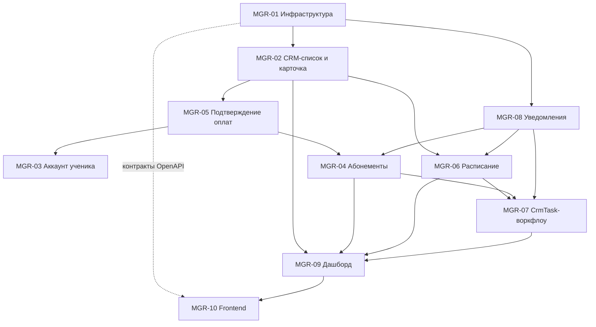

# Пакет инженерных задач (AI Coder Tasks) — Модуль 2: Кабинет менеджера

> Утверждённое уточнение от 31.10.2026: [деньги ученика, распределения и видимость семьи](https://raw.githubusercontent.com/EsinencuP/OnlineSchool/main/docs/online_academy_manager_finance_distribution_clarification_2026_10_31.md).
> Оно переопределяет несовместимые paymentId/balance/видимость/MGR-09 формулировки MGR-02/03/04/05/09 ниже:
> деньги ученика принадлежат его опубликованным распределениям; уникальность операции абонемента — по distributionId, не по целому paymentId.

> Для MGR-04 действуют также [решения владельца от 31.10.2026](https://raw.githubusercontent.com/EsinencuP/OnlineSchool/main/docs/online_academy_manager_subscription_decisions_2026_10_31.md): 30/60 дней, один активный абонемент на направление и готовое опубликованное распределение на входе.

> Для MGR-05 действует [уточнение валюты и финансовых ограничений от 31.10.2026](https://raw.githubusercontent.com/EsinencuP/OnlineSchool/main/docs/online_academy_manager_payment_decisions_2026_10_31.md): новые поступления только MDL; действующий Finance требует директора для подтверждения и утверждения распределения. Manager-confirm отправляет на одобрение. Исходные несовместимые формулировки про самостоятельную публикацию менеджером и consumed целого поступления ниже сохранены как история.

> Для MGR-06 действуют [решения владельца от 31.10.2026](https://raw.githubusercontent.com/EsinencuP/OnlineSchool/main/docs/online_academy_manager_schedule_decisions_2026_10_31.md): подготовка 60 минут по умолчанию; поздний перенос без потери права и третий перенос ученика требуют отдельного решения директора. Флаг менеджера с причиной создаёт запрос, а не разрешение. Исходное предположение ниже применяется с этим уточнением.

Платформа «Онлайн-Академия» · редакция 1.0 от 31.10.2026 · TypeScript strict, NestJS 12, Prisma 7.10.1, PostgreSQL 18, React/Vite, pnpm-монорепозиторий

> Для MGR-07 действует [решение владельца от 01.11.2026](https://raw.githubusercontent.com/EsinencuP/OnlineSchool/main/docs/online_academy_manager_task_decisions_2026_11_01.md): полная отмена исходного списания через директора восстанавливает занятия и аванс абонемента; частичный эффект — отдельное финансовое решение. До исполнения задача IN_PROGRESS, публикации нет. Несовместимое ожидание самостоятельного ACCEPT менеджером ниже сохранено как история. Директорские исключения переноса MGR-06 также сохраняются.

## 0. Исходные данные и сверка с репозиторием

> Для MGR-09 владелец [повторно подтвердил правило ожидающих оплат 01.11.2026](https://raw.githubusercontent.com/EsinencuP/OnlineSchool/main/docs/online_academy_manager_dashboard_decisions_2026_11_01.md): ожидание одобрения и подтверждённый остаток, ещё не покрытый опубликованными распределениями; только положительная сумма остатка, один receipt — один count, валюты отдельно. Семейные поступления со смешанным портфолио исключаются из агрегата. Ограничение только PENDING/AWAITING_APPROVAL ниже применяется с этим уточнением.

> Для MGR-08 действует [решение владельца от 01.11.2026](https://raw.githubusercontent.com/EsinencuP/OnlineSchool/main/docs/online_academy_manager_notification_decisions_2026_11_01.md): если нет аккаунта и email, системная операция завершается с уведомлением FAILED / NO_DELIVERY_CHANNEL; ручная отправка возвращает422. Общее требование422 ниже применяется с этим исключением.

Пакет составлен по ТЗ и публичному README репозитория EsinencuP/OnlineSchool. Локальный каталог D:\\OnlineSchool мне недоступен, исходники `apps/api/src/core/` и `schema.prisma` я не читал. Поэтому в каждой задаче есть шаг 0: сверить имена с реальным кодом до начала работы.

Что важно учесть по README:

- **Имена моделей.** README описывает Household, Student, AuthAccount, 69 моделей. В ТЗ — StudentProfile, CrmTask, PaymentRecord и т. д. В документе используются имена из ТЗ. Исполнитель обязан составить таблицу соответствия «имя в ТЗ → имя в schema.prisma» (результат шага 0 в MGR-01) и дальше работать с реальными именами.
- **Статус Модуля 1.** README описывает завершённую Фазу 0 (TASK-01…13), а ученический кабинет как отдельный этап не отражает. Если Модуль 1 не влит в main, зависимости задач MGR-06/07/08 от его контрактов уточняются на шаге 0.
- **Финансы.** В README финансовая модель — поступления и распределение платежей с подтверждением директора, неполная оплата и рассрочка требуют допуска руководителя (CON-01—11), менеджер ограничен назначенными учениками. Эти правила обязательны и для MGR-04/05.
- **Конвенции ядра** (приняты как обязательные): ESM с расширением `.js` в импортах; `Result<T, E>` из `@online-school/shared`; явный `throw` запрещён ESLint, кроме границы DomainError → AppException; DTO — классы с class-validator и Swagger; OpenAPI → `api-contracts` → Orval-клиент; бизнес-запись, Audit и Outbox — атомарно; SERIALIZABLE retry ≤ 3; идемпотентность критических команд.
- Ученик в CRM создаётся **без аккаунта**; аккаунт создаётся в MGR-03 после подтверждённой первой оплаты.
- Аутентификация в репозитории сессионная (PostgreSQL SessionStore). Под `JwtAuthGuard` из ТЗ понимается существующий guard аутентификации ядра; второй механизм не вводить.

## 1. Диаграмма зависимостей

Порядок поставки: **волна 0** — MGR-01; **волна 1** — MGR-02, MGR-08; **волна 2** — MGR-05; **волна 3** — MGR-03, MGR-04, MGR-06 (параллельно); **волна 4** — MGR-07; **волна 5** — MGR-09. MGR-10 стартует после волны 1 на сгенерированном OpenAPI-клиенте и растёт срезами вслед за бэкендом.

## 2. Таблица приоритетов

| ID | Задача | Приоритет | Сложность | Зависит от | Сценарии |
| --- | --- | --- | --- | --- | --- |
| MGR-01 | Инфраструктура ManagerModule | P0 | M | ядро | все |
| MGR-02 | CRM-список и карточка ученика | P0 | L | 01 | все |
| MGR-08 | Уведомления ученику | P0 | M | 01 | М-02, М-03, М-05 |
| MGR-05 | Подтверждение оплат | P0 | XL | 01, 02 | М-01, М-02, М-04 |
| MGR-03 | Аккаунт ученика после первой оплаты | P0 | L | 05 | М-01 |
| MGR-04 | Управление абонементами | P0 | XL | 05, 08 | М-02, М-05 |
| MGR-06 | Расписание и Google Meet | P0 | XL | 02, 08 | М-03 |
| MGR-07 | CrmTask-воркфлоу | P0 | L | 04, 06, 08 | М-03, М-04 |
| MGR-09 | Дашборд менеджера | P1 | M | 02, 04, 06, 07 | — |
| MGR-10 | Frontend кабинета | P0 | XL | 01…09 (срезами) | все |

## 3. Сквозные инварианты (обязательны для каждой задачи)

| № | Инвариант | Как проверяется |
| --- | --- | --- |
| INV-01 | **Изоляция портфолио.** Любой ученик-центричный запрос фильтруется по `managerId` через `ManagerScopeService`. Чужой и несуществующий ученик дают одинаковый ответ 404 `STUDENT_NOT_FOUND` (не 403, чтобы не раскрывать существование). | Тест на каждый эндпоинт: менеджер А → ученик менеджера Б |
| INV-02 | **Учебные данные только для чтения.** Менеджер не меняет статусы навыков, оценки ДЗ, образовательные отчёты. В `modules/manager` нет write-методов для SkillMap, Homework, EducationalReport. | Архитектурный тест: запрет записи через Prisma-делегаты этих моделей из `modules/manager` |
| INV-03 | **Финансы только через LedgerPublicationService.** Запрет прямой записи в LedgerEntry. Подтверждение директора и допуск руководителя при неполной оплате соблюдаются. | ESLint/архитектурный тест: в `modules/manager` нет `ledgerEntry.create/update/delete` |
| INV-04 | **Audit.** Каждая мутация пишет AuditLog в той же транзакции; при отказе audit бизнес-запись откатывается. Чтение карточки с контактами ученика пишется как `STUDENT_PII_VIEWED`. | Интеграционный тест отката |
| INV-05 | **Деньги.** В Prisma `Decimal(20,4)`, в DTO — строка десятичного вида с не более чем 4 знаками после точки, расчёты через decimal.js. `number`, `parseFloat`, `Number()` в денежных путях запрещены. | ESLint `no-restricted-syntax` + unit-тесты |
| INV-06 | **Deny-by-default.** Все роуты менеджера: аутентификация + `ManagerContextGuard`. STUDENT, TEACHER, ADMIN → 403; без сессии → 401. | Матрица ролей в e2e |
| INV-07 | **CSRF** на POST/PUT/PATCH/DELETE; GET без побочных эффектов. | e2e: мутация без токена → 403 |
| INV-08 | **Result.** Сервисные методы возвращают `Result<T, DomainError>`, без `throw`. Конвертация в HTTP — только на границе ядра. | ESLint |
| INV-09 | **Идемпотентность.** Мутации с денежным или доступовым эффектом требуют заголовок `Idempotency-Key` (UUID). Повтор с тем же телом → тот же ответ; другое тело → 409 `IDEMPOTENCY_KEY_REUSED`. | Тест конкурентного повтора |
| INV-10 | **Атомарность.** Бизнес-запись + Audit + Outbox — одна транзакция `core/transaction`. Деньги и абонементы: SERIALIZABLE, retry ≤ 3. | Тест отката при отказе outbox |
| INV-11 | **Уведомления только через Outbox → NotificationService**, не напрямую из транзакции. | Code review + тест |
| INV-12 | **PII и секреты.** Временный пароль показывается один раз, не попадает в логи, Audit, Outbox, кэш и OpenAPI-примеры. Телефоны и email в логах маскируются. | Тест на отсутствие секрета в audit/outbox |
| INV-13 | **Контракты.** DTO — классы с class-validator и Swagger; клиент генерируется Orval, руками не пишется. | `pnpm generate` без diff |
| INV-14 | **Пагинация.** Cursor-пагинация, `limit` ≤ 100, безлимитных списков нет. | Валидация DTO |
| INV-15 | **Время и валюта.** В БД UTC, в API ISO-8601. Таймзона школы и валюта берутся из конфигурации/ledger (по умолчанию Europe/Chisinau, MDL), не хардкодятся. | Unit-тесты на границах суток |
| INV-16 | **Матрица тестов на эндпоинт:** аноним, STUDENT, TEACHER, ADMIN, MANAGER-свой, MANAGER-чужой, плюс валидация и конфликт. | Чек-лист каждой задачи |

---

