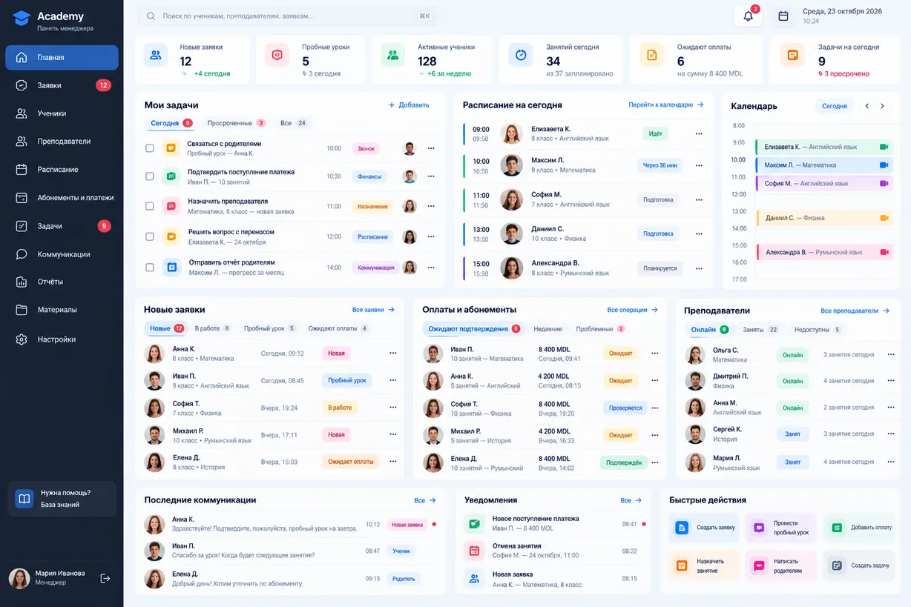
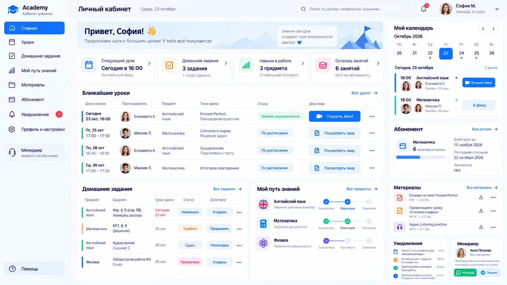
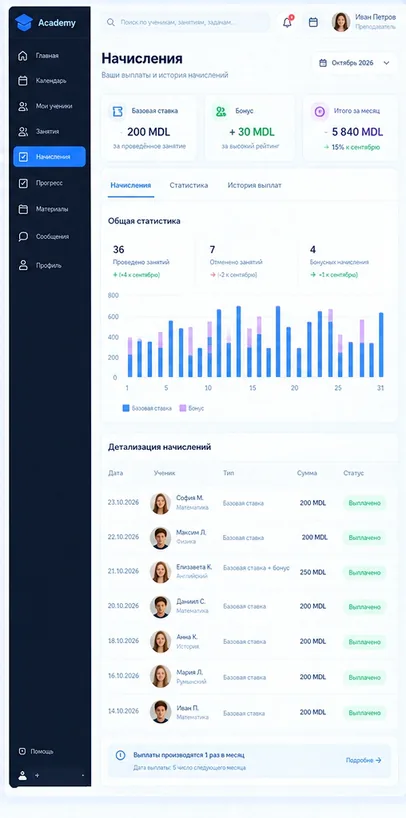
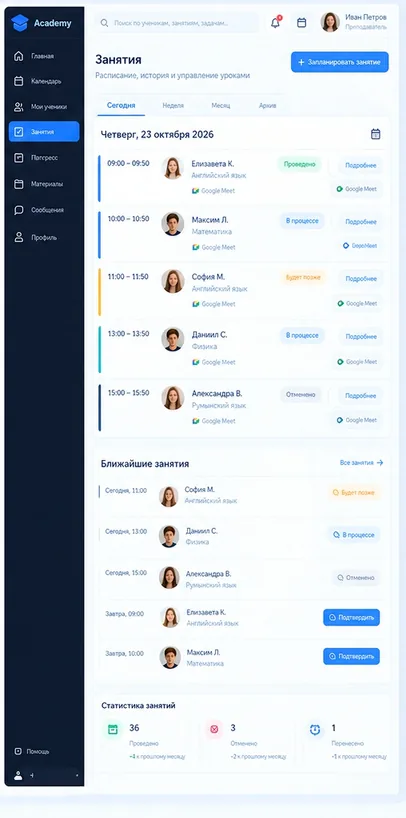
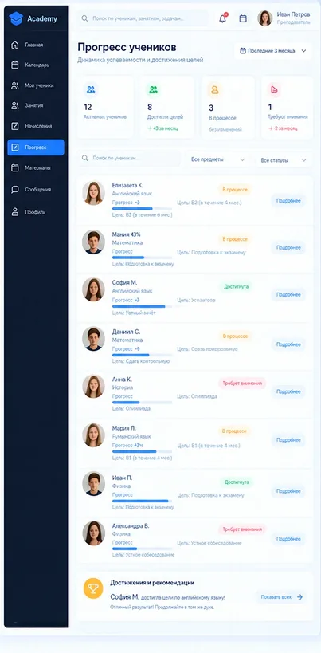
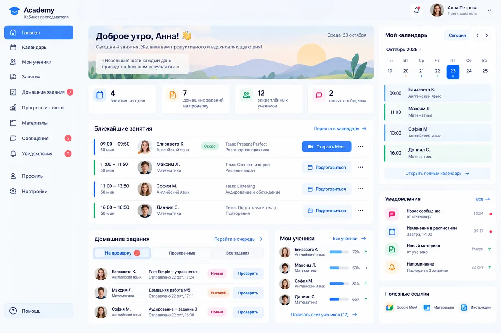
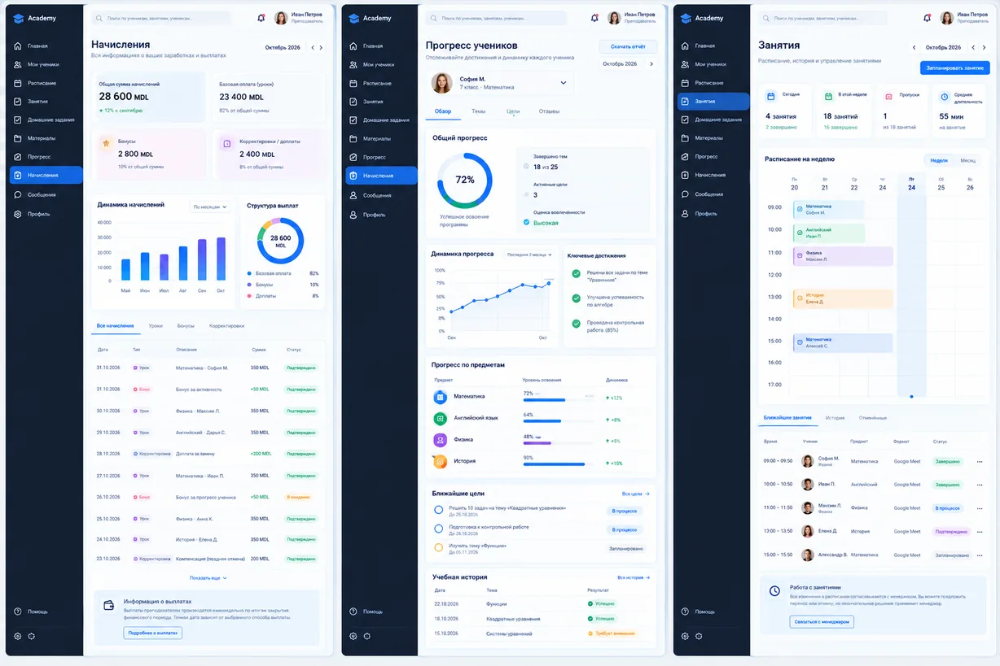

# Визуальные шаблоны

Все изображения в этой папке публичны, формат WebP. Это визуальные ориентиры; цифры и действия на них не утверждают бизнес-правила.

## manager.webp

[Прямой файл](https://raw.githubusercontent.com/EsinencuP/OnlineSchool/main/template/manager.webp) · 1228 × 819

## student.webp

[Прямой файл](https://raw.githubusercontent.com/EsinencuP/OnlineSchool/main/template/student.webp) · 1336 × 752

## teacher_earnings_mockup.webp

[Прямой файл](https://raw.githubusercontent.com/EsinencuP/OnlineSchool/main/template/teacher_earnings_mockup.webp) · 406 × 818

## teacher_lessons_mockup.webp

[Прямой файл](https://raw.githubusercontent.com/EsinencuP/OnlineSchool/main/template/teacher_lessons_mockup.webp) · 406 × 818

## teacher_progress_mockup.webp

[Прямой файл](https://raw.githubusercontent.com/EsinencuP/OnlineSchool/main/template/teacher_progress_mockup.webp) · 403 × 819

## techers.webp

[Прямой файл](https://raw.githubusercontent.com/EsinencuP/OnlineSchool/main/template/techers.webp) · 1228 × 819

## techers2.webp

[Прямой файл](https://raw.githubusercontent.com/EsinencuP/OnlineSchool/main/template/techers2.webp) · 1228 × 819
